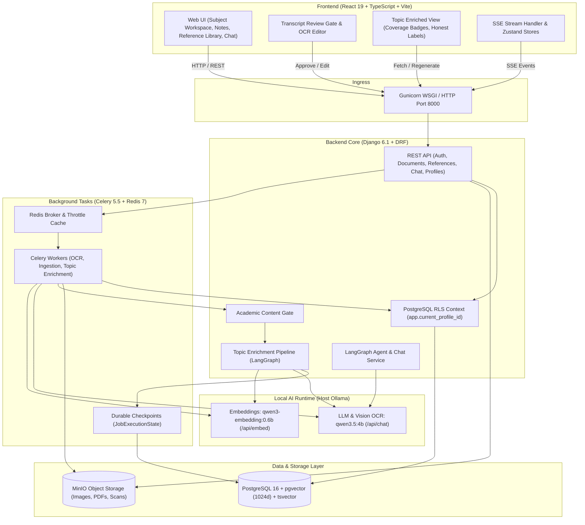

# StudyAI

StudyAI is an AI-powered learning and study platform that transforms handwritten notes and authoritative textbooks into searchable, reference-backed, enriched learning material.

Students upload photos or scans of handwritten notes and reference textbooks. StudyAI transcribes notes using local vision models, provides an explicit Human-in-the-Loop Transcript Review Gate for line-level edits, indexes textbook chapters via hybrid vector and lexical search, structures notes into coherent learning topics, preserves verbatim student text, surfaces verified reference additions with honest grounding labels, and detects reference library updates to prompt timely re-enrichment.

---

## 1. Product Workflows

StudyAI operates through three core asynchronous AI workflows:

### A. Reference Textbook Ingestion Workflow

```text
PDF Upload ──► Text Extraction & OCR ──► Semantic Chunking ──► Dense Embeddings ──► Database Indexing ──► READY
(User / Staff)    (pdfplumber / Vision)      (120w / 30w)     (qwen3-embedding)    (pgvector + tsvector)   (Library)
```

1. **PDF Upload:** Students or administrators upload reference textbooks or course syllabi (PDF format) to the Subject Reference Library.
2. **Text Extraction & OCR Fallback:** Text is extracted per page using digital extractors (`pdfplumber` / PyMuPDF). For scanned or diagram-heavy pages where digital text extraction yields minimal content, the system falls back to vision-based OCR.
3. **Semantic Chunking:** Documents are divided into structured chunks (target 120 words with 30-word overlap) preserving page numbers, chapter headers, and sections.
4. **Dense Vector Embeddings:** Each chunk is converted into a 1024-dimensional normalized dense vector using `qwen3-embedding:0.6b` via Ollama (`qwen3-embedding-0.6b-v1`).
5. **Database Indexing:** Vectors are stored in PostgreSQL with `pgvector` indexing (`vector_cosine_ops`), while text content is indexed into PostgreSQL `tsvector` for full-text lexical search.
6. **Status Lifecycle:** Tracks stage progress (`PENDING` ➔ `PROCESSING` ➔ `READY` / `FAILED`) with page counts and error reporting.

---

### B. Handwritten Transcription & Review Gate Workflow (PR 1)

```text
Note Upload ──► Local Vision OCR ──► Transcript Review Gate ──► User Edits / Approval ──► APPROVED
(Image / PDF)     (qwen3.5:4b)          (pending_review)        (Inline Edit / Retry)       (Ready for AI)
```

1. **Note Upload & Vision OCR:** The student uploads an image or scan of handwritten notes. Multimodal LLM (`qwen3.5:4b`) transcribes handwriting into structured lines with coordinates and confidence scores.
2. **Transcript Review Gate:** Rather than immediately executing downstream AI workflows on raw OCR, the document enters a `pending_review` status.
3. **Interactive Line Review & Editing:** Students review transcription side-by-side with original handwriting, make inline text edits, merge/split lines, or trigger bounded OCR retries.
4. **Approval Invariant:** Downstream enrichment is strictly approval-gated. Only notes in `approved` state can be enriched, preventing wasted compute on misrecognized handwriting.

---

### C. Topic-Based Note Enrichment Pipeline (PR 2 + PR 3 Path B)

```text
Approved Note ──► Content Gate ──► Segment Classifier ──► Topic Planner ──► Decoupled Research ──► Topic Writer
                      │                                                        (pgvector + RRF)     (Verbatim Student)
                      ▼                                                                                    │
               (Check Content)                                                                             ▼
                      │                                                                           Sanitize & Dedupe
                      ▼                                                                                    │
               Job Checkpointing ◄── Markdown Render ◄── Verified Citations ◄── Verifier & Scoring ◄───────┘
              (JobExecutionState)     (Global Biblio)     (Honest Labels)      (supported / partial)
```

1. **Academic Content Gate:** Validates note text against academic terminology. Non-academic content (noise, blank pages, personal greetings) exits early without charging AI budget or creating stub notes.
2. **Windowed Segment Classification:** Identifies semantic concept boundaries across transcript lines using sliding window context.
3. **Topic Planning:** Assigns transcript segments into discrete, cohesive learning topics (capped at 6) with explicit learning goals and search queries.
4. **Decoupled Reference Retrieval:** Vectorized dense retrieval and lexical BM25/tsvector search run against the student's active subject textbooks, retrieving high-relevance textbook passages with page numbers.
5. **Topic Writer (Verbatim Student Preservation):** Generates structured topic sections. **Student notes are preserved 100% verbatim** as `student` blocks, while supplementary concept explanations, formulas, or mistake corrections are generated as `addition` blocks.
6. **Guarded Deduplication & Sanitization:** Strips ungrounded additions and eliminates redundant concept additions across topics.
7. **Verifier & Sentence Support Scoring:** Compares each generated addition against cited textbook passages:
   - **`supported`**: Additions strictly substantiated by the cited reference passage.
   - **`partial`**: Additions that factually extend beyond the passage.
   - **`unsupported`**: Statements not found in or contradicted by references (dropped).
8. **Topic Coverage Badges & Empty State Guidance:** Headings display coverage indicators (`Reference found`, `Limited reference`, or `No reference found`). Topics without reference material feature direct links to upload textbooks for that subject.
9. **Honest Addition Labels:** Additions are labeled transparently:
   - `supported` ➔ **"From your reference"**
   - `partial` ➔ **"Extends the reference"** with warning tooltip (*"This goes beyond the cited passage. Check it against your textbook."*).
10. **Reference Library Change Detection:** Hashes active textbooks at generation time (`reference_snapshot_hash`). If new textbooks are uploaded to the subject, notes with missing or partial coverage display a prompt: *"Your reference library changed since this note was enriched [Regenerate]"*.
11. **Durable Checkpoints:** Every stage and topic checkpoints in `JobExecutionState`, enabling real-time stage progress derivation in the UI (`classify` ➔ `plan` ➔ `research k of n` ➔ `write k of n` ➔ `verify`).

---

## 2. Core Features

### Handwritten Transcription & Review Gate
- **Image & PDF Ingestion:** Accepts PNG, JPEG, WebP, and multi-page PDF scans of handwritten notes.
- **Local Multimodal OCR:** Transcribes handwriting, equations, and diagrams using `qwen3.5:4b` vision via local Ollama without sending student data to third-party APIs.
- **Human-in-the-Loop Review Gate:** Dedicated review interface allows students to inspect OCR confidence, edit transcribed lines, reopen approved pages, or retry OCR with forced override.
- **Immutable Revision History:** Every transcription and manual edit is stored as an immutable document revision with full audit provenance.

### Subject Reference Library
- **Textbook Ingestion:** Ingests comprehensive textbooks, course packs, and lecture notes per subject.
- **Page-Level Provenance:** Chunks retain document ID, title, page numbers, chapters, and section metadata.
- **Scope Isolation:** Supports global reference textbooks (platform-wide) and private references isolated to specific student profiles via PostgreSQL Row-Level Security (RLS).
- **Snapshot Hash Tracking:** Computes SHA-256 snapshots of active subject textbooks to power automatic change detection and cache-busting re-enrichment.

### Topic-Based Note Enrichment
- **100% Verbatim Student Text Preservation:** Student handwriting and transcribed prose are never altered, overwritten, or hallucinated away.
- **Topic Coverage Badges:** Immediate visual clarity on evidence grounding per topic:
  - `Reference found` (`sufficient`): Grounded in subject textbooks.
  - `Limited reference` (`partial`): Extends beyond cited textbook passages.
  - `No reference found` (`none`): Clearly styled with inline links to add subject textbooks.
- **Honest Grounding Labels:** Distinguishes verified additions (*"From your reference"*) from extrapolated concepts (*"Extends the reference"* with tooltip guidance). Gated by `ENRICHMENT_SHOW_PARTIAL`.
- **Dynamic Multi-Stage Progress:** Derives real-time stage progress (`classify`, `plan`, `research`, `write`, `verify`) from background execution checkpoints.
- **Privacy-Safe Numeric Telemetry:** Records numeric-only diagnostics on `EnrichedNote.diagnostics` (no student note text) with management reporting (`report_enrichment_coverage`).

### Grounded Chat & Agent Mode
- **Conversational Study Assistant:** Students can ask questions about their notes or reference textbooks with full conversational context.
- **Server-Sent Events (SSE) Streaming:** Streams responses in real time using non-blocking database transactions that release locks during inference.
- **StudyAI Agent Mode:** Autonomous multi-step orchestration using LangGraph. The agent coordinates tools (`search_notes`, `search_reference_books`, `get_subject_context`, `verify_citations`) to synthesize multi-source answers.
- **Dual Grounding:** Chat queries retrieve evidence from both personal notes and first-class Reference Documents.

### Security, Multi-Tenancy & Profile Isolation
- **Row-Level Security (RLS):** Enforced natively in PostgreSQL across all multi-tenant tables.
- **Profile Scoping:** Multiple study profiles exist under a single account. Notes, subjects, folders, chat sessions, and private references are strictly isolated.
- **Restricted Database Role:** Application web and worker processes run under a restricted role (`studyai_app`) with minimal privileges, while migrations run under administrative credentials.
- **Dual Study Modules:** Supports `AI_CLASSROOM` (full AI enrichment, practice QA, structured tests) and `NOTE_SPACE` (streamlined digitizer and PDF export).

---

## 3. System Architecture



---

## 4. Production AI Stack & Invariants

StudyAI runs a unified, self-hosted local AI configuration. Model execution is handled by the host Ollama server, avoiding cloud API dependencies and external data transfer.

| Component | Canonical Model | Engine / Endpoint | Configuration & Invariants |
|---|---|---|---|
| **Multimodal LLM** | `qwen3.5:4b` | Host Ollama (`/api/chat`) | Multimodal vision OCR transcription, segment classification, topic planning, topic writing, verification, chat, and agent reasoning. |
| **Embeddings** | `qwen3-embedding:0.6b` | Host Ollama (`/api/embed`) | 1024-dimensional normalized dense vectors ($\|v\| \approx 1.0$), canonical version `qwen3-embedding-0.6b-v1`. Zero legacy fallback to SentenceTransformer, MiniLM, or BGE-M3. |
| **Vector Database** | `pgvector` | PostgreSQL 16 Extension | 1024-dimensional cosine distance index (`vector_cosine_ops`). |
| **Lexical Search** | PostgreSQL Full-Text | PostgreSQL `tsvector` | GIN indexing with language-specific stemming for keyword discovery. |
| **Ranking Fusion** | Reciprocal Rank Fusion | Backend Service | Standard RRF ($k=60$) combining dense vector and lexical ranks. |
| **Orchestration** | LangGraph | Python StateGraph | Multi-stage topic pipeline with fan-out topic research/writing and checkpointed execution states. |

---

## 5. Technology Stack

| Domain | Technologies |
|---|---|
| **Frontend** | React 19, TypeScript, Vite, React Router v7, Zustand, IndexedDB (`idb`), i18next, Tailwind CSS |
| **Backend** | Python 3.12 / 3.14, Django 6.1, Django REST Framework, SimpleJWT, Gunicorn |
| **Asynchronous Engine** | Celery 5.5, Redis 7 (broker, result backend, and rate-limiting cache) |
| **Database** | PostgreSQL 16 with `pgvector` extension and Row-Level Security (RLS) |
| **Object Storage** | MinIO (S3-compatible local bucket storage for scans, page images, and rendered PDFs) |
| **AI Runtime** | Host Ollama (`qwen3.5:4b`, `qwen3-embedding:0.6b`), LangGraph, LangChain |
| **API Documentation** | drf-spectacular (OpenAPI 3 / Swagger UI) |
| **Testing** | Pytest, Pytest-Django, Vitest, Playwright (Chromium E2E) |

---

## 6. Repository Layout

```text
StudyAI/
├── backend/
│   ├── ai/                      # LangGraph workflows, nodes, state definitions, prompts
│   │   └── langgraph/
│   │       ├── graphs/          # enrichment_graph.py, agent_graph.py
│   │       ├── nodes/           # classifier, planner, research, writer, verification, render
│   │       └── state/           # topic_enrichment_state.py
│   ├── apps/
│   │   ├── accounts/            # User authentication, JWT tokens, budget management
│   │   ├── agents/              # Autonomous StudyAI agent, tools, and MCP endpoints
│   │   ├── ai_classroom/        # Enrichment services, models, content gating, telemetry command
│   │   ├── audit/               # Security and provider invocation audit logging
│   │   ├── canvas/              # Handwritten canvas strokes and page management
│   │   ├── chat/                # Multi-turn chat sessions, SSE streaming, RLS scoping
│   │   ├── documents/           # Note documents, pages, review gate, OCR handlers, progress views
│   │   ├── jobs/                # Durable Job engine, JobExecutionState checkpointing
│   │   ├── notebooks/           # Notebooks and structured digital note pages
│   │   ├── profiles/            # Multi-profile isolation and module switching
│   │   ├── questions/           # Question generation and verification
│   │   ├── references/          # Reference Library models, PDF ingestion, snapshot hashing
│   │   ├── retrieval/           # NoteChunk models, pgvector search, hybrid RRF
│   │   ├── revision/            # Revision planning and mastery tracking
│   │   ├── subjects/            # Subject categories and metadata
│   │   └── tests/               # Adaptive tests and mastery score evaluation
│   ├── config/                  # Django settings (base, dev, prod, test, ci) and Celery configuration
│   ├── providers/               # Provider adapters (Ollama LLM/Embeddings, MinIO, Mailpit)
│   ├── reports/labeling/        # Human labeling evaluation sets, seeded mistakes, calibration CSVs
│   ├── shared/                  # Database RLS contexts, observability, common utilities
│   └── tests/                   # Backend regression, unit, and API integration test suites
├── frontend/
│   ├── src/
│   │   ├── app/                 # Application entry, global shell, CSS styles
│   │   ├── components/          # UI primitives, notes (EnrichedView, HandwrittenView), chat
│   │   ├── copy/                # Centralized accessibility and UI copy (enrichment.ts)
│   │   ├── features/            # Authentication, onboarding, canvas writing
│   │   ├── routes/              # Client-side routing and module access guards
│   │   ├── services/            # API clients for backend endpoints and SSE streaming
│   │   ├── state/               # Zustand state stores (workspace, auth, modules)
│   │   └── types/               # TypeScript interfaces and schema contracts
│   └── tests/                   # Vitest unit tests and browser E2E test suites
├── docs/                        # OpenAPI schemas, architectural specifications, phase plans
├── docker-compose.yml           # Multi-container Docker composition
└── README.md                    # Project documentation
```

---

## 7. Local Development Setup

### 1. Prerequisites
- **Git:** 2.30+
- **Docker & Docker Compose:** Docker Engine 24+ and Docker Compose v2+
- **Node.js:** 20+ and npm 10+ (for local frontend development/testing)
- **Ollama:** Installed and running on the host machine ([ollama.com](https://ollama.com/))

### 2. Install and Start Ollama Models
Install Ollama on your host operating system and pull the two canonical models:

```bash
# Pull the multimodal LLM and OCR model
ollama pull qwen3.5:4b

# Pull the canonical 1024-dimensional embedding model
ollama pull qwen3-embedding:0.6b
```

Verify that the models are installed and running:
```bash
ollama list
curl http://localhost:11434/api/tags
```

> [!IMPORTANT]
> Containers connect to the host Ollama instance via `http://host.docker.internal:11434`. This is pre-configured via `extra_hosts` in `docker-compose.yml`. Keep Ollama running on your host machine while using StudyAI.

### 3. Clone Repository & Configure Environment
```bash
git clone https://github.com/yashkmr53/StudyAI.git
cd StudyAI
cp .env.example .env
```

Generate secure secrets for development and update `.env`:
```bash
python3 -c "import secrets; print('DJANGO_SECRET_KEY=' + secrets.token_urlsafe(64))"
python3 -c "import secrets; print('POSTGRES_PASSWORD=' + secrets.token_urlsafe(32))"
```

### 4. Build and Start the Infrastructure
```bash
docker compose up --build -d
```

Verify that all 8 containers are healthy:
```bash
docker compose ps
```

### 5. Access the Application
- **Frontend Application:** [http://localhost:5173](http://localhost:5173)
- **Backend API Root:** [http://localhost:8000/api/v1/](http://localhost:8000/api/v1/)
- **Interactive Swagger Documentation:** [http://localhost:8000/api/docs/](http://localhost:8000/api/docs/)
- **Health Check Endpoint:** [http://localhost:8000/healthz](http://localhost:8000/healthz)
- **Mailpit Web UI:** [http://localhost:8025](http://localhost:8025)
- **MinIO Console:** [http://localhost:9001](http://localhost:9001) (`minioadmin` / `minioadmin`)

---

## 8. Environment Configuration

Key environment variables configured in `.env` (or inherited by Docker Compose):

| Variable | Description | Safe Default / Example | Required |
|---|---|---|:---:|
| `DJANGO_SETTINGS_MODULE` | Active Django configuration module | `config.settings.prod` | Yes |
| `DJANGO_SECRET_KEY` | Secret key for cryptographic signing | *(64-char random string)* | Yes |
| `DJANGO_DEBUG` | Enables Django debug mode (0 for off, 1 for on) | `0` | Yes |
| `POSTGRES_DB` | PostgreSQL database name | `studyai` | Yes |
| `POSTGRES_USER` | PostgreSQL superuser username | `studyai` | Yes |
| `POSTGRES_PASSWORD` | PostgreSQL superuser password | *(32-char random string)* | Yes |
| `POSTGRES_HOST` | Database host within Docker network | `db` | Yes |
| `POSTGRES_PORT` | Database port | `5432` | Yes |
| `CELERY_BROKER_URL` | Redis connection URL for Celery | `redis://redis:6379/0` | Yes |
| `LLM_PROVIDER` | Active LLM driver | `ollama` | Yes |
| `LLM_MODEL` | Canonical LLM and vision model | `qwen3.5:4b` | Yes |
| `EMBEDDING_PROVIDER` | Canonical vector embedding driver | `ollama` | Yes |
| `EMBEDDING_MODEL_NAME` | Canonical embedding model | `qwen3-embedding:0.6b` | Yes |
| `EMBEDDING_DIMENSIONS` | Dense vector dimension | `1024` | Yes |
| `EMBEDDING_MODEL_VERSION` | Embedding version identifier | `qwen3-embedding-0.6b-v1` | Yes |
| `OLLAMA_BASE_URL` | Host address of Ollama API | `http://host.docker.internal:11434` | Yes |
| `ENRICHMENT_SHOW_PARTIAL` | Controls display of "Extends the reference" additions | `True` | No |
| `ENRICHMENT_CONCURRENCY` | Topic processing parallelism in LangGraph pipeline | `4` (production) / `1` (tests) | No |
| `STORAGE_BACKEND` | Object storage backend (`minio` or `s3`) | `minio` | Yes |
| `MINIO_ENDPOINT` | MinIO internal endpoint | `http://minio:9000` | Yes |
| `EMAIL_BACKEND` | Email driver (`mailpit`, `smtp`, `console`) | `mailpit` | Yes |

---

## 9. Testing & Quality Assurance

StudyAI maintains a test suite across backend unit tests, PostgreSQL RLS integration tests, frontend unit tests, and real-browser Playwright E2E suites.

### Backend Unit & API Test Suite
Run the 453-test unit and API test suite (pinned to isolated test settings via `pytest.ini`):

```bash
docker compose exec api pytest tests/unit tests/api --reuse-db
```

To run the full project test suite across all apps:
```bash
docker compose exec api pytest --tb=short
```

### PostgreSQL & RLS Integration Tests
To test live Row-Level Security, multi-profile isolation, and pgvector retrieval against real PostgreSQL:

```bash
docker compose exec api pytest tests/api/test_phase12_security.py tests/api/test_canvas.py --ds=config.settings.prod
```

### Enrichment Telemetry Reporting
Generate the executive reference coverage summary across subjects:

```bash
docker compose exec api python manage.py report_enrichment_coverage --days 30
```

### Frontend Typecheck & Test Suite
```bash
cd frontend
# Run TypeScript compilation check
npx tsc --noEmit

# Run Vitest test suite with coverage
npm test -- --run

# Validate production build bundle
npm run build
```

### Live Browser End-to-End (E2E) Verification
Executes the comprehensive 25-point end-to-end acceptance suite in a headless Chromium browser against the running application stack:

```bash
node frontend/tests/e2e/phase14_frontend_e2e.mjs
```

---

## 10. Security & Data Isolation Architecture

- **PostgreSQL Row-Level Security (RLS):** Every tenant table (`documents`, `references`, `chat`, `notes`, `ai_classroom_enrichednote`, etc.) enforces native RLS policies checking `app.current_profile_id`.
- **Session & Transaction Binding:** The active profile is safely bound using `bind_profile_session(profile_id)` and cleared upon transaction/middleware teardown.
- **Least-Privilege Database Role:** Web requests and Celery workers operate under the `studyai_app` unprivileged database role. Table definitions, extensions, and schema migrations are isolated to administrative migration operations.
- **Human-in-the-Loop Gate:** Document transcripts require explicit approval (`DocumentPageApproveView`) before AI enrichment is permitted, protecting AI resources and user data integrity.
- **Safe Asynchronous Dispatch:** Background tasks are queued via Django's `transaction.on_commit(_dispatch)` hook, ensuring Celery workers never attempt to fetch uncommitted records.
- **Streaming Connection Lifecycle:** During Server-Sent Events (SSE) chat streaming, database transactions are opened only for brief, discrete persistence operations. Database connections are not held open during long LLM inference calls.

---

## 11. Troubleshooting

### 1. Celery Worker Cannot Reach Ollama (`Connection refused`)
- **Cause:** `localhost` inside a Docker container resolves to the container itself, not your host computer.
- **Solution:** Verify that `OLLAMA_BASE_URL` is set to `http://host.docker.internal:11434`. On Linux, ensure Docker Compose includes `extra_hosts: ["host.docker.internal:host-gateway"]`.

### 2. Missing Ollama Model (`model not found`)
- **Cause:** The required LLM or embedding model has not been pulled on the host.
- **Solution:** Run on the host:
  ```bash
  ollama pull qwen3.5:4b
  ollama pull qwen3-embedding:0.6b
  ```

### 3. Gunicorn Worker Timeout During Long Operations
- **Cause:** Processing dense handwriting or long textbooks can exceed standard HTTP timeouts.
- **Solution:** The Gunicorn worker timeout in `docker-compose.yml` is configured to 300 seconds (`--timeout 300`). For large files, use the asynchronous ingestion endpoints which process in background Celery workers.

### 4. Database Locking Under SQLite in Tests
- **Cause:** Multi-threaded parallel topic processing in LangGraph can lock SQLite during concurrent writes.
- **Solution:** Sequential fallback is automatically active when `ENRICHMENT_CONCURRENCY = 1`, which is pinned in `config.settings.test`.

---

## 12. License

This project is proprietary and confidential. Unauthorized copying, distribution, or reproduction is strictly prohibited.
