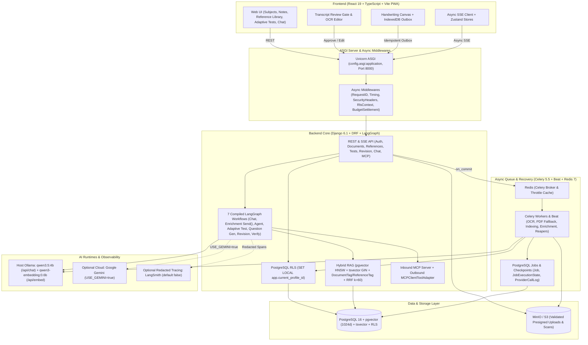

# StudyAI

StudyAI is a full-stack, AI-powered learning platform that turns handwritten lecture notes and reference textbooks into a searchable, citation-verified, and adaptive knowledge base.

Students capture handwriting on an offline-first digital canvas or upload scans and PDFs via presigned object storage. StudyAI validates uploaded binaries, runs multimodal OCR (`qwen3.5:4b` via local Ollama or optional Google Gemini), enforces a **Human-in-the-Loop Transcript Review Gate** with immutable line lineage, indexes notes and textbooks into PostgreSQL (`pgvector` HNSW + `tsvector` GIN) fused via Reciprocal Rank Fusion (`k=60`), orchestrates 7 compiled LangGraph workflows (`chat`, parallel `Send()` topic enrichment, agentic MCP tool use, question generation, verification, adaptive testing, and revision planning), and tracks tag-level learner mastery with confidence-weighted EMA scoring.

---

## 1. Product Workflows

### A. Reference Textbook Ingestion Workflow

```text
PDF Upload ──► Text Extraction & OCR Fallback ──► Semantic Chunking ──► Dense Embeddings ──► Postgres Indexing ──► READY
(User / Staff)   (pypdf + embedded-image OCR)       (120w / 30w)        (1024-d vector)    (HNSW + GIN + Tags)  (Library)
```

1. **PDF Upload:** Students or staff upload reference textbooks or course packs into the Subject Reference Library (global platform-wide books or private profile-scoped references).
2. **Text Extraction & Vision OCR Fallback:** Extracts page text via **`pypdf`**. For scanned/image-only pages with `< 30` extracted characters (`MIN_TEXT_CHARS_THRESHOLD`), StudyAI extracts the page's embedded image and falls back to vision OCR (`qwen3.5:4b` or Gemini) with bounded retries.
3. **Semantic Chunking:** Splits pages into structured chunks (target `120` words, `30`-word overlap) preserving page bounds, chapters, and sections.
4. **Dense Embeddings:** Embeds each chunk into a `1024`-dimensional vector using `qwen3-embedding:0.6b` via host Ollama (`hashing` deterministic embedder in test/CI).
5. **Dual Postgres Indexing & Metadata Tags:** Stores vectors on `ReferenceChunk` (`USING hnsw (embedding vector_cosine_ops)`) alongside full-text `tsvector` (`GIN`) and optional `ReferenceDocumentTag` (`Tag` M2M, PostgreSQL RLS-scoped) for tag-filtered reference search.
6. **Status Lifecycle:** Tracks `PENDING` → `PROCESSING` → `READY` / `FAILED` with page counts and change snapshots (`reference_snapshot_hash`).

---

### B. Handwritten Canvas, Presigned Upload & Review Gate Workflow

```text
Canvas / Upload ──► Size & Magic-Byte Check ──► Multimodal OCR ──► Transcript Review Gate ──► Incremental Index
(IndexedDB / MinIO)  (validate_uploaded_object)   (qwen3.5 / Gemini)   (pending / needs_review)   (sha256 + 1024d)
```

1. **Offline-First Canvas & Presigned Upload Validation:**
   - **Digital Canvas:** Multi-device single-writer fencing (`device_id`, `lock_generation`, `90s` lock TTL, `409 SESSION_LOCK_LOST`), idempotent batched strokes persisted locally in IndexedDB (`studyai` v2) with an offline sync outbox, and transactional PNG rasterization (`CanvasSyncService.finalize_page`).
   - **Direct-to-MinIO Validation:** On `IngestionService.finalize_upload`, `validate_uploaded_object` inspects `storage.size(key)` before reading bytes (`<= UPLOAD_MAX_BYTES`, default `10 MB`), verifies PNG/JPEG/WebP/PDF binary magic bytes (`MAGIC_SIGNATURES`), and deletes spoofed or empty objects before raising `422 ValidationError`.
2. **Multimodal OCR & Heuristics:** Vision OCR transcribes lines with bounding boxes and confidence scores. Pages with average confidence `< 0.80` (`OCR_REVIEW_THRESHOLD`), `> 15%` `[illegible]` lines (`OCR_ILLEGIBLE_THRESHOLD`), `> 30%` low-confidence lines, `>= 4` repeated consecutive lines, low resolution (`< 300px`), or blank/heavy-ink anomalies enter `needs_review`.
3. **Immutable Line Revisions & Incremental Re-Indexing:** Edits create a new immutable `DocumentPageRevision` preserving stable `lineage_id` UUIDs per line. Approval (`DocumentPageApproveView`) triggers incremental SHA-256 chunk indexing—unchanged chunks retain existing embeddings while superseded chunks become `stale=True`.

---

### C. Topic-Based Note Enrichment Workflow (`enrichment_graph`)

```text
Approved Note ──► Academic Content Gate ──► Classifier & Planner ──► LangGraph Send() Fan-Out ──► Sanitize & Dedupe
                       │                                                  │  (research + write#0      │
                       ▼                                                  │   per topic w/ reducer)     ▼
                  (No LLM Calls)                                     JobExecutionState          Quote-or-Drop Verifier
                                                                     (SQL Checkpoints)                  │
                       Markdown Render ◄── Repair Pass (Send() write#1 -> verify#1) ◄────────────────────┘
```

1. **Academic Content Gate:** Filters out blank/non-academic notes early without invoking LLMs (`0` inference calls).
2. **Windowed Segmentation & Topic Planning:** Classifies note lines (escaping XML delimiters against prompt injection) and groups content into up to `6` coherent topics (`SEGMENT_MIN_CONFIDENCE = 0.70`), with single-topic fallback.
3. **Compiled LangGraph `StateGraph` + `Send()` Fan-Out:** `build_enrichment_graph()` compiles a real LangGraph `StateGraph` (`TopicEnrichmentState` with `_merge_topic_dicts` reducers), fanning out parallel `Send("topic_worker", ...)` workers per topic (`max_concurrency=4` on PostgreSQL, `1` on SQLite) under per-worker RLS binding.
4. **Batched Embedding Relevance Gate:** `gap_detection_node` and `coverage_comparison_node` run `apply_relevance_gate(..., strategy="D")` (`relevance_gate.py`), batching `[user_note, *concepts]` in one `embed()` call to drop off-topic textbook distractors via cosine similarity.
5. **Verbatim Student Preservation & Quote-or-Drop Verification:** Student lines are preserved verbatim (`student` blocks). Cited `addition` blocks (`supported` → *"From your reference"*, `partial` → *"Extends the reference"*) pass through deterministic qualifier/negation guards, `QuoteVerificationVerdict` substring extraction, and semantic checks; failing topics trigger targeted `Send("repair_worker", ...)` pass-1 regeneration (`write#1` → `verify#1`).
6. **Durable SQL Checkpoints & Snapshot Change Detection:** Every stage and topic checkpoints in PostgreSQL `JobExecutionState`, deriving real-time UI progress and prompting regeneration when `reference_snapshot_hash` detects newly uploaded subject textbooks.

---

### D. Grounded Chat, Agentic MCP & Adaptive Mastery Loop

1. **Hybrid RAG & Tiered Citation Verification:** `RetrievalService.search` queries top-`50` dense `pgvector` cosine candidates + top-`50` PostgreSQL `SearchRank` keyword candidates—pre-filtered by tenant `profile_id`, `subject`, `READY` status, and `tag_ids` across **both** `NoteChunk` (`DocumentTag`) and `ReferenceChunk` (`ReferenceDocumentTag`)—and fuses them via Reciprocal Rank Fusion (`RETRIEVAL_RRF_K = 60`). Citations in Chat, Agent synthesis, and Question Generation pass through **Tiered `EvidenceVerifier`**: fast lexical overlap (`>= 0.60` `supported`, `< 0.15` `unsupported`) plus a Tier 2 semantic NLI judge (`VerificationEntailmentVerdict`) on the `0.15..0.60` borderline band with lexical fallback.
2. **Non-Blocking Async SSE Chat & Agent Mode:** Under ASGI (`ASGIRequest`), `/api/v1/chat/sessions/{id}/messages/stream` returns an async `StreamingHttpResponse` powered by `ChatService.astream` and `StreamingLLMProvider.astream` (`httpx.AsyncClient` / `ChatOllama.astream`). Agent mode runs `agent_graph` across bounded iterations (`<= 5` iterations, `<= 10` tool calls) and verifies synthesized responses before completion.
3. **Adaptive Testing, Confidence & Mastery Scoring:** Questions bind to exact `source_revision_id` and `source_chunk_id` (`stale` flag on edits). In [TestsPage.tsx](file:///Users/yash/CV_Project/StudyAI/frontend/src/components/tests/TestsPage.tsx), learners choose confidence per answer (**Guess `0.4`**, **Unsure `0.75`**, **Confident `1.0`**), updating per-`(profile, tag)` mastery via EMA (`MasteryScoringService`: unattempted tags stay `not_assessed`, `weak < 0.4`, `strong >= 0.8`). Creating a test (`mode="adaptive"`) runs `adaptive_test_graph` to generate weak-topic questions with deterministic fallback ranking (`0.6*weakness + 0.25*recency + 0.15*difficulty`). A deterministic 14-day `RevisionPlanningService` schedules weakest/urgent topics with zero LLM calls.

---

## 2. Core Engineering Features

- **Unified DB + JSON Prompt Versioning:** `resolve_prompt_version` & `resolve_qualified_version` (`backend/ai/langchain/prompts.py`) prioritize active PostgreSQL `PromptVersion` rows before falling back to `backend/ai/prompts/*.json`, seeded via `seed_all_prompt_versions()` / `seed_agent_prompt_versions()` across chat, agents, and question generation.
- **Bidirectional Model Context Protocol (MCP):**
  - **Inbound MCP Server (`/api/v1/mcp/`):** JSON-RPC `2.0` (`initialize`, `tools/list`, `tools/call`, `ping`) with scoped tokens (`/api/v1/mcp/token/`), Pydantic schema checks, `MCPRateLimiter`, profile isolation, and 12 boot-registered tools plus `search_web`.
  - **Outbound MCP Client (`apps/agents/mcp/client.py`):** `MCPClient` + `MCPClientToolAdapter` discovers external JSON-RPC MCP tools (`tools/list`) and registers them into `ToolRegistry` as profile-authorized `BaseTool`s.
- **Local-First AI + Optional Cloud Switch (`USE_GEMINI`):** Defaults to local host Ollama (`qwen3.5:4b` LLM/OCR + `qwen3-embedding:0.6b`), with `USE_GEMINI=true` routing LLM reasoning & OCR to Google Gemini (`gemini-2.5-flash`) while keeping 1024-d `pgvector` embeddings consistent. `LLMChainProvider` prepends prompt-injection directives, redacts PII (`_sanitize_for_provider`: email, phone, card, SSN; `8000` char cap), handles fallbacks, and logs `ProviderCallLog`.
- **Durable Idempotent Jobs & Celery Beat Recovery:** `Job` rows enforce unique `idempotency_key`s (`IntegrityError` race-safe), atomic `.claim()`, `transaction.on_commit` dispatch, exponential backoff + jitter (`5s..300s`), and Beat tasks (`reap-stuck-enrichment-jobs` `60s`, `promote-retries` `120s`, stuck OCR/index reconciliation `300s`, daily backup, monthly budget reset).
- **Atomic Per-User AI Budgets & Live Redis Throttling:** Per-action `AIBudgetThrottle` reserves estimated tokens/cost (`DEFAULT_MONTHLY_TOKEN_BUDGET = 100000`, `DEFAULT_MONTHLY_COST_BUDGET_USD = $50.00`) via conditional SQL `F()` updates and settles actual `ProviderCallLog` usage (or refunds on error) in `BudgetSettlementMiddleware` / async SSE `finally`, alongside Redis throttles (`auth: 30/min`, `ai: 120/min`, `user: 600/min`).
- **Observability & Redacted LangSmith Tracing:** Runs once at `LLMChainProvider._record_and_trace` under nested `@traced_graph` / `@traced_node` spans with `_redact_payload` replacing student text when `LANGSMITH_TRACING=true` (disabled by default; `LANGSMITH_REDACT_STUDENT_TEXT=true` by default). Exposes `/healthz`, `/readyz`, Prometheus `/metrics`, and staff-only `/api/v1/status` (including boolean tracing readiness without leaking API keys).

---

## 3. System Architecture



---

## 4. Production AI Stack & Invariants

| Component | Default / Canonical | Optional / Test Alternative | Key Invariants |
|---|---|---|---|
| **Multimodal LLM & OCR** | `qwen3.5:4b` (Host Ollama `/api/chat`) | `gemini-2.5-flash` (`USE_GEMINI=true`), `MockLLMProvider` / `MockOCRProvider` in tests | Centralized `LLMChainProvider` / `OCRChainProvider`; PII scrubbing (`8000` chars) & prompt-injection directive. |
| **Embeddings** | `qwen3-embedding:0.6b` (Host Ollama `/api/embed`) | `HashingEmbeddingProvider` (`1024`-d in test/CI) | Strictly `1024`-dimensional vectors (`EMBEDDING_DIMENSIONS=1024`). |
| **Vector & Full-Text DB** | PostgreSQL 16 (`pgvector` HNSW + `tsvector` GIN) | SQLite keyword fallback in unit tests | `idx_notechunk_hnsw_embedding`, `idx_refchunk_hnsw_embedding`, `idx_notechunk_gin_tsv`; fused via RRF (`k=60`). |
| **PDF Extraction** | `pypdf` (`PdfReader`) + embedded-image vision OCR | Direct multimodal image OCR (`PNG`/`JPEG`/`WebP`) | Pages with `< 30` chars fall back to vision OCR on embedded images with retries. |
| **Orchestration** | 7 compiled LangGraph `StateGraph`s | Parallel `Send()` (`max_concurrency=4` PG / `1` SQLite) | `enrichment_graph`, `chat_graph`, `agent_graph`, `adaptive_test_graph`, `question_generation_graph`, `revision_planning_graph`, `verification_graph`. |
| **Citation Verification** | Tiered `EvidenceVerifier` + Enrichment `"Quote-or-Drop"` | Lexical fallback if semantic judge fails | Fast path (`>= 0.60` pass, `< 0.15` reject) + NLI LLM judge on `0.15..0.60`; qualifier & contradiction guards on additions. |

---

## 5. Technology Stack

| Domain | Technologies |
|---|---|
| **Frontend** | React 19, TypeScript, Vite 7 (`vite-plugin-pwa`), React Router v7, Zustand, IndexedDB (`idb`), i18next, Custom CSS Design Tokens (`styles.css`) |
| **Backend** | Python 3.12 (CI) / 3.14 (Docker image), Django 6.1, Django REST Framework, SimpleJWT, Uvicorn (ASGI), `httpx`, `pypdf`, `tesserocr`, `boto3` |
| **Asynchronous Engine** | Celery 5.5 (+ Beat), Redis 7 (Celery broker & `django-redis` rate-limit cache) |
| **Database** | PostgreSQL 16 (`pgvector/pgvector:pg16`) with `pgvector`, `tsvector` GIN, and Row-Level Security (RLS) |
| **Object Storage** | MinIO / S3 (`MinIOStorageProvider`, `S3StorageProvider`, `LocalObjectStorage`) |
| **AI & Tracing** | Host Ollama (`qwen3.5:4b`, `qwen3-embedding:0.6b`), Optional Google Gemini, LangGraph, LangChain (`langchain-core`, `langchain-ollama`), LangSmith, DuckDuckGo web search |
| **API Schema & Telemetry** | `drf-spectacular` (OpenAPI 3 / Swagger UI), `django-prometheus` (`/metrics`), `/api/v1/status` |
| **Testing** | Pytest, Pytest-Django, Vitest, `fake-indexeddb`, `puppeteer-core` (Chromium E2E) |

---

## 6. Repository Layout

```text
StudyAI/
├── backend/
│   ├── ai/
│   │   ├── langchain/           # PromptRegistry + unified DB/JSON resolver, LangChain adapters
│   │   ├── langgraph/
│   │   │   ├── graphs/          # 7 graphs: adaptive_test, agent, chat, enrichment, question_generation, revision_planning, verification
│   │   │   ├── nodes/           # Topic enrichment nodes (load/gate, classifier, planner, research, writer, verification, render) + agent nodes
│   │   │   └── state/           # State schemas & dictionary reducers for all 7 workflows
│   │   ├── prompts/             # Versioned JSON prompt templates synced with PromptVersion
│   │   └── tracing/             # LangSmith client, @traced_graph / @traced_node decorators, _redact_payload
│   ├── apps/
│   │   ├── accounts/            # Email-auth User, JWT, password reset, UserProfile & atomic BudgetService
│   │   ├── agents/              # AgentViewSet, 12+1 BaseTools, AgentPromptVersion, inbound MCP server + outbound MCPClient
│   │   ├── ai_classroom/        # Topic Enrichment services, PromptVersion, EvidenceVerifier, Tag/EnrichedNote models, relevance_gate
│   │   ├── audit/               # ProviderCallLog telemetry, daily backup task
│   │   ├── canvas/              # Canvas sessions (single-writer fencing), idempotent strokes, PNG rasterization
│   │   ├── chat/                # ChatSession/ChatMessage, SSE sync + ASGI async streaming, chat LangGraph nodes
│   │   ├── documents/           # Document/Page/Revision/Line models, presigned finalize, OCR heuristics & review gate
│   │   ├── jobs/                # Durable Job queue, JobExecutionState checkpoints, Celery tasks & Beat recovery
│   │   ├── notebooks/           # NoteSpace notebooks & structured pages
│   │   ├── profiles/            # Multi-profile isolation & ModuleIsolationPermission
│   │   ├── questions/           # Revision-bound Questions, QuestionTagLink, generation nodes
│   │   ├── references/          # ReferenceBook/Document/Chunk, ReferenceDocumentTag, pypdf+OCR extractor, snapshots
│   │   ├── retrieval/           # NoteChunk (AdaptiveVectorField + GIN), incremental chunking, hybrid RRF search
│   │   ├── revision/            # RevisionGoals & deterministic 14-day RevisionPlanningService
│   │   ├── subjects/            # Subject models & scoping
│   │   └── tests/               # TestInstance, TestAttempt (unique per test+question), MasteryScore EMA, adaptive nodes
│   ├── config/                  # asgi.py, wsgi.py, celery.py, urls.py, settings/{base,dev,prod,test,ci}.py
│   ├── providers/               # OCR (qwen35/gemini/tesseract/paddle), LLM (qwen35/gemini/local/mock/chain + astream), embeddings, storage validation, web, email
│   ├── reports/labeling/        # Human labeling evaluation sets & calibration CSVs
│   ├── shared/                  # Async-capable RLS/RequestID/Timing/SecurityHeaders/BudgetSettlement middlewares, throttles, /status & /metrics
│   └── tests/                   # Unit, API, PostgreSQL integration, evaluation, and load/e2e suites
├── frontend/
│   ├── src/
│   │   ├── app/                 # App entry, global shell, styles.css (CSS design tokens)
│   │   ├── components/          # UI primitives, Notes, ReferenceLibrary, Chat/Agent UI, Tests (ConfidenceSelector)
│   │   ├── db/indexeddb/        # IndexedDB (studyai v2) local-first stroke & outbox persistence
│   │   ├── features/            # auth (authStore), onboarding, writing/canvas tools
│   │   ├── hooks/               # useAgentChat, useOnlineStatus
│   │   ├── routes/              # React Router v7 routes & module guards
│   │   ├── services/            # REST/SSE API clients & IndexedDB sync outbox
│   │   ├── state/               # Zustand stores (workspace, moduleConfig, ui, outbox)
│   │   └── types/               # TypeScript domain & API interfaces
│   └── tests/                   # Vitest suites + puppeteer-core Chromium E2E scripts (tests/e2e/)
├── docs/                        # OpenAPI schema (docs/openapi/schema.yml), architecture specs, phase docs
├── .github/workflows/ci.yml     # Backend, PG16 integration, Frontend, Docker Compose & OpenAPI drift CI
├── docker-compose.yml           # 8-service local stack + on-demand test profile
└── README.md
```

---

## 7. Local Development Setup

### 1. Prerequisites
- **Git:** 2.30+
- **Docker & Docker Compose:** Docker Engine 24+ and Compose v2+
- **Node.js:** 20+ and npm 10+ (for local frontend builds/tests)
- **Ollama:** Running on the host machine ([ollama.com](https://ollama.com/)) unless `USE_GEMINI=true`

### 2. Pull Canonical Ollama Models
```bash
ollama pull qwen3.5:4b
ollama pull qwen3-embedding:0.6b
curl http://localhost:11434/api/tags
```

> [!IMPORTANT]
> Containers reach host Ollama via `http://host.docker.internal:11434` (`extra_hosts` is configured in `docker-compose.yml`).

### 3. Configure Environment
```bash
git clone https://github.com/yashkmr53/StudyAI.git
cd StudyAI
cp .env.example .env
```

Generate secrets for `.env`:
```bash
python3 -c "import secrets; print('DJANGO_SECRET_KEY=' + secrets.token_urlsafe(64))"
python3 -c "import secrets; print('POSTGRES_PASSWORD=' + secrets.token_urlsafe(32))"
```

### 4. Start the Stack
```bash
docker compose up --build -d
docker compose ps
```
Expect 8 active services (`db`, `redis`, `minio`, `mailpit`, `api`, `worker`, `beat`, `frontend`), with Docker healthchecks on `db`, `redis`, `minio`, `mailpit`, and `api`.

### 5. Access Endpoints
- **Frontend Application:** [http://localhost:5173](http://localhost:5173)
- **Backend API Root:** [http://localhost:8000/api/v1/](http://localhost:8000/api/v1/)
- **Swagger UI:** [http://localhost:8000/api/docs/](http://localhost:8000/api/docs/)
- **Liveness / Readiness / Metrics / Staff Status:** `/healthz`, `/readyz`, `/metrics`, `/api/v1/status`
- **Mailpit Web UI:** [http://localhost:8025](http://localhost:8025)
- **MinIO Console:** [http://localhost:9001](http://localhost:9001) (`minioadmin` / `minioadmin`)

---

## 8. Environment Configuration

Key environment variables (see [.env.example](file:///Users/yash/CV_Project/StudyAI/.env.example)):

| Variable | Description | Default / Example | Required |
|---|---|---|:---:|
| `DJANGO_SETTINGS_MODULE` | Active Django settings module | `config.settings.prod` | Yes |
| `DJANGO_SECRET_KEY` | Cryptographic signing secret | *(64-char random string)* | Yes |
| `DJANGO_DEBUG` | Enable debug mode (`0` or `1`) | `0` | Yes |
| `POSTGRES_DB`, `POSTGRES_USER`, `POSTGRES_PASSWORD` | Postgres DB & migration superuser credentials | `studyai` / `studyai` | Yes |
| `POSTGRES_APP_USER`, `POSTGRES_APP_PASSWORD` | Restricted non-superuser runtime DB role (`studyai_app`) | `studyai_app` / `studyai_app_pass` | Yes |
| `POSTGRES_HOST`, `POSTGRES_PORT` | Postgres service host/port | `db` / `5432` | Yes |
| `CELERY_BROKER_URL` | Redis broker for Celery | `redis://redis:6379/0` | Yes |
| `USE_GEMINI`, `GEMINI_API_KEY`, `GEMINI_MODEL` | Switch LLM & OCR to Google Gemini (`true`/`false`) | `false` / `""` / `gemini-2.5-flash` | No |
| `LLM_PROVIDER`, `LLM_MODEL` | Local Ollama LLM configuration | `ollama` / `qwen3.5:4b` | Yes |
| `OCR_PROVIDER_CHAIN` | OCR chain (`qwen35`, `gemini`, `tesseract`, `paddleocr`, `mock`) | `qwen35` | Yes |
| `EMBEDDING_PROVIDER`, `EMBEDDING_MODEL_NAME`, `EMBEDDING_DIMENSIONS` | Dense vector encoder configuration | `ollama` / `qwen3-embedding:0.6b` / `1024` | Yes |
| `STORAGE_BACKEND`, `MINIO_ENDPOINT`, `UPLOAD_MAX_BYTES` | Object store (`local` / `minio` / `s3`) & binary cap | `minio` / `http://minio:9000` / `10485760` | Yes |
| `ENRICHMENT_CONCURRENCY` | Parallel `Send()` topic workers | `4` (PG/prod), `1` (SQLite/tests) | No |
| `ENRICHMENT_SHOW_PARTIAL` | Show *"Extends the reference"* additions | `True` | No |
| `DEFAULT_MONTHLY_TOKEN_BUDGET`, `DEFAULT_MONTHLY_COST_BUDGET_USD` | Default per-user monthly AI budget caps | `100000` / `50.00` | No |
| `LANGSMITH_TRACING`, `LANGSMITH_API_KEY`, `LANGSMITH_PROJECT`, `LANGSMITH_REDACT_STUDENT_TEXT` | Opt-in redacted LangSmith tracing | `false` / `""` / `studyai` / `true` | No |

---

## 9. Testing & Quality Assurance

### Full Backend Suite (SQLite — `770 passed, 22 skipped` on `main`)
```bash
docker compose exec -T api pytest --tb=short -q
```
> [!NOTE]
> `backend/pytest.ini` sets `DJANGO_SETTINGS_MODULE=config.settings.test` (SQLite `:memory:`, deterministic `mock` providers, `hashing` 1024-d embeddings, `ENRICHMENT_CONCURRENCY=1`, and `ALLOW_SINGLE_PROFILE_FALLBACK=True` for legacy fixtures). In `config.settings.base` / `prod` / `ci`, `ALLOW_SINGLE_PROFILE_FALLBACK=False` fails closed on missing `X-Active-Profile` headers.

### Real PostgreSQL 16 Suite (RLS `studyai_app`, `pgvector` HNSW, FTS, Tag Filter, ASGI SSE, `Send()`, Budgets)
Uses `config.settings.ci` against the `pgvector/pgvector:pg16` container:
```bash
docker compose exec -T api pytest --ds=config.settings.ci --create-db --strict-markers --tb=short -q \
  tests/api/test_postgres_integration.py \
  tests/api/test_phase12_security.py::Phase12PostgresRLSTests \
  tests/unit/test_shared.py::RLSMiddlewarePostgresLeakTests \
  tests/api/test_retrieval.py::HybridRetrievalTests \
  tests/api/test_retrieval.py::TagFilterRetrievalTests \
  tests/unit/test_reference_library.py::TestReferenceVectorIndex \
  tests/api/test_topic_enrichment_integration.py \
  tests/unit/test_topic_enrichment_pipeline.py \
  tests/unit/test_asgi_async_streaming.py \
  tests/api/test_hardening.py::PostgresConcurrentBudgetTests
```

### Migrations & OpenAPI Drift Checks
```bash
docker compose exec -T api python manage.py check
docker compose exec -T api python manage.py makemigrations --check --dry-run
docker compose exec -T api python manage.py spectacular --settings=config.settings.ci > /tmp/schema.yml && diff -u docs/openapi/schema.yml /tmp/schema.yml
```

### Enrichment Coverage Report
```bash
docker compose exec -T api python manage.py report_enrichment_coverage --days 30
```

### Frontend Typecheck, Vitest (`14` files, `92 tests`) & Production Build
```bash
cd frontend
npx tsc --noEmit
npm test
npm run build
```

### Live Browser E2E (`puppeteer-core`)
Requires the full Compose stack, Ollama running on host, and Google Chrome (`CHROME_PATH` in `frontend/tests/e2e/phase14_frontend_e2e.mjs`):
```bash
node frontend/tests/e2e/phase14_frontend_e2e.mjs
```

---

## 10. Security & Data Isolation Architecture

- **PostgreSQL Row-Level Security (RLS):** Tenant tables across `subjects`, `notebooks`, `documents`, `canvas`, `retrieval`, `references` (including `ReferenceDocumentTag`), `ai_classroom`, `questions`, `tests`, `chat`, and `revision` enforce native PostgreSQL RLS policies checking `current_setting('app.current_profile_id', true)`.
- **Least-Privilege DB Role (`studyai_app`):** Web and worker processes connect as `NOSUPERUSER` role `studyai_app` (superusers bypass RLS), reserving `POSTGRES_USER` strictly for migrations (`config/settings/prod.py`).
- **Async & Thread-Safe RLS Binding:** `RlsContextMiddleware` supports both sync (`__call__`) and async (`__acall__`); Celery tasks, async chat streams, and parallel LangGraph `Send()` workers bind transaction-local `SET LOCAL app.current_profile_id` via `profile_scoped_transaction` and release PostgreSQL worker connections cleanly.
- **Upload & Input Guardrails:** Presigned MinIO uploads enforce byte caps and binary magic signatures (`validate_uploaded_object`); LLM prompts run PII redaction and prompt-injection framing in `LLMChainProvider`; LangSmith redacts student text when enabled.
- **Approval & Dispatch Safety:** Notes cannot enrich before `DocumentPageApproveView`; Celery jobs dispatch inside `transaction.on_commit(...)` over durable PostgreSQL `Job` rows with conditional `F()` budget reservations.

---

## 11. Troubleshooting

1. **Worker / API Cannot Reach Ollama (`Connection refused`):** Ensure `OLLAMA_BASE_URL` uses `http://host.docker.internal:11434` (`extra_hosts: host.docker.internal:host-gateway` is configured in `docker-compose.yml`).
2. **Missing Ollama Models:** Run `ollama pull qwen3.5:4b && ollama pull qwen3-embedding:0.6b` on the host machine.
3. **Long Streaming or Large Document Processing:** Uvicorn keeps connections alive (`--timeout-keep-alive 120`) and streams SSE asynchronously without blocking threads, while OCR, chunking, and enrichment run asynchronously in Celery workers (`--queues`/default queue).
4. **SQLite Locking in Parallel Tests:** `enrichment_graph.py` automatically clamps `max_concurrency = 1` when `connection.vendor == "sqlite"` and runs multi-worker parallel fan-out on PostgreSQL (`ENRICHMENT_CONCURRENCY`).
5. **Rebuilding API Container After Dependencies Change:** Run `docker compose up --build -d api worker beat` if `backend/requirements.txt` or `Dockerfile` changes (such as Uvicorn ASGI updates).

---

## 12. License

This project is proprietary and confidential. Unauthorized copying, distribution, or reproduction is strictly prohibited.
