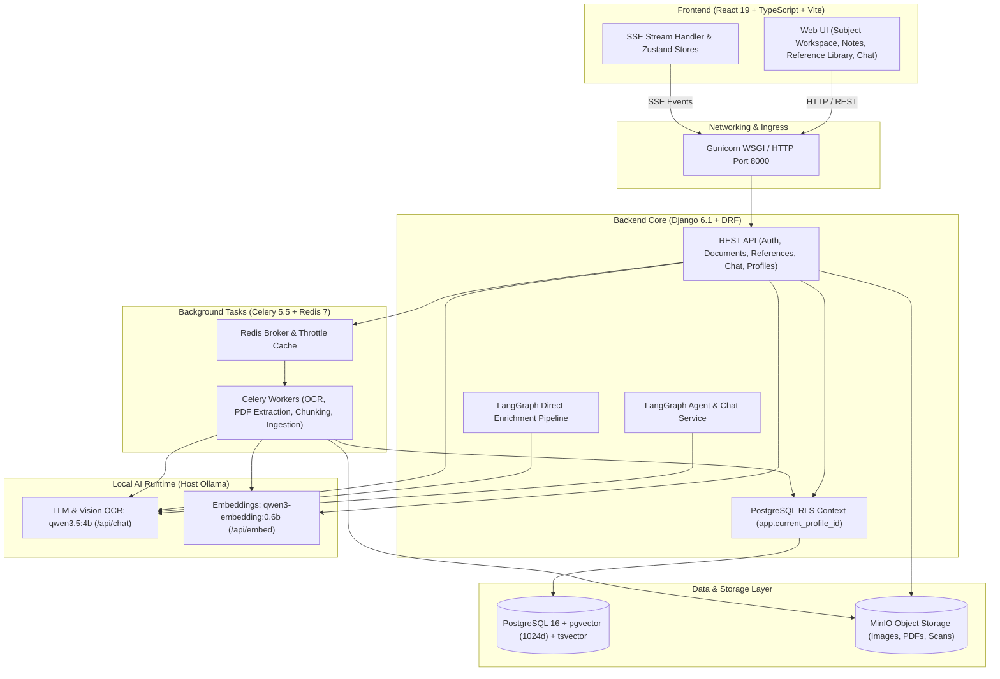

# StudyAI

StudyAI is an AI-powered learning and study platform that transforms handwritten notes and authoritative textbooks into searchable, reference-backed, enriched learning material.

Students upload photos or scans of handwritten notes and reference textbooks. StudyAI transcribes notes using local vision models, extracts and indexes textbook chapters via hybrid vector and lexical search, performs semantic gap analysis against reference material, generates enriched study blocks with verifiable citations, and enables grounded conversational learning through interactive multi-turn chat and autonomous agent workflows.

---

## 1. Product Workflows

StudyAI operates through two principal asynchronous AI workflows:

### A. Reference Textbook Ingestion Workflow

```text
PDF Upload ──► Text Extraction & OCR ──► Chunking ──► Ollama Embeddings ──► Database Indexing ──► READY
 (User / Staff)    (pdfplumber / Vision)     (120w / 30w)     (qwen3-embedding)      (pgvector + tsvector)   (Library)
```

1. **PDF Upload:** Students or administrators upload reference textbooks or course materials (PDF format) to the Reference Library.
2. **Text Extraction & OCR Fallback:** Text is extracted per page using digital extractors (`pdfplumber` / PyMuPDF). For scanned or diagram-heavy pages where digital text extraction yields minimal content, the system falls back to vision-based OCR.
3. **Semantic Chunking:** Documents are divided into structured chunks (target 120 words with 30-word overlap) preserving page numbers, chapter headers, and sections.
4. **Dense Vector Embeddings:** Each chunk is converted into a 1024-dimensional normalized dense vector using `qwen3-embedding:0.6b` via Ollama.
5. **Database Indexing:** Vectors are stored in PostgreSQL with `pgvector` indexing (`vector_cosine_ops`), while text content is indexed into PostgreSQL `tsvector` for full-text lexical search.
6. **Status Lifecycle:** Tracks stage progress (`PENDING` ➔ `PROCESSING` ➔ `READY` / `FAILED`) with page counts and error reporting.

### B. Note Enrichment Workflow

```text
Note Upload ──► Visual OCR ──► Hybrid Retrieval ──► LLM Gap Analysis ──► LLM Enrichment ──► Citation Validation ──► Persistence
(Handwritten)    (qwen3.5:4b)   (pgvector + RRF)      (qwen3.5:4b)         (qwen3.5:4b)      (EvidenceVerifier)     (Enriched Blocks)
```

1. **Handwritten Upload & OCR:** The student uploads an image of handwritten notes. The local multimodal LLM (`qwen3.5:4b`) transcribes handwriting into structured digital text revisions.
2. **Hybrid Reference Retrieval:** Transcribed note contents are embedded and searched against the ingested textbook corpus using dense vector similarity and full-text keyword ranking combined via Reciprocal Rank Fusion (RRF, $k=60$).
3. **LLM Gap Analysis:** The LLM evaluates the note against the retrieved reference excerpts to identify omitted definitions, missing theorems, conceptual gaps, or incomplete explanations.
4. **LLM Enrichment:** The LLM synthesizes structured, explanatory blocks that address identified gaps while preserving the student's original notes intact.
5. **Citation Validation:** Generated statements are cross-checked against source textbook pages by an automated evidence verifier, guaranteeing provenance.
6. **Persistence:** Enriched blocks with interactive citation chips (`📖 Page X`) are saved to PostgreSQL within a profile-scoped transaction.

---

## 2. Core Features

### Handwritten Note Transcription & OCR
- **Image & PDF Ingestion:** Accepts PNG, JPEG, WebP, and PDF scans of handwritten notes.
- **Local Vision OCR:** Transcribes handwriting, diagrams, and structural headings using `qwen3.5:4b` vision through Ollama without sending student data to third-party cloud APIs.
- **Immutable Revision History:** Every transcription and manual edit is stored as an immutable document revision with line coordinates and confidence scores.
- **Asynchronous Processing:** Long-running OCR tasks execute in Celery background workers with Redis broker queues, reporting live progress.

### Reference Library & Document Management
- **Textbook Ingestion:** Ingests comprehensive textbooks and course syllabi.
- **Provenance Tracking:** Chunks retain document ID, title, page numbers, chapters, and section metadata.
- **Scope Isolation:** Supports both global reference textbooks (accessible platform-wide) and private reference documents isolated to specific student profiles.
- **Resilient Extraction:** Fault-tolerant pipeline with automatic retries, batch checkpointing, and stage tracking.

### Reference-Grounded Note Enrichment
- **Direct LLM Gap Detection:** Replaced brittle heuristic clustering with direct LLM semantic gap analysis comparing note text against retrieved reference evidence.
- **Structured Block Generation:** Creates digestible explanations, formulas, and context that target conceptual gaps directly.
- **Interactive In-Place Citations:** Enriched blocks display interactive citation chips (`📖 Page X`). Clicking a chip opens a detail card displaying the verified textbook quote, source title, page number, and verification score.

### Grounded Chat & Agent Mode
- **Conversational Study Assistant:** Students can ask questions about their notes or reference textbooks with full conversational context.
- **Server-Sent Events (SSE) Streaming:** Streams responses in real time using a non-blocking database transaction architecture that releases database locks during LLM inference.
- **StudyAI Agent Mode:** Autonomous multi-step orchestration using LangGraph. The agent coordinates tools (`search_notes`, `search_reference_books`, `get_subject_context`, `verify_citations`) to synthesize multi-source answers.
- **Dual Grounding:** Chat queries retrieve evidence from both personal notes and first-class Reference Documents.

### Security, Multi-Tenancy & Profile Isolation
- **Row-Level Security (RLS):** Enforced natively in PostgreSQL across all multi-tenant tables.
- **Profile Scoping:** Multiple study profiles exist under a single account. Notes, subjects, folders, chat sessions, and private references are strictly isolated.
- **Restricted Database Role:** Application web and worker processes run under a restricted role (`studyai_app`) with minimal privileges, while migrations run under administrative credentials.
- **Dual Study Modules:** Supports `AI_CLASSROOM` (full AI enrichment, practice QA, structured tests) and `NOTE_SPACE` (streamlined digitizer and PDF export).

---

## 3. System Architecture



---

## 4. Production AI Stack

StudyAI runs a unified, self-hosted local AI configuration. Model execution is handled by the host Ollama server, avoiding cloud API dependencies and external data transfer.

| Component | Canonical Model | Engine / Endpoint | Configuration & Invariants |
|---|---|---|---|
| **Multimodal LLM** | `qwen3.5:4b` | Host Ollama (`/api/chat`) | Multimodal vision OCR transcription, note gap analysis, enrichment generation, citation validation, chat, and agent reasoning. |
| **Embeddings** | `qwen3-embedding:0.6b` | Host Ollama (`/api/embed`) | 1024-dimensional normalized dense vectors ($\|v\| \approx 1.0$), canonical version `qwen3-embedding-0.6b-v1`. Zero legacy fallback to SentenceTransformer, MiniLM, or BGE-M3. |
| **Vector Database** | `pgvector` | PostgreSQL 16 Extension | 1024-dimensional cosine distance index (`vector_cosine_ops`). |
| **Lexical Search** | PostgreSQL Full-Text | PostgreSQL `tsvector` | GIN indexing with language-specific stemming for keyword discovery. |
| **Ranking Fusion** | Reciprocal Rank Fusion | Backend Service | Standard RRF ($k=60$) combining dense vector and lexical ranks. |
| **Agent Orchestration** | LangGraph | Python StateGraph | Multi-step agent graph coordinating dynamic retrieval, synthesis, and citation verification. |

> [!NOTE]
> Hardware acceleration (Metal / MPS on macOS, CUDA on Linux) is managed natively by your host's Ollama installation and available hardware. Running on CPU is supported automatically when a GPU is not present.

---

## 5. Technology Stack

| Domain | Technologies |
|---|---|
| **Frontend** | React 19, TypeScript, Vite, React Router v7, Zustand, IndexedDB (`idb`), i18next, Tailwind CSS |
| **Backend** | Python 3.12 / 3.14, Django 6.1, Django REST Framework, SimpleJWT, Gunicorn |
| **Asynchronous Engine** | Celery 5.5, Redis 7 (broker, result backend, and rate-limiting cache) |
| **Database** | PostgreSQL 16 with `pgvector` extension and Row-Level Security (RLS) |
| **Object Storage** | MinIO (S3-compatible local bucket storage for scans, page images, and rendered PDFs) |
| **AI Runtime** | Host Ollama (`qwen3.5:4b`, `qwen3-embedding:0.6b`), LangGraph, LangChain |
| **API Documentation** | drf-spectacular (OpenAPI 3 / Swagger UI) |
| **Testing** | Pytest, Pytest-Django, Vitest, Playwright (Chromium E2E) |

---

## 6. Repository Layout

```text
StudyAI/
├── backend/
│   ├── ai/                      # LangGraph workflows, state definitions, prompts, schemas
│   ├── apps/
│   │   ├── accounts/            # User authentication, JWT tokens, budget management
│   │   ├── agents/              # Autonomous StudyAI agent, tools, and MCP endpoints
│   │   ├── ai_classroom/        # Enrichment services, direct gap analysis, practice tags
│   │   ├── audit/               # Security and provider invocation audit logging
│   │   ├── canvas/              # Handwritten canvas strokes and page management
│   │   ├── chat/                # Multi-turn chat sessions, SSE streaming, RLS scoping
│   │   ├── documents/           # Note documents, pages, revisions, OCR handlers
│   │   ├── jobs/                # Asynchronous durable job engine and Celery dispatch
│   │   ├── notebooks/           # Notebooks and structured digital note pages
│   │   ├── profiles/            # Multi-profile isolation and module switching
│   │   ├── questions/           # Question generation and verification
│   │   ├── references/          # Reference Library models, PDF ingestion, extraction
│   │   ├── retrieval/           # NoteChunk models, pgvector search, hybrid RRF
│   │   ├── revision/            # Revision planning and mastery tracking
│   │   ├── subjects/            # Subject categories and metadata
│   │   └── tests/               # Adaptive tests and mastery score evaluation
│   ├── config/                  # Django settings (base, dev, prod, test, ci) and Celery configuration
│   ├── providers/               # Provider adapters (Ollama LLM/Embeddings, MinIO, Mailpit)
│   ├── shared/                  # Database RLS contexts, observability, common utilities
│   └── tests/                   # Backend regression and unit test suite
├── frontend/
│   ├── src/
│   │   ├── app/                 # Application entry, global shell, CSS styles
│   │   ├── components/          # UI primitives, notes, reference library, chat, subjects
│   │   ├── features/            # Authentication, onboarding, canvas writing
│   │   ├── routes/              # Client-side routing and module access guards
│   │   ├── services/            # API clients for backend endpoints and SSE streaming
│   │   ├── state/               # Zustand state stores (workspace, auth, modules)
│   │   └── types/               # TypeScript interfaces and schema contracts
│   └── tests/                   # Vitest unit tests and browser E2E test suites
├── docs/                        # OpenAPI schemas, architectural specifications, phase reports
├── docker-compose.yml           # Multi-container Docker composition
└── README.md                    # Project documentation
```

---

## 7. Local Development Setup

Follow these steps to set up and run StudyAI locally:

### 1. Prerequisites
- **Git:** 2.30+
- **Docker & Docker Compose:** Docker Engine 24+ and Docker Compose v2+
- **Node.js:** 20+ and npm 10+ (for local frontend development/testing)
- **Ollama:** Installed and running on the host machine ([ollama.com](https://ollama.com/))

### 2. Install and Start Ollama Models
Install Ollama on your host operating system and pull the two canonical models:

```bash
# Pull the multimodal LLM and OCR model
ollama pull qwen3.5:4b

# Pull the canonical 1024-dimensional embedding model
ollama pull qwen3-embedding:0.6b
```

Verify that the models are installed:
```bash
ollama list
```

Ensure Ollama is running and accessible on port `11434`:
```bash
curl http://localhost:11434/api/tags
```

> [!IMPORTANT]
> Containers connect to the host Ollama instance via `http://host.docker.internal:11434`. This is pre-configured via `extra_hosts` in `docker-compose.yml`. Keep Ollama running on your host machine while using StudyAI.

### 3. Clone Repository & Configure Environment
```bash
git clone https://github.com/yashkmr53/StudyAI.git
cd StudyAI
```

Create a local `.env` configuration file from the template:
```bash
cp .env.example .env
```

Generate secure secrets for development:
```bash
# Generate DJANGO_SECRET_KEY
python3 -c "import secrets; print('DJANGO_SECRET_KEY=' + secrets.token_urlsafe(64))"

# Generate POSTGRES_PASSWORD
python3 -c "import secrets; print('POSTGRES_PASSWORD=' + secrets.token_urlsafe(32))"
```
Update your `.env` file with these values.

### 4. Build and Start the Infrastructure
Start all backend services, database, worker, and frontend via Docker Compose:

```bash
docker compose up --build -d
```

Check container status and health:
```bash
docker compose ps
```

You should see 8 healthy/running containers:
- `studyai-api-1` (Django REST API & Gunicorn)
- `studyai-worker-1` (Celery background task worker)
- `studyai-beat-1` (Celery periodic task scheduler)
- `studyai-db-1` (PostgreSQL 16 with pgvector)
- `studyai-redis-1` (Redis broker and cache)
- `studyai-frontend-1` (Vite dev server)
- `studyai-minio-1` (MinIO S3 object storage)
- `studyai-mailpit-1` (Local mail testing server)

### 5. Verify Worker-to-Ollama Connectivity
Verify that the Celery worker inside Docker can reach Ollama on your host:

```bash
docker compose exec worker curl -s http://host.docker.internal:11434/api/tags
```
This should return a JSON response containing `qwen3.5:4b` and `qwen3-embedding:0.6b`.

### 6. Access the Application
Once the containers are up:
- **Frontend Application:** [http://localhost:5173](http://localhost:5173)
- **Backend API Root:** [http://localhost:8000/api/v1/](http://localhost:8000/api/v1/)
- **Interactive Swagger Documentation:** [http://localhost:8000/api/docs/](http://localhost:8000/api/docs/)
- **Health Check Endpoint:** [http://localhost:8000/healthz](http://localhost:8000/healthz)
- **Mailpit Web UI:** [http://localhost:8025](http://localhost:8025)
- **MinIO Console:** [http://localhost:9001](http://localhost:9001) (`minioadmin` / `minioadmin`)

---

## 8. Environment Configuration

Key environment variables configured in `.env` (or inherited by Docker Compose):

| Variable | Description | Safe Default / Example | Required |
|---|---|---|:---:|
| `DJANGO_SETTINGS_MODULE` | Active Django configuration module | `config.settings.prod` | Yes |
| `DJANGO_SECRET_KEY` | Secret key for cryptographic signing | *(64-char random string)* | Yes |
| `DJANGO_DEBUG` | Enables Django debug mode (0 for off, 1 for on) | `0` | Yes |
| `POSTGRES_DB` | PostgreSQL database name | `studyai` | Yes |
| `POSTGRES_USER` | PostgreSQL superuser username | `studyai` | Yes |
| `POSTGRES_PASSWORD` | PostgreSQL superuser password | *(32-char random string)* | Yes |
| `POSTGRES_HOST` | Database host within Docker network | `db` | Yes |
| `POSTGRES_PORT` | Database port | `5432` | Yes |
| `CELERY_BROKER_URL` | Redis connection URL for Celery | `redis://redis:6379/0` | Yes |
| `LLM_PROVIDER` | Active LLM driver | `ollama` | Yes |
| `LLM_MODEL` | Canonical LLM and vision model | `qwen3.5:4b` | Yes |
| `EMBEDDING_PROVIDER` | Canonical vector embedding driver | `ollama` | Yes |
| `EMBEDDING_MODEL_NAME` | Canonical embedding model | `qwen3-embedding:0.6b` | Yes |
| `EMBEDDING_DIMENSIONS` | Dense vector dimension | `1024` | Yes |
| `EMBEDDING_MODEL_VERSION` | Embedding version identifier | `qwen3-embedding-0.6b-v1` | Yes |
| `OLLAMA_BASE_URL` | Host address of Ollama API | `http://host.docker.internal:11434` | Yes |
| `STORAGE_BACKEND` | Object storage backend (`minio` or `s3`) | `minio` | Yes |
| `MINIO_ENDPOINT` | MinIO internal endpoint | `http://minio:9000` | Yes |
| `EMAIL_BACKEND` | Email driver (`mailpit`, `smtp`, `console`) | `mailpit` | Yes |

---

## 9. Testing & Quality Assurance

StudyAI maintains a test suite across backend unit tests, PostgreSQL RLS integration tests, frontend unit tests, and real-browser Playwright E2E suites.

### Backend Unit & Regression Suite
Runs the comprehensive backend test suite under the non-live test configuration (using fast hashing embeddings and in-memory databases):

```bash
# Run tests inside the API container
docker compose exec api pytest --ds=config.settings.test

# Or run via an ephemeral test container
docker compose run --rm test
```

> [!NOTE]
> When run under SQLite in-memory test settings, tests that specifically exercise PostgreSQL GUC session variables (`app.current_profile_id`), pgvector cosine indexing, or PostgreSQL connection leaks are safely skipped. They are verified separately via PostgreSQL integration tests.

### PostgreSQL & RLS Integration Tests
To test live Row-Level Security, multi-profile isolation, and pgvector retrieval against real PostgreSQL:

```bash
docker compose exec api pytest tests/api/test_phase12_security.py tests/api/test_retrieval.py
```

### Frontend Vitest Suite
Runs the frontend component and store unit tests:

```bash
cd frontend
npm test
```

### Frontend Production Build
Validates TypeScript compilation and the Vite production asset bundle:

```bash
cd frontend
npm run build
```

### Live Browser End-to-End (E2E) Verification
Executes the comprehensive 25-point end-to-end acceptance suite in a headless Chromium browser against the running application stack:

```bash
node frontend/tests/e2e/phase14_frontend_e2e.mjs
```

This verifies the complete user journey:
1. Authentication & profile context setup
2. Reference Library inspection & textbook integrity
3. Disposable reference upload, stage tracking, completion, and cleanup
4. Note upload & OCR visual transcription
5. Note enrichment generation & block rendering
6. Interactive citation chip validation
7. Persistence across hard page reloads
8. Multi-turn grounded chat & LangGraph Agent Mode
9. Cross-profile RLS data isolation

---

## 10. Security & Data Isolation Architecture

- **PostgreSQL Row-Level Security (RLS):** Every tenant table (`documents`, `references`, `chat`, `notes`, etc.) enforces RLS policies checking `app.current_profile_id`.
- **Transaction-Local Scoping (`SET LOCAL`):** The profile context is bound only for the duration of a transaction using `SELECT set_config('app.current_profile_id', ..., true)`. When connection pooling returns the connection, the context automatically resets, preventing cross-profile leakage.
- **Least-Privilege Database Role:** Web requests and Celery workers operate under the `studyai_app` unprivileged database role. Table definitions, extensions, and schema migrations are isolated to administrative migration operations.
- **Safe Asynchronous Dispatch:** Background tasks are queued via Django's `transaction.on_commit(_dispatch)` hook, ensuring Celery workers never attempt to fetch uncommitted records.
- **Streaming Connection Lifecycle:** During Server-Sent Events (SSE) chat streaming, database transactions are opened only for brief, discrete persistence operations. Database connections are not held open during long LLM inference calls.

---

## 11. Troubleshooting

### 1. Celery Worker Cannot Reach Ollama (`Connection refused`)
- **Cause:** `localhost` inside a Docker container resolves to the container itself, not your host computer.
- **Solution:** Verify that `OLLAMA_BASE_URL` is set to `http://host.docker.internal:11434`. On Linux, ensure Docker Compose includes `extra_hosts: ["host.docker.internal:host-gateway"]`.

### 2. Missing Ollama Model (`model not found`)
- **Cause:** The required LLM or embedding model has not been pulled on the host.
- **Solution:** Run on the host:
  ```bash
  ollama pull qwen3.5:4b
  ollama pull qwen3-embedding:0.6b
  ```

### 3. Gunicorn Worker Timeout During Long Operations
- **Cause:** Processing dense handwriting or long textbooks can exceed standard HTTP timeouts.
- **Solution:** The Gunicorn worker timeout in `docker-compose.yml` is configured to 300 seconds (`--timeout 300`). For large files, use the asynchronous ingestion endpoints which process in background Celery workers.

### 4. PostgreSQL Tests Skipped Under SQLite
- **Cause:** Running `pytest` with default SQLite test settings will skip tests that require `pgvector` or PostgreSQL-specific GUC parameters.
- **Solution:** Run integration tests against the live `db` service using `docker compose exec api pytest tests/api/test_phase12_security.py`.

---

## 12. License

This project is proprietary and confidential. Unauthorized copying, distribution, or reproduction is strictly prohibited.
