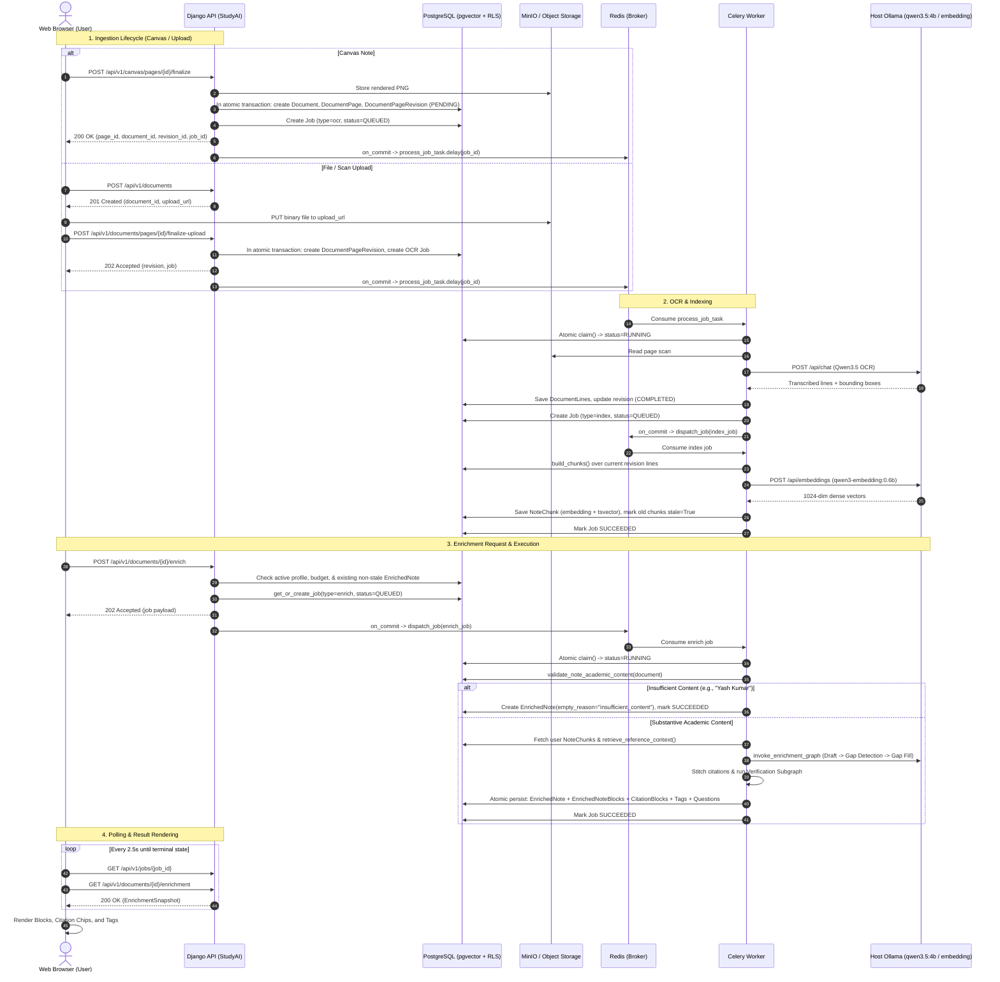
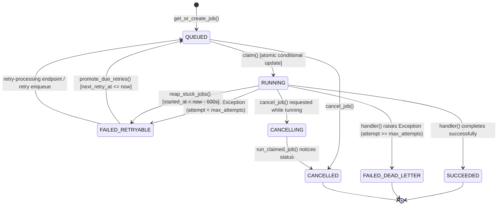

# StudyAI — Complete LangGraph and API Lifecycle Audit

**Audit Date:** 2026-10-18  
**Auditor:** Antigravity AI  
**Scope:** Production Codebase, LangGraph Enrichment, API Endpoints, Asynchronous Job Queue, RLS Security, and Frontend-Backend Lifecycle.  
**Mode:** Read-Only, Evidence-Based Audit.

---

## 1. Repository Baseline & Environment State

### 1.1 Git Working Tree & Commit History
- **Current Branch:** `main` (up to date with `origin/main`)
- **HEAD Commit:** [`cf26e0a`](file:///Users/yash/CV_Project/StudyAI) (`Merge pull request #22 from yashkmr53/fix/enrichment-insufficient-content-ux`)
- **Merge Base with `main`:** `cf26e0a167348176079788313cde27481ed12de3` (Identical to `main`)
- **Worktree Status:** Clean (`nothing to commit, working tree clean`)
- **Commit History Baseline:**
  1. [`cf26e0a`](file:///Users/yash/CV_Project/StudyAI): PR #22 — `fix(enrichment): add early content gate and eliminate runaway polling for insufficient notes`
  2. [`ed0ad04`](file:///Users/yash/CV_Project/StudyAI): PR #21 — `fix(enrichment): resolve handwritten canvas document identity and session routing`
  3. [`7f7d7af`](file:///Users/yash/CV_Project/StudyAI): PR #20 — `Merge pull request #20 from yashkmr53/docs/update-studyai-readme`
  4. [`368ee53`](file:///Users/yash/CV_Project/StudyAI): PR #19 — `Merge pull request #19 from yashkmr53/feature/phase-14-enrichment-architecture-cleanup`
  5. [`3252da9`](file:///Users/yash/CV_Project/StudyAI): PR #18 — `Merge pull request #18 from yashkmr53/feature/phase-13-reliability-core-services`
  6. PR #17: Phase 12 Security Hardening (`3907c2e`)

### 1.2 Presence of Critical Architecture Features
- **Phase 12 (Security Hardening):** Present. RLS policies on all sensitive tables (`Document`, `DocumentPage`, `DocumentPageRevision`, `NoteChunk`, `EnrichedNote`, `EnrichedNoteBlock`, `CitationBlock`, `ReferenceDocument`, `ReferenceChunk`, `ChatSession`, `ChatMessage`, `TestInstance`). RLS context middleware active in settings.
- **Phase 13 (Core Reliability):** Present. Periodic Celery tasks (`reap_stuck_jobs_task`, `promote_retries_task`, `daily_backup`, `reset_monthly_budgets`), transaction-local RLS job executions.
- **Phase 14 (Canonical Ollama Migration & Direct Enrichment):** Present. Legacy `SentenceTransformer` and `sentence_transformers` dependencies completely removed; canonical Ollama embedding provider (`qwen3-embedding:0.6b`, 1024 dimensions) and LLM (`qwen3.5:4b`). Direct enrichment pipeline compiled in LangGraph.
- **Canvas Identity Fix (PR #21):** Present. Two-way document association in `CanvasSession`, `IngestionService.get_owned_document`, and `workspaceStore`.
- **Insufficient-Content Gate & UX (PR #22):** Present. Deterministic `content_gate.py`, `empty_reason` column on `EnrichedNote`, frontend `"insufficient_content"` state, polling timeout remedies.

---

## 2. Compiled Enrichment LangGraph Architecture

### 2.1 Graph Definition and Active Nodes
The runtime enrichment graph is compiled in [enrichment_graph.py](file:///Users/yash/CV_Project/StudyAI/backend/ai/langgraph/graphs/enrichment_graph.py#L54-L82).

```
[Entry: retrieve] ──> [draft] ──> [gap_detection]
                                         │
                   ┌─────────────────────┴─────────────────────┐
                   │ gaps present?                             │ no gaps
                   ▼                                           ▼
              [gap_fill] ───────────────────────────> [citation_stitch]
                                                               │
                                                               ▼
                                                    [evidence_verification]
                                                               │
                                                               ▼
                                                        [format_output]
                                                               │
                                                               ▼
                                                            [END]
```

### 2.2 Active Node Inventory

| Node Name | Handler Function | File Location | Invocation Mechanism |
|---|---|---|---|
| `retrieve` | `retrieve_chunks_node` | [enrichment_nodes.py](file:///Users/yash/CV_Project/StudyAI/backend/apps/ai_classroom/enrichment_nodes.py#L145-L265) | Direct Graph Node |
| `draft` | `draft_node` | [enrichment_nodes.py](file:///Users/yash/CV_Project/StudyAI/backend/apps/ai_classroom/enrichment_nodes.py#L267-L316) | Direct Graph Node |
| `gap_detection` | `gap_detection_node` | [enrichment_nodes.py](file:///Users/yash/CV_Project/StudyAI/backend/apps/ai_classroom/enrichment_nodes.py#L318-L366) | Direct Graph Node |
| `gap_fill` | `gap_fill_node` | [enrichment_nodes.py](file:///Users/yash/CV_Project/StudyAI/backend/apps/ai_classroom/enrichment_nodes.py#L515-L552) | Conditional Edge Target |
| `citation_stitch` | `citation_stitch_node` | [enrichment_nodes.py](file:///Users/yash/CV_Project/StudyAI/backend/apps/ai_classroom/enrichment_nodes.py#L554-L631) | Direct Graph Node |
| `evidence_verification` | `_run_verification` | [enrichment_graph.py](file:///Users/yash/CV_Project/StudyAI/backend/ai/langgraph/graphs/enrichment_graph.py#L20-L44) | Invokes Subgraph `verification_graph` |
| `format_output` | `format_output_node` | [enrichment_nodes.py](file:///Users/yash/CV_Project/StudyAI/backend/apps/ai_classroom/enrichment_nodes.py#L648-L661) | Direct Graph Node |

### 2.3 Legacy / Superseded Nodes (Inactive in Production)
Lines 368–512 in [enrichment_nodes.py](file:///Users/yash/CV_Project/StudyAI/backend/apps/ai_classroom/enrichment_nodes.py#L368-L512) contain:
- `candidate_generation_node`
- `coverage_comparison_node`
- `candidate_validation_node`

> [!NOTE]
> **Definitive Code Finding:** These three functions are **NOT** added to `StateGraph(EnrichmentState)` in [enrichment_graph.py](file:///Users/yash/CV_Project/StudyAI/backend/ai/langgraph/graphs/enrichment_graph.py#L54-L82). They were superseded in Phase 14 by the direct LLM `gap_detection_node` and remain in the file strictly for backwards-compatibility or historical reference.

### 2.4 Subgraphs and Verification
- **Evidence Verification Subgraph:** Defined in [verification_graph.py](file:///Users/yash/CV_Project/StudyAI/backend/ai/langgraph/graphs/verification_graph.py#L13-L27).
  - Graph: `StateGraph(VerificationState)`
  - Nodes: Single node `verify` mapped to `verify_node` in [verification_nodes.py](file:///Users/yash/CV_Project/StudyAI/backend/ai/langgraph/nodes/verification_nodes.py#L11-L21).
  - Edge: `verify` ──> `END`
  - Handler: Calls `EvidenceVerifier._classify(content, cited_contents)` which computes deterministic Jaccard token lexical overlap.

---

## 3. Node-by-Node State, Input, and Output Contracts

### 3.1 State Definition (`EnrichmentState`)
Defined in [enrichment_state.py](file:///Users/yash/CV_Project/StudyAI/backend/ai/langgraph/state/enrichment_state.py#L8-L21):
- `document_id`: `str`
- `job_id`: `str`
- `user_chunks`: `List[Dict[str, Any]]`
- `reference_chunks`: `List[Dict[str, Any]]`
- `evidence_payload`: `Dict[str, Any]`
- `draft_result`: `Dict[str, Any]`
- `gaps_result`: `Dict[str, Any]`
- `fill_result`: `Dict[str, Any]`
- `all_blocks`: `List[Dict[str, Any]]`
- `stitched_blocks`: `List[Dict[str, Any]]`
- `llm_provider`: `str`
- `llm_model`: `str`
- Inherited from `BaseStudyAIState`: `errors: list[str]`, `execution_metadata: dict[str, Any]`

### 3.2 Stage Specification Table

| Stage | Inputs Read | Outputs Written | External / AI Calls | Skip Conditions | Error & Exception Behavior |
|---|---|---|---|---|---|
| **1. Retrieve** | `document_id` | `user_chunks`, `reference_chunks`, `evidence_payload` | PostgreSQL `NoteChunk`, `retrieve_reference_context` (Ollama embeddings) | Auto-indexes if no chunks exist. | Database query exceptions bubble to Celery worker for retry. |
| **2. Draft** | `evidence_payload`, `job_id` | `draft_result`, `llm_provider`, `llm_model` | Ollama LLM (`qwen3.5:4b`) structured JSON completion (`enrichment_draft`) | None. Adapts prompt if reference chunks empty. | Schema validation via `validate_stage_output`. Raises on malformed JSON; triggers retry. |
| **3. Gap Detection** | `evidence_payload`, `job_id` | `gaps_result` | Ollama LLM (`qwen3.5:4b`) structured JSON completion (`gap_detection`) | If `has_reference_material == False`, returns `{"gaps": []}` without LLM call. | Raises on invalid schema; bubbles to retry handler. |
| **Branch Routing** | `gaps_result` | *Routing decision* | None (in-memory condition) | Gaps present ──> `gap_fill`; No gaps ──> `citation_stitch` | None. |
| **4. Gap Fill** | `evidence_payload`, `gaps_result`, `job_id` | `fill_result`, `llm_provider`, `llm_model` | Ollama LLM (`qwen3.5:4b`) structured JSON completion (`gap_filling`) | Bypassed if `_branch_after_gap_detection` routed to `citation_stitch`. | Raises on invalid schema; bubbles to retry handler. |
| **5. Citation Stitch** | `user_chunks`, `reference_chunks`, `draft_result`, `fill_result` | `all_blocks`, `stitched_blocks` | None (pure in-memory indexing & fallback lexical matching) | None. Matches exact UUIDs, then 1-based indices, then fallback lexical support >= 0.20. | Does not fail if references missing; marks block as having no refs. |
| **6. Verification** | `stitched_blocks` | `stitched_blocks` (updated with `status`, `score`) | Subgraph `verification_graph` ──> `EvidenceVerifier._classify` | None. Loops over all stitched blocks. | Uncited blocks marked `not_verified`; lexical scores < 0.30 marked `unsupported`. |
| **7. Format Output** | All completed state keys | Passthrough dict | None | None | Clean dict return to LangGraph executor. |

---

## 4. Complete Note Lifecycle Sequence Diagram



---

## 5. Complete API Endpoint Inventory

| HTTP Method | URL Path | Frontend Caller | Backend View Handler | Auth Required | Profile Isolation Enforcement | Request Body / Params | Response Codes & Shape | Side Effects | Async / Sync | Line Reference |
|---|---|---|---|---|---|---|---|---|---|---|
| `POST` | `/api/v1/auth/login` | `authStore.login` | `LoginView` | Public | None | `{ email, password }` | 200 `{ access, refresh, user }` | Updates last login | Sync | [accounts/views.py#L32](file:///Users/yash/CV_Project/StudyAI/backend/apps/accounts/views.py#L32) |
| `POST` | `/api/v1/profiles` | `workspaceStore` | `ProfileViewSet.create` | Bearer JWT | User scoped | `{ name, module_id }` | 201 `{ id, name, module_id }` | Creates Profile | Sync | [profiles/views.py#L22](file:///Users/yash/CV_Project/StudyAI/backend/apps/profiles/views.py#L22) |
| `GET` | `/api/v1/profiles` | `workspaceStore` | `ProfileViewSet.list` | Bearer JWT | User scoped | Query `?module=` | 200 `[{ id, name, ... }]` | None | Sync | [profiles/views.py#L18](file:///Users/yash/CV_Project/StudyAI/backend/apps/profiles/views.py#L18) |
| `POST` | `/api/v1/canvas/sessions` | `canvasStore.newSession` | `CanvasSessionViewSet.create` | Bearer JWT | `ensure_profile_access` | `{ profile, device_id, subject }` | 201 `CanvasSession` JSON | Creates Session with lock generation 1 | Sync | [canvas/views.py#L53](file:///Users/yash/CV_Project/StudyAI/backend/apps/canvas/views.py#L53) |
| `POST` | `/api/v1/canvas/sessions/{id}/heartbeat` | `WritingPage` timer | `CanvasSessionViewSet.heartbeat` | Bearer JWT | Owner scoped | `{ device_id, lock_generation }` | 200 `CanvasSession` JSON | Updates `lock_expires_at` | Sync | [canvas/views.py#L69](file:///Users/yash/CV_Project/StudyAI/backend/apps/canvas/views.py#L69) |
| `POST` | `/api/v1/canvas/pages` | `canvasStore.addPage` | `CanvasPageViewSet.create` | Bearer JWT | Session lock fenced | `{ session, page_number, device_id, lock_generation }` | 201 `CanvasPage` JSON | Creates `CanvasPage` | Sync | [canvas/views.py#L101](file:///Users/yash/CV_Project/StudyAI/backend/apps/canvas/views.py#L101) |
| `POST` | `/api/v1/canvas/pages/{id}/strokes` | `outbox.flushOutbox` | `CanvasPageViewSet.strokes` | Bearer JWT | Session lock fenced | `{ device_id, lock_generation, strokes: [...] }` | 200 `{ created: [], duplicate_keys: [] }` | Appends `CanvasStroke` rows | Sync | [canvas/views.py#L124](file:///Users/yash/CV_Project/StudyAI/backend/apps/canvas/views.py#L124) |
| `POST` | `/api/v1/canvas/pages/{id}/finalize` | `WritingPage.finishWriting` | `CanvasPageViewSet.finalize` | Bearer JWT | Session lock fenced | `{ device_id, lock_generation, title }` | 200 `{ page_id, is_finalized, document_id, revision_id, job_id }` | Renders PNG, creates Document, Page, Revision, enqueues OCR | Async OCR job | [canvas/views.py#L136](file:///Users/yash/CV_Project/StudyAI/backend/apps/canvas/views.py#L136) |
| `POST` | `/api/v1/documents` | `SubjectWorkspace` upload | `DocumentViewSet.create` | Bearer JWT | `ensure_profile_access` | `{ profile, subject, filename, source_type }` | 201 `{ document, page, upload: { url, method, key } }` | Pre-allocates Document & signed upload URL | Sync | [documents/views.py#L101](file:///Users/yash/CV_Project/StudyAI/backend/apps/documents/views.py#L101) |
| `GET` | `/api/v1/documents/{id}` | `NoteDetailPage` | `DocumentViewSet.retrieve` | Bearer JWT | `X-Active-Profile` + User | Path `{id}` | 200 `Document` JSON | None | Sync | [documents/views.py#L50](file:///Users/yash/CV_Project/StudyAI/backend/apps/documents/views.py#L50) |
| `GET` | `/api/v1/documents/{id}/pages` | `HandwrittenView` | `DocumentViewSet.pages` | Bearer JWT | `X-Active-Profile` + User | Path `{id}` | 200 `[DocumentPage]` JSON | None | Sync | [documents/views.py#L203](file:///Users/yash/CV_Project/StudyAI/backend/apps/documents/views.py#L203) |
| `GET` | `/api/v1/documents/pages/{id}/download` | `HandwrittenView` | `PageDownloadView` | Bearer JWT | User scoped | Path `{page_id}` | 200 `{ url, expires_in }` | Generates short-lived signed URL | Sync | [documents/views.py#L404](file:///Users/yash/CV_Project/StudyAI/backend/apps/documents/views.py#L404) |
| `POST` | `/api/v1/documents/pages/{id}/finalize-upload` | `SubjectWorkspace` upload | `FinalizeUploadView` | Bearer JWT | User scoped | Path `{page_id}` | 202 `{ revision, job, job_created }` | Hashes scan, creates Revision, dispatches OCR Job | Async OCR job | [documents/views.py#L422](file:///Users/yash/CV_Project/StudyAI/backend/apps/documents/views.py#L422) |
| `POST` | `/api/v1/documents/{id}/revisions` | `HandwrittenView` user edit | `DocumentViewSet.revisions` | Bearer JWT | User scoped | `{ page_id, lines: [...] }` | 200 `{ revision, job: null }` | Creates immutable revision, enqueues re-indexing | Async Index job | [documents/views.py#L209](file:///Users/yash/CV_Project/StudyAI/backend/apps/documents/views.py#L209) |
| `POST` | `/api/v1/documents/{id}/enrich` | `EnrichedView.generate` | `DocumentViewSet.enrich` | Bearer JWT | AIBudgetThrottle + User | Path `{id}` | 200 `{ enriched_note, job: null }` OR 202 `{ enriched_note: null, job }` | Enqueues/reuses durable enrich Job | Async LangGraph | [documents/views.py#L281](file:///Users/yash/CV_Project/StudyAI/backend/apps/documents/views.py#L281) |
| `GET` | `/api/v1/documents/{id}/enrichment` | `EnrichedView.refresh` | `DocumentViewSet.enrichment` | Bearer JWT | User scoped | Path `{id}` | 200 `EnrichedNote` JSON or 404 `ResourceNotFound` | None | Sync | [documents/views.py#L295](file:///Users/yash/CV_Project/StudyAI/backend/apps/documents/views.py#L295) |
| `POST` | `/api/v1/documents/{id}/refresh-ai` | `EnrichedView.generate` | `DocumentViewSet.refresh_ai` | Bearer JWT | AIBudgetThrottle + User | Path `{id}` | 202 `{ enriched_note: null, job }` | Forces regeneration job dispatch | Async LangGraph | [documents/views.py#L307](file:///Users/yash/CV_Project/StudyAI/backend/apps/documents/views.py#L307) |
| `GET` | `/api/v1/documents/{id}/tags` | `EnrichedView` | `DocumentViewSet.tags` | Bearer JWT | User scoped | Path `{id}` | 200 `{ results: [...] }` | None | Sync | [documents/views.py#L317](file:///Users/yash/CV_Project/StudyAI/backend/apps/documents/views.py#L317) |
| `GET` | `/api/v1/jobs/{id}` | `EnrichedView` polling | `JobViewSet.retrieve` | Bearer JWT | User profiles scoped | Path `{id}` | 200 `Job` JSON (status, attempt_count, etc.) | None | Sync | [documents/views.py#L460](file:///Users/yash/CV_Project/StudyAI/backend/apps/documents/views.py#L460) |
| `POST` | `/api/v1/jobs/{id}/cancel` | Frontend actions | `CancelJobView` | Bearer JWT | User profiles scoped | Path `{id}` | 200 `{ id, status }` | Transitions QUEUED/RUNNING to CANCELLED | Sync | [documents/views.py#L475](file:///Users/yash/CV_Project/StudyAI/backend/apps/documents/views.py#L475) |
| `POST` | `/api/v1/references` | `ReferenceLibrary` | `ReferenceDocumentViewSet.create` | Bearer JWT | User active profile | Multipart `{ file, title, subject_id, is_global }` | 201 `ReferenceDocument` JSON | Stores PDF in storage, creates record, triggers ingestion | Async Ingestion | [references/views.py#L62](file:///Users/yash/CV_Project/StudyAI/backend/apps/references/views.py#L62) |
| `GET` | `/api/v1/references/{id}/status` | `ReferenceLibrary` | `ReferenceDocumentViewSet.status` | Bearer JWT | Profile or Global | Path `{id}` | 200 `{ status, page_count, chunk_count }` | None | Sync | [references/views.py#L147](file:///Users/yash/CV_Project/StudyAI/backend/apps/references/views.py#L147) |
| `DELETE` | `/api/v1/references/{id}` | `ReferenceLibrary` | `ReferenceDocumentViewSet.destroy` | Bearer JWT | Owner or Staff | Path `{id}` | 204 No Content | Deletes storage object, cascades chunks & embeddings | Sync | [references/views.py#L120](file:///Users/yash/CV_Project/StudyAI/backend/apps/references/views.py#L120) |
| `POST` | `/api/v1/search` | Global Search | `SearchView` | Bearer JWT | LiveScopedRateThrottle | `{ query, subject, top_k, include_reference }` | 200 `{ query, count, results: [...] }` | Executes hybrid search | Sync | [retrieval/views.py#L23](file:///Users/yash/CV_Project/StudyAI/backend/apps/retrieval/views.py#L23) |
| `POST` | `/api/v1/chat/sessions` | `ChatWorkspace` | `ChatSessionViewSet.create` | Bearer JWT | Profile scoped | `{ subject, title }` | 201 `ChatSession` JSON | Creates ChatSession | Sync | [chat/views.py#L59](file:///Users/yash/CV_Project/StudyAI/backend/apps/chat/views.py#L59) |
| `POST` | `/api/v1/chat/sessions/{id}/messages/stream` | `ChatView` | `ChatSessionViewSet.stream_message` | Bearer JWT | Profile scoped | `{ content, image }` | 200 SSE Stream (`text/event-stream`) | Streams tokens, invokes retrieval/agent | Async SSE | [chat/views.py#L101](file:///Users/yash/CV_Project/StudyAI/backend/apps/chat/views.py#L101) |

---

## 6. Exact Identifier Relationships

```
CanvasSession (id)
   ├── CanvasPage (id, session_id, page_number)
   │      └── CanvasStroke (id, page_id, client_idempotency_key)
   └── Document (id, profile_id, subject_id, source="canvas")
          │
          ├── DocumentPage (id, document_id, page_number, current_revision_id)
          │      └── DocumentPageRevision (id, page_id, revision_number, content_hash)
          │             └── DocumentLine (id, page_revision_id, text, bbox)
          │
          ├── NoteChunk (id, document_id, revision_id, embedding, tsvector_content)
          │
          ├── Job (id, job_type, resource_id, idempotency_key)
          │      └── JobExecutionState (id, job_id, completed_node, state_json)
          │
          └── EnrichedNote (id, document_id, generation_job_id, content_hash, empty_reason)
                 └── EnrichedNoteBlock (id, enriched_note_id, block_index)
                        └── CitationBlock (id, enriched_note_block_id, source_refs)
                               └── Links to ReferenceDocument (id) / ReferenceChunk (id)
```

- **`CanvasSession.id` vs `Document.id`:** A canvas session is an interactive writing session with single-writer fencing. A `Document` is the canonical durable entity. Prior to PR #21, these were disconnected; now, `CanvasSession.document_id` links directly to `Document.id`.
- **`DocumentPage.id` vs `DocumentPageRevision.id`:** A document page represents a physical page. Revisions are immutable snapshots. When transcription lines are edited, a new `DocumentPageRevision` is appended, leaving historical revisions intact.
- **`Job.resource_id`:** Dynamically references `Document.id` (for `enrich` and `index` jobs) or `DocumentPageRevision.id` (for `ocr` jobs).

---

## 7. OCR and Indexing Lifecycle

### 7.1 OCR Execution
1. Triggered on upload finalization or canvas page finalization via [`IngestionService.enqueue_ocr_job`](file:///Users/yash/CV_Project/StudyAI/backend/apps/documents/services.py#L107-L126).
2. Worker invokes [`run_ocr_job`](file:///Users/yash/CV_Project/StudyAI/backend/apps/documents/services.py#L230-L311) inside `profile_scoped_transaction(job.profile_id)`.
3. Provider chain calls `Qwen35OCRProvider` via Ollama (`http://host.docker.internal:11434/api/chat`).
4. Output lines are parsed and atomically written to `DocumentLine` rows.
5. If average confidence < 0.80, sets `ocr_status="needs_review"`; otherwise `ocr_status="completed"`.
6. Enqueues downstream `index` job.

### 7.2 Incremental Indexing
1. [`IngestionService.enqueue_index_job`](file:///Users/yash/CV_Project/StudyAI/backend/apps/retrieval/services.py#L138-L156) uses idempotency key:
   `index:{document.pk}:{combined_revision_hash}:{chunker_version}:{embedding_model_version}`
2. [`index_document`](file:///Users/yash/CV_Project/StudyAI/backend/apps/retrieval/services.py#L173-L297):
   - Computes greedy word-bounded chunks (120 target words, 30 overlap words).
   - Diffs against existing active `NoteChunk` hashes.
   - Marks superseded chunks as `stale=True`.
   - Embeds newly created chunks via `OllamaEmbeddingProvider` (`qwen3-embedding:0.6b`, 1024 dimensions).
   - Generates PostgreSQL `tsvector_content` via `SearchVector("content", config="english")`.
   - Invalidates dependent active AI artifacts: `EnrichedNote.objects.filter(document=document).update(ai_stale=True)`.

---

## 8. Asynchronous Job State Machine



### 8.1 Key Mechanisms
- **Atomic Claiming:** [`Job.claim()`](file:///Users/yash/CV_Project/StudyAI/backend/apps/jobs/models.py#L51-L57) updates `status=RUNNING, started_at=now, attempt_count=F("attempt_count") + 1` with a `WHERE status='queued'` condition.
- **Transaction Safety:** Jobs dispatched via [`transaction.on_commit(_enqueue)`](file:///Users/yash/CV_Project/StudyAI/backend/apps/jobs/services.py#L68) in production, preventing race conditions where the Celery worker attempts to claim an uncommitted job row.
- **Checkpoints:** [`JobExecutionState`](file:///Users/yash/CV_Project/StudyAI/backend/apps/jobs/models.py#L76-L112) records node outputs so retries can resume without restarting from `retrieve`.

---

## 9. Reference Retrieval & Citation Provenance Lifecycle

1. **Storage & Ingestion:** Uploaded reference textbooks are stored in object storage at `references/{id}/{filename}` and chunked into `ReferenceChunk` records with 1024-dim dense embeddings.
2. **Scoping:**
   - Private Reference: `profile = user.active_profile`. Accessible only to that profile.
   - Global Reference: `profile = None`. Accessible across all users/profiles.
3. **Retrieval:** In `retrieve_chunks_node`, query terms are extracted using stop-word filtering and heuristic scoring. [`retrieve_reference_context`](file:///Users/yash/CV_Project/StudyAI/backend/apps/references/services.py#L22-L75) runs hybrid RRF search across reference chunks.
4. **Stitching:** [`citation_stitch_node`](file:///Users/yash/CV_Project/StudyAI/backend/apps/ai_classroom/enrichment_nodes.py#L554-L631) binds block-level citations (`source_chunk_ids`) to concrete page numbers, book titles, and chapters.
5. **Verification:** [`EvidenceVerifier._classify`](file:///Users/yash/CV_Project/StudyAI/backend/apps/ai_classroom/services.py#L121-L131) determines whether citations are `supported` (overlap >= 0.60), `partially_supported` (overlap >= 0.30), or `unsupported`.

---

## 10. Persistence and Transaction Boundaries

- **Atomic Enrichment Persistence:** In [services.py](file:///Users/yash/CV_Project/StudyAI/backend/apps/ai_classroom/services.py#L393-L437), the entire bundle is wrapped in `with transaction.atomic()`:
  1. Supersedes existing active notes: `EnrichedNote.objects.filter(document=document, superseded=False).update(superseded=True)`.
  2. Creates new `EnrichedNote`.
  3. Bulk-creates `EnrichedNoteBlock` and `CitationBlock` records.
  4. Calls `TaggingService.extract_for_document(document)`.
  5. Calls `QuestionGenerationService.generate_for_document(document)`.
- **Failure Recovery:** If any learning feature fails, the entire transaction rolls back; the job transitions to `FAILED_RETRYABLE`, leaving zero partial or orphaned blocks in the database.

---

## 11. Frontend Polling and UI-State Mapping

[EnrichedView.tsx](file:///Users/yash/CV_Project/StudyAI/frontend/src/components/notes/EnrichedView.tsx) maps backend contracts into 6 distinct user interface states:

| UI State | Trigger Condition | Polling Behavior | User Action Available |
|---|---|---|---|
| `not_enriched` | `GET /documents/{id}/enrichment` returns 404 and no active job exists | Stopped | "Generate enrichment" button |
| `enriching` | Job status is `queued` / `running` or generation just requested | Polls every 2.5s (up to 120 attempts / 5 mins) | Animated progress spinner ("Synthesizing notes...") |
| `enriched` | Succeeded job with >= 1 block | Stopped immediately | Interactive citation chips, view blocks & tags |
| `insufficient_content` | `empty_reason` present or job succeeded with 0 blocks | Stopped immediately | "Not enough academic content yet" + "Edit Handwritten Note" button |
| `out_of_date` | `ai_stale === true` (note was edited after enrichment) | Stopped | Alert banner + "Regenerate" button |
| `failed` | Job failed dead-letter/cancelled or polling budget exhausted | Stopped | Error banner + "Try Again" button |

---

## 12. Security and Data Integrity Boundaries

1. **PostgreSQL RLS Role:** Verified configured with `studyai_app` (NOSUPERUSER). Connecting as superuser bypasses RLS; connecting as `studyai_app` strictly evaluates RLS policies.
2. **Middleware Context Binding:** [`RlsContextMiddleware`](file:///Users/yash/CV_Project/StudyAI/backend/shared/database/middleware.py) reads `X-Active-Profile`, validates that the profile belongs to `request.user`, and executes queries inside `profile_scoped_transaction`.
3. **Worker Context Binding:** Celery workers call `profile_scoped_transaction(job.profile_id)` prior to executing `handler(job)`.
4. **Cascading Cleanups:** When a document is deleted via `DocumentViewSet.perform_destroy`:
   - Active jobs are marked `CANCELLED`.
   - Storage objects (images, rendered PDFs) are deleted from MinIO.
   - Database record deletion cascades to pages, revisions, lines, chunks, enrichments, and questions.

---

## 13. Test Execution Results and Environmental Limitations

### 13.1 Executed Test Suites

| Test Suite / Command | Scope | Result | Execution Time | Notes / Environmental Limitations |
|---|---|---|---|---|
| `pytest tests/unit/test_enrichment_graph.py tests/unit/test_verification_graph.py` | Unit LangGraph construction, conditional branching, mock E2E | **15 passed** | 2.18s | Pure graph logic verified in isolation. |
| `pytest apps/ai_classroom/ tests/api/test_content_gate_enrichment.py tests/api/test_canvas_ingestion.py tests/api/test_canvas.py` | Content gate, canvas ingestion, session lifecycle, tag renaming | **44 passed** | 32.54s | Verified in running Docker container. |
| `pytest tests/api/test_profiles_subjects.py` | Profile isolation, subject scoping | **16 passed** | 3.82s | Verified in running Docker container. |
| `npm --prefix frontend test -- --run` | Frontend stores, UI flows, enrichment mapping, insufficient content | **81 passed** (12 suites) | 0.65s | Vitest unit & integration tests clean. |
| `npm --prefix frontend run build` | Frontend TypeScript typecheck & Vite build | **Passed** | 0.91s | 0 TypeScript errors, bundle generated cleanly. |
| `pytest tests/api/test_phase12_security.py tests/api/test_ai_classroom.py` | Phase 12 security & AI classroom regression | **16 passed, 5 failed** | 92.07s | **Limitation:** In the Docker production environment (`config.settings.prod`), Django's `TestCase` transaction wrapping prevents `SET LOCAL` from resetting within the same test method, causing RLS assertion mismatches. Additionally, `test_ai_classroom.py` still asserts legacy Phase 13 `rule_based` generation method instead of Phase 14 `llm`. |
| `pytest tests/api/test_documents.py` | Document upload, OCR, retry processing | **15 passed, 4 failed** | 5.96s | **Limitation:** In `config.settings.prod`, real Ollama is invoked for OCR; test dummy byte payloads (`b"not-a-real-png"`) trigger `400 Bad Request: Failed to load image`. Requires `config.settings.test` mock OCR. |

---

## 14. Confirmed Behavior vs. Unverified / Missing Behavior

| Architectural Claim | Status in Current Code | Concrete Evidence in Codebase |
|---|---|---|
| **Direct LLM Gap Detection in Graph** | **Confirmed** | [enrichment_graph.py#L54-L82](file:///Users/yash/CV_Project/StudyAI/backend/ai/langgraph/graphs/enrichment_graph.py#L54-L82) compiles `gap_detection_node` directly into `gap_fill` or `citation_stitch`. |
| **Candidate-Based Gap Extraction** | **Superseded / Inactive** | Exists in [enrichment_nodes.py#L368-L512](file:///Users/yash/CV_Project/StudyAI/backend/apps/ai_classroom/enrichment_nodes.py#L368-L512) but excluded from compiled graph. |
| **Early Content Gate Short-Circuit** | **Confirmed** | [content_gate.py](file:///Users/yash/CV_Project/StudyAI/backend/apps/ai_classroom/content_gate.py) runs before LangGraph; halts execution in ~30ms for non-academic notes. |
| **Two-Way Canvas-Document Binding** | **Confirmed** | [canvas/services.py#L191-L201](file:///Users/yash/CV_Project/StudyAI/backend/apps/canvas/services.py#L191-L201) sets `session.document = document` on page finalization. |
| **Infinite Polling on Empty Enrichment** | **Resolved** | [EnrichedView.tsx#L109-L122](file:///Users/yash/CV_Project/StudyAI/frontend/src/components/notes/EnrichedView.tsx#L109-L122) clears interval timer on terminal states. |
| **Shared Reference Retrieval in Graph** | **Confirmed** | `retrieve_chunks_node` calls `retrieve_reference_context` across textbook library. |
| **Dynamic Graph Planner / Sub-Agents** | **Missing / Planned** | Current graph is a fixed sequential DAG with one conditional branch. No autonomous planner or dynamic tool dispatch is present in the enrichment pipeline. |

---

## 15. Prioritized Recommendations for Future Planner / Parallel Worker Architecture

1. **Replace Static Linear Pipeline with Dynamic Graph Planner:**
   - *Current Limitation:* The enrichment graph executes sequentially (`retrieve` ──> `draft` ──> `gap_detection` ──> `gap_fill` ──> `stitch` ──> `verify`).
   - *Recommendation:* Introduce a Planner Node that analyzes the note content and emits an execution plan (e.g., determining whether reference retrieval is even required, or if conceptual expansion vs. formula verification is needed).
2. **Parallelize Independent Worker Nodes:**
   - *Current Limitation:* Gap detection and drafting run sequentially even when they could analyze evidence concurrently.
   - *Recommendation:* Use LangGraph Send / Map-Reduce branches to execute drafting, terminology tagging, and question generation in parallel workers once evidence is retrieved.
3. **Decouple Post-Processing Learning Features:**
   - *Current Limitation:* `TaggingService` and `QuestionGenerationService` run synchronously inside the final atomic persistence transaction of `run_enrichment_job`. If question generation fails, the entire enrichment graph rolls back.
   - *Recommendation:* Dispatch separate Celery jobs or LangGraph worker branches for tagging and question generation once the `EnrichedNote` is committed.
4. **Reconcile Test Suite Settings for Docker vs Local:**
   - *Current Limitation:* Running `pytest` against `config.settings.prod` in Docker calls real Ollama with dummy test bytes, failing tests that pass under mock test settings.
   - *Recommendation:* Provide a dedicated `docker compose exec api pytest -c pytest.ini --ds=config.settings.test` target.
