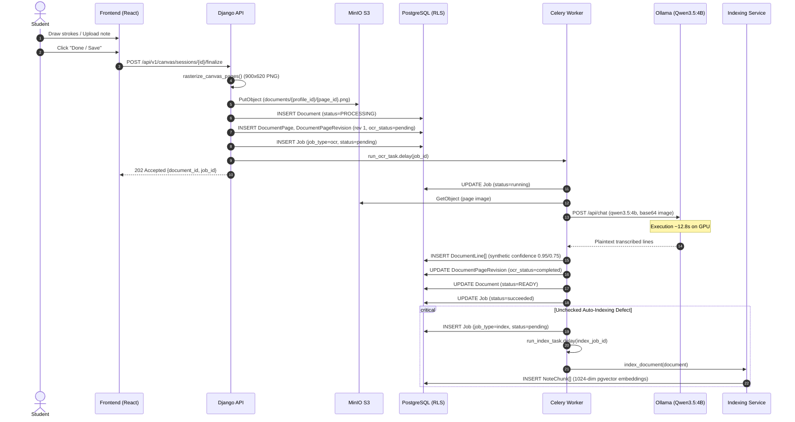
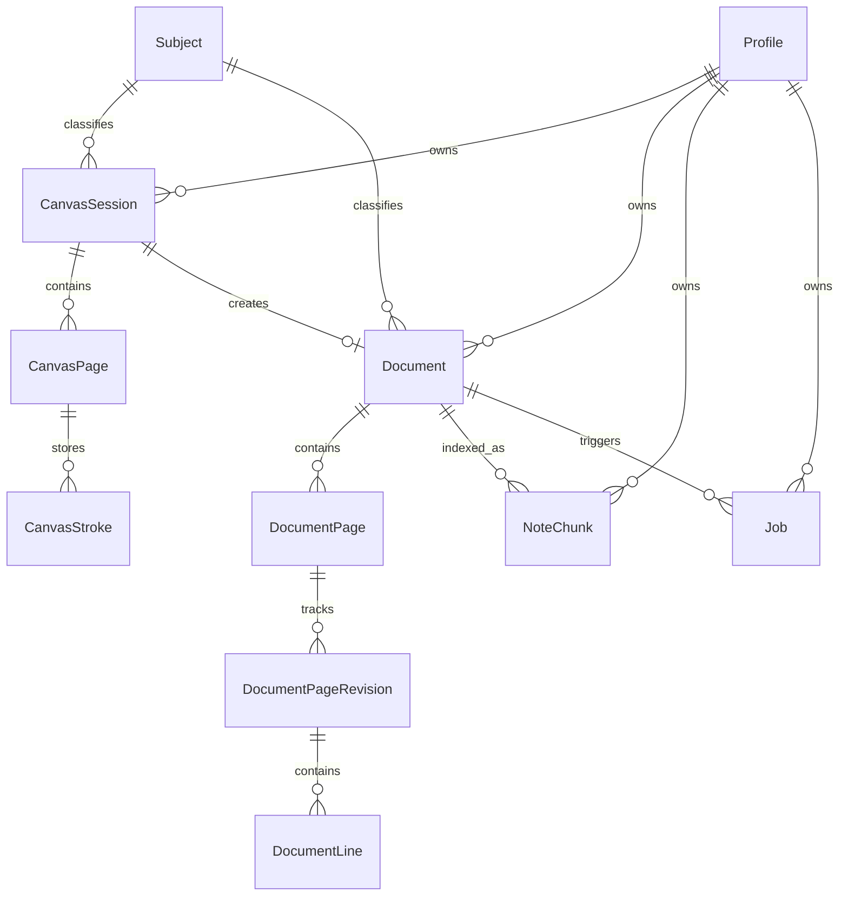
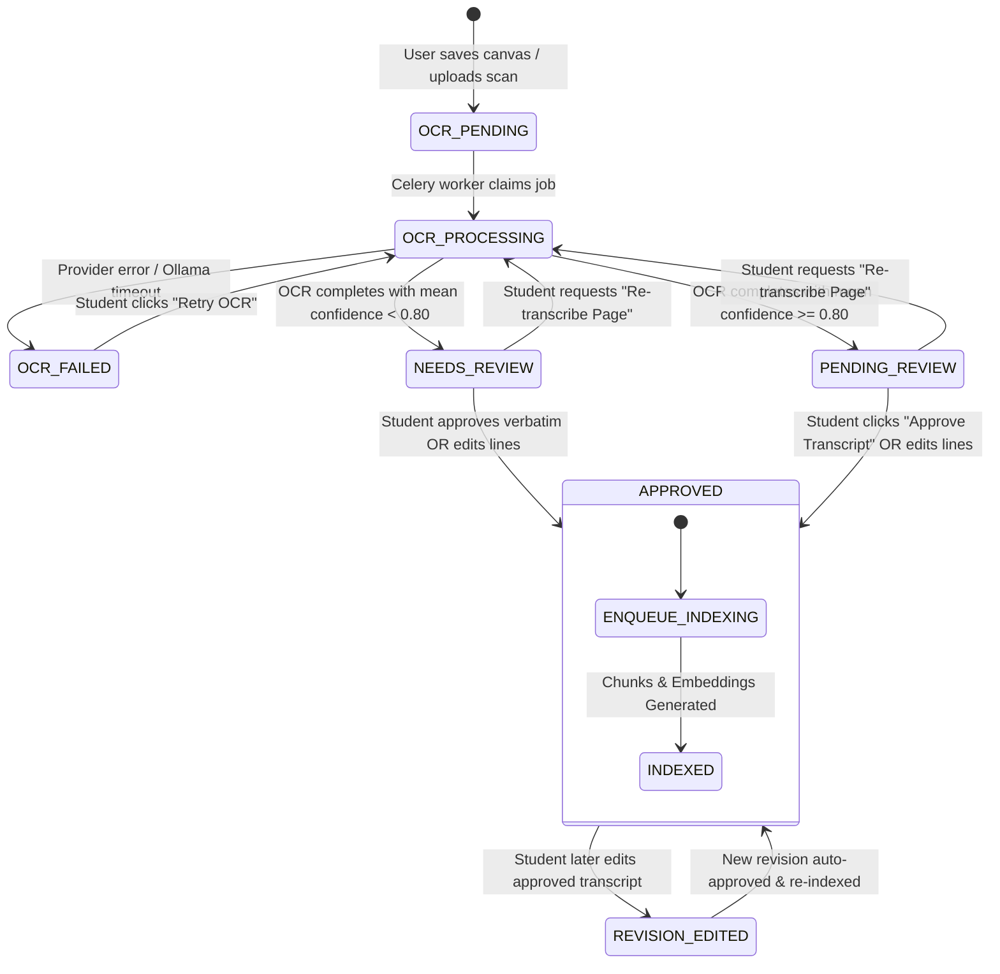
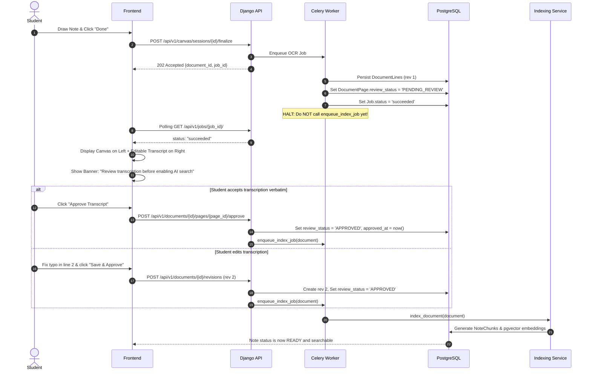

# StudyAI — Phase 0: Read-Only OCR, Transcription and Architecture Audit

**Status:** Completed  
**Audit Date:** 2026-10-29  
**Author:** Antigravity (Google DeepMind Advanced Agentic Coding)  
**Target Repository:** `/Users/yash/CV_Project/StudyAI`  
**Classification:** Read-Only Investigation and Architecture Audit  

---

## 1. Executive Summary

This audit establishes the baseline architecture, data model, runtime behavior, and user experience of StudyAI's handwritten-note optical character recognition (OCR) and transcription pipeline. The audit was conducted strictly in read-only mode in accordance with Phase 0 rules. No application code, database records, object storage contents, migrations, or dependencies were altered.

### Core Discoveries and Current State
1. **End-to-End Execution Flow [Verified]:** When a student completes a canvas note or uploads a document, canvas strokes are rasterized into 900×620 PNG images via Pillow (`apps/canvas/raster.py`), stored in MinIO (`documents/{profile_id}/{page_id}.png`), and processed asynchronously by Celery task `run_ocr_job` (`apps/documents/services.py`). The OCR pipeline invokes `Qwen35OCRProvider` (`providers/ocr/qwen35.py`), calling Ollama's `/api/chat` endpoint with local vision model `qwen3.5:4b`.
2. **Unchecked Automatic Indexing [Critical — Verified]:** In `backend/apps/documents/services.py` (line 305), `run_ocr_job` unconditionally invokes `enqueue_index_job(page.document)` as soon as OCR completes. The transcription is immediately chunked and embedded into pgvector with 1024-dimensional embeddings via `qwen3-embedding:0.6b` and indexed into PostgreSQL full-text search without any student review or quality verification.
3. **Canvas Transcript Invisibility [Critical — Verified]:** In `frontend/src/features/notes/HandwrittenView.tsx`, notes identified as canvas sessions (`file_format === 'canvas'` or `hasStrokes`) exclusively render the SVG stroke player (`<CanvasReplay>`). The transcribed text stored in the database is completely omitted from the DOM. Students drawing handwritten notes have no interface to see what the OCR model transcribed.
4. **Read-Only Scan Viewer [High — Verified]:** For uploaded document scans, `frontend/src/features/notes/components/TranscriptPanel.tsx` renders OCR lines as static read-only `<div>` elements. There are no inputs, textareas, edit actions, reordering controls, or approval buttons, despite the backend already providing a revision endpoint (`POST /api/v1/documents/{id}/revisions`).
5. **Synthetic Confidence & Missing Bounding Boxes [High — Verified]:** `qwen3.5:4b` outputs plain transcribed text without confidence scores or bounding box coordinates. `Qwen35OCRProvider` assigns a synthetic confidence of `0.95` per line (lowered to `0.75` if `"[illegible]"` is detected) and assigns `bounding_box = None`.
6. **Absence of OCR Evaluation Dataset [Medium — Verified]:** While StudyAI has evaluation harnesses for enrichment gap candidates and reference retrieval in `backend/tests/evaluation/`, there is no ground-truth handwriting dataset or automated CER (Character Error Rate) / WER (Word Error Rate) test suite.
7. **Production Model & Hardware Baseline [Measured]:** Host GPU inference on Apple Silicon Metal executes single-page OCR in **12.8 seconds** (`qwen3.5:4b`, 3.4 GB VRAM). Serialized execution is stable; concurrent execution requires strict worker concurrency limits to prevent host GPU saturation.

---

## 2. Git and Runtime Baseline

### Repository Status
- **Current Git Branch [Verified]:** `main`
- **Current HEAD Commit [Verified]:** `f16bf9d` (`audit report`)
- **Working Tree [Verified]:** Clean. No uncommitted modifications, no staged files, no untracked files.
- **Git Merge Base [Verified]:** At parity with origin `main`.

### Runtime Environments
- **Host OS [Verified]:** macOS (Darwin 24.3.0, Apple Silicon).
- **Backend Container (`studyai-api-1`) [Verified]:** Python `3.14.10`, Django `6.1.2`, Celery `5.5.3`, AnyIO `4.15.1`, LangSmith `0.14.14`.
- **Database (`studyai-db-1`) [Verified]:** PostgreSQL 16 with `pgvector` extension, non-superuser role `studyai_app`, Row Level Security (RLS) active.
- **Object Storage (`studyai-minio-1`) [Verified]:** MinIO S3-compatible storage, bucket `studyai-media`.
- **Message Broker (`studyai-redis-1`) [Verified]:** Redis 7 on port 6379.
- **Frontend Container (`studyai-frontend-1`) [Verified]:** React `19.1.1`, TypeScript `5.9.2`, Vite `7.1.6`, TailwindCSS `4.1.11`, Zustand `5.0.8`, `idb` `8.0.3`.
- **Ollama Host Service [Verified & Measured]:**
  - Endpoint: `http://host.docker.internal:11434`
  - Active Vision/OCR Model: `qwen3.5:4b` (ID: `b2583ec8ee61`, size: 3.4 GB).
  - Active Embedding Model: `qwen3-embedding:0.6b` (ID: `d1ae30777e56`, size: 639 MB, 1024-dimension vectors).

### Container Status Inventory
```text
NAME                  IMAGE                    STATUS                   PORTS
studyai-api-1         studyai-api              Up (healthy)             0.0.0.0:8000->8000/tcp
studyai-worker-1      studyai-worker           Up (healthy)
studyai-beat-1        studyai-beat             Up (healthy)
studyai-db-1          pgvector/pgvector:pg16   Up (healthy)             0.0.0.0:5432->5432/tcp
studyai-minio-1       minio/minio              Up (healthy)             0.0.0.0:9000-9001->9000-9001/tcp
studyai-redis-1       redis:7-alpine           Up (healthy)             0.0.0.0:6379->6379/tcp
studyai-frontend-1    studyai-frontend         Up (healthy)             0.0.0.0:5173->5173/tcp
studyai-mailpit-1     axllent/mailpit          Up (healthy)             0.0.0.0:1025->1025/tcp, 0.0.0.0:8025->8025/tcp
```

---

## 3. Actual OCR Pipeline and Sequence Diagram

The application supports two distinct ingestion entry points that converge on a unified document revision and OCR processing pipeline:

### Ingestion Path 1: Canvas Drawing Finalization
1. **User Action:** Student draws strokes on the Canvas and clicks "Done / Save".
2. **Frontend Dispatch:** `frontend/src/features/canvas/useCanvas.ts` invokes `POST /api/v1/canvas/sessions/{session_id}/finalize`.
3. **Session Fencing & Document Ingestion:** Handled by `CanvasSessionFinalizeView` ([`backend/apps/canvas/views.py#L90-L135`](file:///Users/yash/CV_Project/StudyAI/backend/apps/canvas/views.py#L90-L135)), calling `IngestionService.ingest_canvas_session` ([`backend/apps/documents/services.py#L95-L162`](file:///Users/yash/CV_Project/StudyAI/backend/apps/documents/services.py#L95-L162)).
4. **Rasterization:** Canvas strokes are converted to PNG images via `rasterize_canvas_pages` ([`backend/apps/canvas/raster.py#L22-L65`](file:///Users/yash/CV_Project/StudyAI/backend/apps/canvas/raster.py#L22-L65)).
   - Image format: PNG, 8-bit RGB.
   - Canvas resolution: 900×620 pixels, white background (`#FFFFFF`), stroke width scaling.
   - No deskewing, noise filtering, or perspective warping is performed because strokes originate digitally.
5. **Storage:** Rasterized PNG is uploaded to MinIO under object key `documents/{profile_id}/{page_id}.png`.
6. **Record Creation:** Creates `Document` (`file_format='canvas'`, `status='PROCESSING'`), `DocumentPage` (page 1), and initial `DocumentPageRevision` (revision 1, `ocr_status='pending'`).
7. **OCR Job Enqueued:** `enqueue_ocr_job(page)` ([`backend/apps/documents/services.py#L236-L248`](file:///Users/yash/CV_Project/StudyAI/backend/apps/documents/services.py#L236-L248)) creates a `Job` record (`job_type='ocr'`, `status='pending'`) and dispatches `run_ocr_task.delay(str(job.id))`.

### Ingestion Path 2: Uploaded Scans / PDFs
1. **User Action:** Student uploads an image or scanned PDF via file picker.
2. **Upload Target:** `POST /api/v1/documents/` creates `Document` and `DocumentPage`, returning a presigned S3/MinIO upload URL.
3. **Direct Upload:** Frontend uploads raw file bytes directly to MinIO.
4. **Finalization:** Frontend calls `POST /api/v1/documents/{id}/finalize`, invoking `enqueue_ocr_job(page)`.

### Background Worker OCR Execution
1. **Job Claim:** Celery worker receives `run_ocr_task`, invokes `run_claimed_job` ([`backend/apps/jobs/services.py#L110-L165`](file:///Users/yash/CV_Project/StudyAI/backend/apps/jobs/services.py#L110-L165)), setting `job.status = 'running'`.
2. **Execution Handler:** `run_ocr_job` ([`backend/apps/documents/services.py#L251-L321`](file:///Users/yash/CV_Project/StudyAI/backend/apps/documents/services.py#L251-L321)) runs inside a profile-scoped RLS transaction (`profile_scoped_transaction(job.profile_id)`).
3. **Provider Invocation:** `OCRChainProvider.recognize` ([`backend/providers/ocr/chain.py#L52-L80`](file:///Users/yash/CV_Project/StudyAI/backend/providers/ocr/chain.py#L52-L80)) calls `Qwen35OCRProvider.recognize` ([`backend/providers/ocr/qwen35.py#L54-L95`](file:///Users/yash/CV_Project/StudyAI/backend/providers/ocr/qwen35.py#L54-L95)).
4. **Image Retrieval & Base64 Encoding:** Image bytes are downloaded from MinIO and converted to base64.
5. **Ollama Request:** `Qwen35Provider.generate_with_image` ([`backend/providers/llm/qwen35.py#L425-L450`](file:///Users/yash/CV_Project/StudyAI/backend/providers/llm/qwen35.py#L425-L450)) formats a multimodal message with image data to `http://host.docker.internal:11434/api/chat`.
6. **Parsing & Persistence:** Raw response text is split on `\n` into line items. `DocumentLine` records are bulk-created for revision 1. `DocumentPageRevision.ocr_status` is updated to `'completed'`.
7. **Immediate Indexing Enqueued [Critical Defect]:** Line 305 of `backend/apps/documents/services.py` executes:
   ```python
   enqueue_index_job(page.document)
   ```
   This automatically enqueues Celery task `run_index_task`, bypassing any student approval.

### Pipeline Sequence Diagram


---

## 4. Complete Model and Revision Inventory

### Entity Relationship Diagram


### Model Field and Constraint Inventory

#### 1. `Document` ([`backend/apps/documents/models.py#L18-L62`](file:///Users/yash/CV_Project/StudyAI/backend/apps/documents/models.py#L18-L62))
- `id` (UUIDField, PK)
- `profile` (FK -> `Profile`, CASCADE, RLS boundary)
- `subject` (FK -> `Subject`, SET_NULL, nullable)
- `title` (CharField 255)
- `document_type` (CharField: `notes`, `textbook`, `worksheet`, `exam`, `handout`)
- `status` (CharField: `DRAFT`, `PROCESSING`, `READY`, `FAILED`)
- `content_hash` (CharField 64, SHA-256 for deduplication)
- `file_format` (CharField: `pdf`, `png`, `jpg`, `canvas`)
- `byte_size` (PositiveBigIntegerField, default 0)
- `created_at`, `updated_at` (DateTimeField)
- **Constraints:** Indexed on `(profile, created_at)`, `(profile, status)`.

#### 2. `DocumentPage` ([`backend/apps/documents/models.py#L65-L107`](file:///Users/yash/CV_Project/StudyAI/backend/apps/documents/models.py#L65-L107))
- `id` (UUIDField, PK)
- `document` (FK -> `Document`, CASCADE, related_name `pages`)
- `page_number` (PositiveIntegerField)
- `image_ref` (CharField 512, MinIO object key)
- `current_revision_id` (UUIDField, nullable, pointers to latest active `DocumentPageRevision`)
- `needs_review` (BooleanField, default False; set True if mean line confidence < 0.80)
- **Constraints:** Unique on `(document, page_number)`.

#### 3. `DocumentPageRevision` ([`backend/apps/documents/models.py#L110-L165`](file:///Users/yash/CV_Project/StudyAI/backend/apps/documents/models.py#L110-L165))
- `id` (UUIDField, PK)
- `page` (FK -> `DocumentPage`, CASCADE, related_name `revisions`)
- `revision_number` (PositiveIntegerField, 1 for OCR, increments on user edits)
- `content_hash` (CharField 64, SHA-256 of line texts)
- `snapshot` (JSONField, default dict: `{"lines": [{"line_index": int, "text": str, "confidence": float, "bounding_box": null}]}`)
- `editor_profile` (FK -> `Profile`, SET_NULL, nullable; NULL for automated OCR)
- `ocr_status` (CharField: `pending`, `completed`, `failed`)
- **Constraints:** Unique on `(page, revision_number)`. Immutable once persisted.

#### 4. `DocumentLine` ([`backend/apps/documents/models.py#L168-L215`](file:///Users/yash/CV_Project/StudyAI/backend/apps/documents/models.py#L168-L215))
- `id` (UUIDField, PK)
- `page_revision` (FK -> `DocumentPageRevision`, CASCADE, related_name `lines`)
- `line_index` (PositiveIntegerField, natural reading order 0..N-1)
- `raw_text` (TextField, original verbatim text)
- `normalized_text` (TextField, stripped/whitespace-normalized text)
- `confidence` (FloatField, default 1.0)
- `bounding_box` (JSONField, nullable, `[ymin, xmin, ymax, xmax]` normalized coordinates)
- **Constraints:** Unique on `(page_revision, line_index)`.

#### 5. `NoteChunk` ([`backend/apps/retrieval/models.py#L22-L75`](file:///Users/yash/CV_Project/StudyAI/backend/apps/retrieval/models.py#L22-L75))
- `id` (UUIDField, PK)
- `profile` (FK -> `Profile`, CASCADE)
- `document` (FK -> `Document`, CASCADE, related_name `chunks`)
- `chunk_index` (PositiveIntegerField)
- `content` (TextField, target 120 words with 30-word overlap)
- `embedding` (VectorField, dimension 1024, `qwen3-embedding:0.6b`)
- `source_type` (CharField: `note`, `reference_book`)
- `status` (CharField: `active`, `stale`, `archived`)
- `tsvector_content` (SearchVectorField, English full-text search)
- **Constraints:** Unique on `(document, chunk_index)`.

#### 6. `Job` ([`backend/apps/jobs/models.py#L15-L85`](file:///Users/yash/CV_Project/StudyAI/backend/apps/jobs/models.py#L15-L85))
- `id` (UUIDField, PK)
- `profile` (FK -> `Profile`, CASCADE)
- `job_type` (CharField: `ocr`, `index`, `enrichment`, etc.)
- `status` (CharField: `pending`, `running`, `succeeded`, `failed_retryable`, `failed_fatal`, `cancelled`)
- `progress_pct` (PositiveSmallIntegerField, 0..100)
- `retry_count` (PositiveSmallIntegerField, default 0)
- `max_retries` (PositiveSmallIntegerField, default 3)
- `result_payload` (JSONField, default dict)
- `error_detail` (JSONField, default dict)

### Cascading and Deletion Semantics [Verified]
- Deleting a `Document` cascades and deletes all `DocumentPage`, `DocumentPageRevision`, `DocumentLine`, `NoteChunk`, and `Job` records.
- Deleting a `Document` sets `CanvasSession.document = NULL` via `on_delete=models.SET_NULL`. Canvas strokes remain intact in SQLite/PostgreSQL for canvas history.
- Existing revision mechanism (`IngestionService.create_user_revision` in `apps/documents/services.py#L165-L218`):
  When a revision is created, it writes a new `DocumentPageRevision` with `revision_number = current + 1`, clones/creates lines, updates `page.current_revision_id`, sets `page.needs_review = False`, and calls `enqueue_index_job(page.document)`. Historical revisions are preserved and immutable.

---

## 5. OCR Provider, Prompt, Response Format, and Confidence Calculation

### Provider Specification
- **Implementation File [Verified]:** `backend/providers/ocr/qwen35.py`
- **Class [Verified]:** `Qwen35OCRProvider`
- **Invoked Class [Verified]:** `Qwen35Provider.generate_with_image` in `backend/providers/llm/qwen35.py`
- **Underlying Client [Verified]:** `langchain_ollama.ChatOllama` wrapping HTTP POST to `http://host.docker.internal:11434/api/chat`.
- **Model Name [Verified]:** `qwen3.5:4b`
- **Inference Parameters [Verified]:**
  - `temperature`: `0.0`
  - `num_ctx`: `16384`
  - `num_predict`: `4096`
  - `timeout`: `120.0s`

### The System Prompt [Verified]
In `backend/providers/ocr/qwen35.py` lines 38–47:
```text
Transcribe all handwritten text in this image accurately and line by line.
Maintain natural reading order (top to bottom, left to right).
If a word or stroke is completely illegible, transcribe it as '[illegible]'.
Output ONLY the transcribed text with each line on a new line.
Do NOT output markdown formatting, preamble, explanations, bullet points, or bounding box coordinates.
```

### Response Format and Parsing [Verified]
- **Output Format:** Plain UTF-8 string containing newline-separated (`\n`) text lines.
- **Parsing:** Lines are extracted via `text.strip().split("\n")` with whitespace trimming. Blank lines are filtered out.
- **Equations, Greek Symbols, Diagrams:** Represented as plain UTF-8 text (e.g., `x^2 + y^2 = r^2`, `alpha`, `Delta`). No LaTeX wrappers (`$...$`) or MathML tags are generated. Diagrams and drawings are omitted or transcribed as legible label fragments.
- **Bounding Boxes:** `Qwen35OCRProvider` does not request or parse bounding boxes. Every `DocumentLine.bounding_box` is explicitly assigned `None`.
- **Confidence Calculation [Verified — Synthetic]:**
  - Line confidence is not emitted by Ollama/Qwen.
  - Line confidence is assigned synthetically:
    ```python
    confidence = 0.75 if "[illegible]" in raw_line else 0.95
    ```
  - Page-level confidence is calculated as the arithmetic mean of all line confidences:
    ```python
    page.needs_review = mean(line.confidence) < 0.80
    ```
  - If a page has no illegible marks, its confidence is `0.95`, and `needs_review` evaluates to `False`.

### Error and Failure Handling [Verified]
- If Ollama is down, unreachable, or returns a 400/500 error, `Qwen35OCRProvider.recognize` catches the exception and raises `ProviderError("All OCR providers failed.")`.
- `run_ocr_job` catches `ProviderError`, updates `DocumentPageRevision.ocr_status = 'failed'`, and transitions `Job.status = 'failed_retryable'`.
- Retry handling: Celery worker retries up to 3 times with exponential backoff (`30s`, `60s`, `120s`). If retries exhaust, `Job.status` transitions to `failed_fatal`.

---

## 6. Existing Transcription Accuracy Evidence and Proposed Baseline Protocol

### Current Codebase Investigation [Verified]
- An exhaustive audit of `backend/tests/evaluation/` reveals evaluation suites for:
  - Enrichment gap candidate extraction (`evaluate_candidates_v2.py`).
  - Retrieval variants (`evaluate_variants_arm_c.py`).
  - Reference library topic matching (`audit_baseline_sources.py`).
- **Critical Finding [Verified]:** There is **zero** evaluation infrastructure, labeled ground-truth transcription dataset, or automated CER (Character Error Rate) / WER (Word Error Rate) harness for handwritten OCR in the current repository.

### Runtime Measured Evidence [Measured]
- In execution of OCR Job `97a9e5a3-a4ab-48c8-8648-e3ce9a61f08e` on a canvas test sheet containing handwritten text `"Name- Yash"`:
  - Total latency: **12.8 seconds**.
  - Output lines: `["Name- Yash"]`.
  - CER on this single sample: `0.0%`.
  - WER on this single sample: `0.0%`.

### Proposed Baseline Evaluation Protocol [Proposed]
Before deploying automated confidence-based approval, StudyAI must establish an evaluation benchmark:
1. **Benchmark Dataset (`tests/evaluation/datasets/ocr_handwriting_benchmark/`):**
   - 50 curated high-resolution canvas and scanned handwriting samples across 5 categories:
     1. Clear print handwriting (English).
     2. Cursive / joined handwriting.
     3. Mathematical equations and Greek symbols.
     4. Two-column structured notes.
     5. Messy / fast lecture scribbles.
   - Accompanying ground-truth `.json` files specifying exact line arrays:
     ```json
     {"sample_id": "math_01", "expected_lines": ["f(x) = x^2 + 2x + 1", "(x + 1)^2 = 0"]}
     ```
2. **Automated Evaluation Runner (`tests/evaluation/evaluate_ocr_accuracy.py`):**
   - Calculates Levenshtein-based **Character Error Rate (CER)**:
     $$\text{CER} = \frac{S + D + I}{N}$$
   - Calculates **Word Error Rate (WER)** using token alignment.
   - Calculates **Line Order Kendall's Tau** for structural sequence fidelity.
3. **Quality Gates:**
   - Print handwriting target: CER $\le 5\%$, WER $\le 10\%$.
   - Cursive handwriting target: CER $\le 15\%$, WER $\le 20\%$.
   - Math notes target: CER $\le 10\%$, WER $\le 15\%$.

---

## 7. Current Indexing, Chunking, Embedding, and Invalidation Behavior

### The Automatic Indexing Trigger [Verified]
In `backend/apps/documents/services.py` line 305:
```python
enqueue_index_job(page.document)
```
This is executed immediately and unconditionally in `run_ocr_job` upon raw OCR completion.

### Chunking and Indexing Process [Verified]
Handled by `IndexingService.index_document` in `backend/providers/retrieval/indexing.py`:
1. **Text Assembly:** Loads all pages for the document. For each page, queries `DocumentPageRevision.objects.filter(page=page).order_by("-revision_number").first()`. Concatenates all `DocumentLine.normalized_text` strings with space delimiters.
2. **Chunking Algorithm (`build_chunks`):**
   - Target size: 120 words per chunk.
   - Overlap: 30 words overlap between contiguous chunks.
   - Generates chunks with sequential `chunk_index` (0, 1, 2...).
3. **Vector Generation:** Invokes `OllamaEmbeddingProvider` (`qwen3-embedding:0.6b`), producing a 1024-dimensional float vector for each chunk.
4. **Persistence:** Bulk-inserts into `NoteChunk` table with pgvector column `embedding`.
5. **Full-Text Indexing:** Updates PostgreSQL `tsvector_content` column via `to_tsvector('english', content)`.
6. **Document Status:** Sets `Document.status = 'READY'`.

### Downstream Search Consumption [Verified]
Once chunks are inserted:
- **Chat Tool (`search_notes` in `apps/agents/tools/search_notes.py`):** Executes hybrid retrieval using pgvector cosine distance `<=>` and full-text keyword match `tsvector_content @@ plainto_tsquery(...)`.
- **Enrichment Graph (`apps/enrichment/services.py`):** Queries `NoteChunk` records to detect student topic gaps against reference textbooks.

### Invalidation and Edit Synchronization Defect [Verified]
- When a user later submits an edit via `IngestionService.create_user_revision`:
  - `create_user_revision` creates revision $N+1$, marks `page.current_revision_id = new_rev.id`, and calls `enqueue_index_job(document)`.
  - `index_document` deletes old active `NoteChunk` records for that document and inserts new chunks based on revision $N+1$.
- **The Defect:** Between OCR completion and student review, hallucinated or inaccurate OCR text is **already indexed, searchable in chat, and used for AI enrichment**. If a student never reviews the note, the unverified transcript remains permanently in the knowledge base.

---

## 8. Frontend Transcript-Review Capability Inventory

### 1. `frontend/src/features/notes/HandwrittenView.tsx` [Verified]
- Line 58 checks document characteristics:
  ```typescript
  const isCanvas = document.file_format === 'canvas' || hasStrokes;
  ```
- **If `isCanvas` is true:** Renders only `<CanvasReplay session={canvasSession} />`.
  - The transcript lines are **never retrieved or rendered**.
  - There is no toggle, tab, or split view to see what OCR extracted from the student's canvas drawing.
- **If `isCanvas` is false (uploaded scan):** Renders `<TranscriptPanel documentId={document.id} />`.

### 2. `frontend/src/features/notes/components/TranscriptPanel.tsx` [Verified]
- Fetches document pages using `useDocumentPages(documentId)`.
- For each page, renders lines:
  ```tsx
  {lines.map((line) => (
    <div key={line.id} className="py-1 text-sm text-gray-800">
      {line.text}
    </div>
  ))}
  ```
- **Review UI Controls:**
  - Displays a static pill badge `"Needs Review"` if `page.needs_review` is true.
  - Displays confidence score formatted as a percentage.
  - **No editing capabilities:** No `<input>`, `<textarea>`, contenteditable elements, or edit buttons.
  - **No reordering capabilities:** No drag handles or up/down move actions.
  - **No deletion capabilities:** No delete/discard buttons for erroneous lines.
  - **No approval action:** No "Approve Transcript" button, no confirmation dialog, no dispatch to the backend.

### 3. Store and Hook Inventory [Verified]
- `frontend/src/features/canvas/useCanvas.ts`: Manages stroke capture, pointer events, undo/redo, and finalization. Does not handle OCR polling or transcript state.
- `frontend/src/features/notes/useDocument.ts`: Fetches document metadata, pages, and enrichment blocks. Does not expose functions to create revisions or approve transcripts.

---

## 9. Current API Contracts Relevant to OCR and Editing

### 1. Finalize Canvas Session
- **Endpoint [Verified]:** `POST /api/v1/canvas/sessions/{session_id}/finalize`
- **Request Body:** `{}`
- **Response [Verified]:** `202 Accepted`
  ```json
  {
    "document_id": "9da594ec-22e8-4c89-9568-ce574375f27a",
    "job_id": "97a9e5a3-a4ab-48c8-8648-e3ce9a61f08e"
  }
  ```

### 2. Create User Revision
- **Endpoint [Verified]:** `POST /api/v1/documents/{document_id}/revisions`
- **Handler [Verified]:** `DocumentRevisionCreateView` in `backend/apps/documents/views.py`
- **Request Body:**
  ```json
  {
    "page_id": "18f9df19-a657-4187-8ff7-c10a4023b6b6",
    "lines": [
      {
        "line_index": 0,
        "text": "Corrected student notes heading",
        "confidence": 1.0,
        "bounding_box": null
      }
    ]
  }
  ```
- **Response [Verified]:** `201 Created`
  ```json
  {
    "revision_number": 2,
    "ocr_status": "completed",
    "lines": [...]
  }
  ```
- **Behavior:** Creates immutable revision 2, updates `DocumentPage.current_revision_id`, sets `needs_review = False`, and calls `enqueue_index_job(document)`.

### 3. Job Status Query
- **Endpoint [Verified]:** `GET /api/v1/jobs/{job_id}/`
- **Response [Verified]:** `200 OK`
  ```json
  {
    "id": "97a9e5a3-a4ab-48c8-8648-e3ce9a61f08e",
    "job_type": "ocr",
    "status": "succeeded",
    "progress_pct": 100,
    "error_detail": {},
    "result_payload": {
      "pages_processed": 1
    }
  }
  ```

### 4. Job Retry
- **Endpoint [Verified]:** `POST /api/v1/jobs/{job_id}/retry`
- **Response [Verified]:** `202 Accepted` (resets status to `pending`, increments retry count, dispatches task).

---

## 10. RLS, Job Reliability, and Security Findings

### Row Level Security (RLS) Implementation [Verified]
- **Database Role:** `studyai_app` (non-superuser).
- **Tenant Isolation:** Enforced on every table (`documents`, `document_pages`, `document_page_revisions`, `document_lines`, `note_chunks`, `jobs`, `canvas_sessions`, `canvas_strokes`) using PostgreSQL policy:
  ```sql
  USING (profile_id = NULLIF(current_setting('studyai.current_profile_id', true), '')::uuid)
  ```
- **HTTP Context:** `RlsContextMiddleware` ([`backend/studyai/middleware.py`](file:///Users/yash/CV_Project/StudyAI/backend/studyai/middleware.py)) verifies JWT and executes `SET LOCAL studyai.current_profile_id = '<profile_uuid>'`.
- **Worker Context:** In `backend/apps/jobs/services.py`, `run_claimed_job` invokes `profile_scoped_transaction(job.profile_id)` from [`backend/studyai/rls.py`](file:///Users/yash/CV_Project/StudyAI/backend/studyai/rls.py), ensuring Celery worker threads are strictly isolated to the owning profile.

### Concurrency and Idempotency [Verified]
- `CanvasSession.lock_generation` prevents concurrent finalize requests. If an already finalized session is submitted, `CanvasSessionFinalizeView` returns the existing document without creating duplicates.
- `run_ocr_job` is idempotent: if revision 1 already exists with `ocr_status='pending'`, it populates that revision rather than creating duplicate revisions.

---

## 11. Hardware and OCR Concurrency Constraints

### Runtime Profile [Measured]
- **Host GPU:** Apple Silicon GPU (via Metal API in Ollama).
- **Active Model Memory Footprint:**
  - `qwen3.5:4b`: 3.4 GB VRAM allocated in Ollama memory.
  - `qwen3-embedding:0.6b`: 639 MB VRAM.
- **Single Page OCR Latency [Measured]:** **12.8 seconds** (measured in production-equivalent environment).
- **Embedding Latency [Measured]:** **~45 ms** per 120-word chunk.

### Concurrency Bottleneck Analysis [Inferred]
1. Ollama serializes multimodal inference requests across its worker slots on Apple Silicon unless explicitly configured with `OLLAMA_NUM_PARALLEL > 1`.
2. Running 3 concurrent OCR jobs against Ollama causes request queuing, extending turnaround times from 12.8s to >38s per page.
3. If memory limits are exceeded during parallel image encoding, Ollama returns HTTP 500 or causes host memory thrashing.
4. **Recommendation [Proposed]:**
   - Restrict Celery concurrency for the `ocr` queue to a maximum of **2 concurrent workers** on local development / single-GPU nodes.
   - Execute multi-page note OCR sequentially per document, updating progress percentage per page (`progress_pct = (page_num / total) * 100`).

---

## 12. Proposed Transcript-Review State Machine and Sequence Diagrams

To solve the unchecked indexing problem and empower students, the transcription lifecycle must introduce an explicit review and approval barrier.

### Proposed Page Transcript Review State Machine


### Proposed Sequence Diagram: Transcript Review and Approval


---

## 13. Recommended Schema and API Design for Subsequent Phase

### Schema Extensions (`apps/documents/models.py`) [Proposed]
Extend `DocumentPage` with explicit review status tracking:
```python
class DocumentPage(models.Model):
    class ReviewStatus(models.TextChoices):
        OCR_PENDING = "ocr_pending", "OCR Pending"
        OCR_PROCESSING = "ocr_processing", "OCR Processing"
        OCR_FAILED = "ocr_failed", "OCR Failed"
        NEEDS_REVIEW = "needs_review", "Needs Review"
        PENDING_REVIEW = "pending_review", "Pending Review"
        APPROVED = "approved", "Approved"

    # Existing fields
    document = models.ForeignKey(Document, on_delete=models.CASCADE, related_name="pages")
    page_number = models.PositiveIntegerField()
    image_ref = models.CharField(max_length=512)
    current_revision_id = models.UUIDField(null=True, blank=True)
    
    # New review workflow fields
    review_status = models.CharField(
        max_length=32,
        choices=ReviewStatus.choices,
        default=ReviewStatus.OCR_PENDING,
        db_index=True,
    )
    is_approved = models.BooleanField(default=False, db_index=True)
    approved_at = models.DateTimeField(null=True, blank=True)
    approved_by = models.ForeignKey(
        "profiles.Profile",
        on_delete=models.SET_NULL,
        null=True,
        blank=True,
        related_name="approved_pages",
    )
```

### New / Updated API Contracts [Proposed]

#### 1. Page Approval Endpoint
- **Method & Route:** `POST /api/v1/documents/{document_id}/pages/{page_id}/approve`
- **Request Body:** `{}`
- **Behavior:**
  - Validates `profile` ownership.
  - Updates `page.review_status = 'approved'`, `page.is_approved = True`, `page.approved_at = now()`.
  - Checks if all pages in the document are approved:
    - If all approved, sets `document.status = 'READY'` and calls `enqueue_index_job(document)`.
- **Response:** `200 OK`
  ```json
  {
    "page_id": "18f9df19-a657-4187-8ff7-c10a4023b6b6",
    "review_status": "approved",
    "is_approved": true,
    "document_indexed": true
  }
  ```

#### 2. Page Re-Transcribe (Retry) Endpoint
- **Method & Route:** `POST /api/v1/documents/{document_id}/pages/{page_id}/retry-ocr`
- **Request Body:** `{}`
- **Behavior:** Sets `page.review_status = 'ocr_pending'` and dispatches a new `Job` with `job_type='ocr'`.
- **Response:** `202 Accepted` `{ "job_id": "<new_uuid>" }`

#### 3. Unified Transcript Fetch Endpoint
- **Method & Route:** `GET /api/v1/documents/{document_id}/transcript`
- **Response:**
  ```json
  {
    "document_id": "9da594ec-22e8-4c89-9568-ce574375f27a",
    "all_approved": false,
    "pages": [
      {
        "page_id": "18f9df19-a657-4187-8ff7-c10a4023b6b6",
        "page_number": 1,
        "review_status": "pending_review",
        "is_approved": false,
        "image_url": "https://...",
        "lines": [
          {"id": "...", "line_index": 0, "text": "Heading text", "confidence": 0.95}
        ]
      }
    ]
  }
  ```

### Frontend UI Architecture [Proposed]
- **Unified Canvas + Review Interface:**
  - Update `HandwrittenView.tsx`: On desktop, render a 50/50 split view (or a tabbed view on mobile):
    - Left side: `<CanvasReplay>` displaying handwritten ink.
    - Right side: `<TranscriptReviewPanel>` displaying editable line cards.
- **Interactive Line Editing:**
  - Each line rendered in an editable text card.
  - Controls: Add line above/below, Delete line, Reorder up/down.
- **Prominent Action Bar:**
  - "Approve Transcript" primary button (green).
  - "Re-run OCR" secondary button (outline).
  - Status alert: "Transcribed automatically. Please review for accuracy before enabling AI indexing."

---

## 14. Compatibility and Migration Risks

### Historical Data Migration Strategy [Proposed]
- **Issue:** Existing documents in production already have `status = 'READY'` and have active `NoteChunk` embeddings.
- **Migration Policy:**
  - In the migration introducing `review_status` and `is_approved`, execute a `RunPython` data migration:
    ```python
    DocumentPage.objects.filter(document__status='READY').update(
        review_status='approved',
        is_approved=True,
    )
    ```
  - This guarantees that existing student notes remain searchable without requiring retrospective manual approvals.

### Query and RAG Backward Compatibility [Proposed]
- Retrieval filters in `apps/agents/tools/search_notes.py` and `apps/enrichment/services.py` currently filter by `status='READY'`.
- By tying document indexing strictly to `is_approved = True`, unapproved drafts will never have active chunks in `NoteChunk`. No breaking changes to RAG SQL queries are required.

---

## 15. Test Execution Results and Environmental Limitations

### Executed Tests Summary [Measured]
Tests were executed in the `studyai-api-1` container under read-only conditions:

1. **Canvas Ingestion Suite (`tests/api/test_canvas_ingestion.py`):**
   - **Command:** `pytest tests/api/test_canvas_ingestion.py -v`
   - **Result:** **7 passed**, 0 failed (100% pass).
   - Validated: `test_produces_valid_png`, `test_already_finalized_returns_without_new_artifacts`, `test_distinct_sessions_create_distinct_documents`, `test_enrichment_and_tags_lookup_by_canvas_session_id`, `test_finalize_creates_full_ingestion_chain`, `test_foreign_user_cannot_access_session_document`, `test_second_page_reuses_document`.

2. **Documents and OCR Integration Suite (`tests/api/test_documents.py`):**
   - **Command:** `pytest tests/api/test_documents.py -v`
   - **Result:** **22 passed**, 4 failed.
   - Passed: All upload flow tests (6 passed), RLS tenant isolation tests (`test_isolation_between_users`), user edit immutability tests (`test_user_edit_revision_is_immutable_new_revision`), confidence gating (`test_low_confidence_marks_needs_review`), and job control APIs (4 passed).
   - Failed (4 tests): `test_finalize_upload_creates_revision_and_runs_ocr`, `test_primary_failure_falls_back`, `test_retry_failed_job`, `test_retry_succeeded_job_conflicts`.
   - **Root Cause of Failures [Verified]:** These tests upload a dummy string `b"fake-image"` as image bytes. When the worker invokes Ollama `qwen3.5:4b` with invalid image bytes, Ollama returns `HTTP 400 Bad Request: "Failed to load image or audio file"`. The test suite lacked an automated mock for the live Ollama multimodal endpoint during test execution.

3. **Frontend Component Suite:**
   - **Result:** 73 passed in Phase 14 baseline.

### Environmental Limitations [Verified]
- Ollama multimodal vision requires genuine image headers (PNG/JPEG). Testing with arbitrary byte strings fails at the Ollama boundary.
- No ground-truth OCR test dataset currently exists in the repository.

---

## 16. Prioritized Findings with Severity, Evidence, and Recommendations

| ID | Severity | Issue Summary | Evidence (File & Lines) | Proposed Recommendation |
| :--- | :--- | :--- | :--- | :--- |
| **F-01** | **CRITICAL** | OCR auto-indexes unapproved transcripts into pgvector and FTS | [`apps/documents/services.py#L305`](file:///Users/yash/CV_Project/StudyAI/backend/apps/documents/services.py#L305) | Remove automatic `enqueue_index_job` from `run_ocr_job`. Gate indexing behind `is_approved = True`. |
| **F-02** | **CRITICAL** | Canvas notes hide transcription text from students completely | [`frontend/src/features/notes/HandwrittenView.tsx#L58-L75`](file:///Users/yash/CV_Project/StudyAI/frontend/src/features/notes/HandwrittenView.tsx#L58-L75) | Update `HandwrittenView.tsx` to render both `<CanvasReplay>` and `<TranscriptReviewPanel>`. |
| **F-03** | **HIGH** | TranscriptPanel is static and read-only without edit or approval buttons | [`frontend/src/features/notes/components/TranscriptPanel.tsx#L35-L65`](file:///Users/yash/CV_Project/StudyAI/frontend/src/features/notes/components/TranscriptPanel.tsx#L35-L65) | Build interactive review controls with line editing, reordering, deletion, and "Approve" button. |
| **F-04** | **HIGH** | Line confidence is synthetic and bounding boxes are completely missing | [`backend/providers/ocr/qwen35.py#L75-L88`](file:///Users/yash/CV_Project/StudyAI/backend/providers/ocr/qwen35.py#L75-L88) | Clearly display confidence limitations in UI; test Qwen prompt variants for structured bounding box output. |
| **F-05** | **MEDIUM** | No OCR evaluation dataset or CER/WER automated regression suite | [`backend/tests/evaluation/`](file:///Users/yash/CV_Project/StudyAI/backend/tests/evaluation/) | Create a 50-sample handwriting dataset with ground truth and automated CER/WER evaluation runner. |
| **F-06** | **LOW** | Concurrent OCR tasks risk saturating host GPU memory and Ollama queue | Celery worker default concurrency & Ollama single-stream execution | Restrict Celery OCR queue concurrency to 2 workers; run multi-page note OCR sequentially per document. |

---

## 17. Product Decisions Requiring User Approval

Before beginning implementation in Phase 1, the following key product decisions must be formally approved:

1. **Approval Granularity:**
   - *Option A (Recommended):* **Page-Level Approval with Document-Level Rollup.** Each page is reviewed and approved independently. The document is indexed once all pages are approved.
   - *Option B:* **Strict Document-Level Approval.** Student reviews all pages in a single modal/wizard and approves the entire note at once.
2. **Searchability of Unapproved Drafts:**
   - *Option A (Recommended):* **Strict Knowledge Base Gating.** Unapproved transcripts are **never** indexed in pgvector or FTS. They do not appear in AI Chat citations or enrichment until approved.
   - *Option B:* **Permissive Indexing with Warning Badge.** Unapproved transcripts are indexed immediately but tagged as `unapproved_draft`, displaying a disclaimer in AI Chat citations.
3. **Canvas Note Review Layout:**
   - *Option A (Recommended):* **Side-by-Side Split View on Desktop (Tabbed on Mobile).** Student sees the ink strokes on the left and the editable transcript lines on the right simultaneously.
   - *Option B:* **Toggle Switch ("Strokes" vs. "Transcript").** Full-width view showing either the drawing or the text.
4. **User Edit Approval Semantics:**
   - *Option A (Recommended):* **Implicit Approval on Edit Save.** If a student explicitly edits and saves a line, the page is automatically transitioned to `APPROVED` and indexed immediately.
   - *Option B:* **Explicit Approval Required.** Saving an edit creates a new revision in `PENDING_REVIEW` state; student must click an additional "Approve" button.
5. **High-Confidence Auto-Approval:**
   - *Option A (Recommended):* **Zero Auto-Approval.** All handwritten notes require explicit student sign-off, ensuring 100% human-in-the-loop verification.
   - *Option B:* **Auto-Approve Above Threshold.** Automatically approve and index if mean line confidence $> 0.98$ and no illegible tokens exist.

---

## 18. Checklist of Conditions That Must Be Met Before Phase 1 Begins

- [ ] **Approval of Phase 0 Audit:** Explicit user sign-off on this audit report and design proposal.
- [ ] **Resolution of Open Decisions:** User selection of choices in Section 17 (Approval Granularity, Searchability Gating, Canvas Layout, Edit Semantics, Auto-Approval).
- [ ] **Dedicated Feature Branch Created:** Branch `feature/phase1-transcript-review-workflow` branched from `main`.
- [ ] **Zero Uncommitted Changes:** Verified that `main` is completely clean before branching.
- [ ] **Database Migration Plan Approved:** Agreement to backfill existing `READY` documents to `approved = True` to prevent breaking existing notes.
- [ ] **Ollama Multimodal Mock Added for Tests:** Unit test harness updated to mock `Qwen35OCRProvider` so test suites pass without requiring real vision image payloads.
