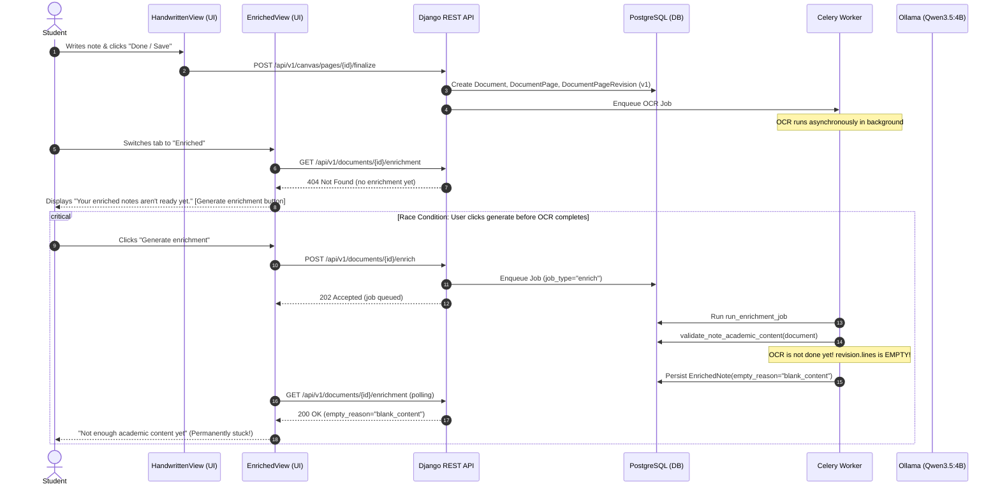

# StudyAI — Phase 2: Generate Enrichment End-to-End Flow & Lifecycle Audit

**Date:** 2026-10-29  
**Branch:** `feature/enrichment-e2e-flow-and-approval-gating`  
**Base Commit:** `9be78dd` (`main`)  
**Status:** Audit Completed — Implementation Plan Formulated  
**Author:** Antigravity (Google DeepMind Advanced Agentic Coding)

---

## 1. Executive Summary

StudyAI features a comprehensive AI note-enrichment pipeline powered by LangGraph, Celery background workers, Ollama (`qwen3.5:4b` and `qwen3-embedding:0.6b`), and PostgreSQL/pgvector.

Following the successful merge of the **Phase 1 Transcript Review and Approval Workflow**, raw OCR completion no longer automatically indexes unverified text into pgvector. This intentional decoupling protects the user's vector space and citation index. However, it exposes **four critical gaps** in the **Generate Enrichment** end-to-end user journey:

1. **OCR-In-Flight Race Condition (Fatal Content Gate False Negative):** When a user saves a canvas note and immediately navigates to the Enriched tab to click "Generate enrichment", the OCR background job is still processing (`ocr_pending` or `ocr_processing`). The revision currently has zero transcribed lines. The early Content Gate (`validate_note_academic_content`) reads empty text, flags `blank_content`, and persists an empty `EnrichedNote`. The user is permanently shown *"Not enough academic content yet"* for a note that contains rich academic handwriting.
2. **Approval Gate Bypass in LangGraph Retrieve Node:** In `backend/apps/ai_classroom/enrichment_nodes.py:retrieve_chunks_node`, if `NoteChunk` is empty, the node unilaterally invokes `index_document(document)`, silently embedding unapproved transcripts into pgvector behind the student's back.
3. **Backend `enqueue_enrichment` Lacks Precondition Validation:** `EnrichmentService.enqueue_enrichment` accepts requests as long as a revision exists. It does not verify whether OCR has finished or whether pages have been approved.
4. **Frontend `EnrichedView` Blindness to Note Transcription/Approval State:** `EnrichedView.tsx` only inspects the `EnrichedNote` record. It does not check if the parent note document is currently transcribing (`ocr_pending` / `ocr_processing`) or awaiting student approval (`pending_review`). Consequently, the user is presented with a premature "Generate enrichment" button when they should be informed to wait for transcription or review their transcript.

This audit documents every layer of the current system, provides primary code evidence, and outlines the step-by-step implementation plan.

---

## 2. Complete End-to-End Architecture & Lifecycle

### 2.1 The Current Pipeline (As-Is)



---

## 3. Deep Dive into the Four Core Issues

### Issue 1: OCR-In-Flight Race Condition
- **File:** [`backend/apps/ai_classroom/services.py:run_enrichment_job`](file:///Users/yash/CV_Project/StudyAI/backend/apps/ai_classroom/services.py#L280-L308)
- **Mechanism:**
  ```python
  gate_valid, gate_reason, gate_details = validate_note_academic_content(document)
  if not gate_valid:
      with transaction.atomic():
          EnrichedNote.objects.create(
              document=document,
              content_hash=_descriptor(document),
              ...
              empty_reason=gate_reason,
          )
      return
  ```
  `validate_note_academic_content` reads `extract_document_text(document)` which inspects `revision.lines`. While OCR is running, lines are empty. The gate determines the note has 0 words and flags `blank_content`.
- **Impact:** Notes written by students fail enrichment silently, producing a persistent false-negative "insufficient content" state.

### Issue 2: LangGraph Auto-Indexing Bypass
- **File:** [`backend/apps/ai_classroom/enrichment_nodes.py:retrieve_chunks_node`](file:///Users/yash/CV_Project/StudyAI/backend/apps/ai_classroom/enrichment_nodes.py#L154-L162)
- **Mechanism:**
  ```python
  user_chunks = list(
      NoteChunk.objects.filter(document=document, stale=False)
      .select_related("reference_book")
      .order_by("chunk_index")[:8]
  )
  if not user_chunks and document.pages.exclude(current_revision_id=None).exists():
      from apps.retrieval.services import index_document
      index_document(document)
      user_chunks = list(...)
  ```
  In Phase 1, `run_ocr_job` was decoupled from automatic indexing. However, if enrichment runs on an unapproved note, `retrieve_chunks_node` notices `user_chunks` is empty and invokes `index_document(document)`.
- **Impact:** Unreviewed, unapproved student transcripts are indexed into pgvector, violating Rule 9 and Phase 1 searchability gating.

### Issue 3: Missing Preconditions in `enqueue_enrichment`
- **File:** [`backend/apps/ai_classroom/services.py:enqueue_enrichment`](file:///Users/yash/CV_Project/StudyAI/backend/apps/ai_classroom/services.py#L201-L205)
- **Mechanism:**
  The endpoint checks:
  1. `document.profile_id is None`
  2. `not document.pages.exclude(current_revision_id=None).exists()`
  3. `assert_within_budget(document.profile_id)`
  It does NOT verify:
  - If any pages are in `DocumentPage.ReviewStatus.OCR_PENDING` or `OCR_PROCESSING`.
  - If all pages have `is_approved == True`.
- **Impact:** Unprepared documents enter the Celery queue prematurely.

### Issue 4: UI Blindness to Document State on Enriched Tab
- **File:** [`frontend/src/components/notes/EnrichedView.tsx`](file:///Users/yash/CV_Project/StudyAI/frontend/src/components/notes/EnrichedView.tsx#L302-L316)
- **Mechanism:**
  `EnrichedView` accepts `note: NoteMeta`, but does not inspect page review statuses or whether OCR is actively transcribing.
  When `snapshot.state === "not_enriched"`, it displays the generic empty state:
  ```tsx
  if (snapshot.state === "not_enriched") {
    return (
      <EmptyState
        icon={<SparkleIcon size={20} />}
        title={t("notes.enriched.emptyTitle")}
        description={t("notes.enriched.emptyDescription")}
        action={
          <button type="button" className="btn btn--primary" onClick={() => void generate()}>
            <SparkleIcon size={14} />
            {t("notes.enriched.generate")}
          </button>
        }
      />
    );
  }
  ```
- **Impact:** The student is given an active button to generate enrichment while the note is completely unready.

---

## 4. Target Architecture & Lifecycle

### 4.1 Strict State Transition Machine

```text
[ Canvas Saved / Scan Uploaded ]
              │
              ▼
    [ OCR_PROCESSING ] ──► Enriched Tab shows: "Transcribing with AI..." (Auto-polls, Generate button disabled)
              │
              ▼ (OCR Completes)
    [ PENDING_REVIEW / NEEDS_REVIEW ] ──► Enriched Tab shows: "Transcript Needs Review" (Prompts student to approve)
              │
              ▼ (Student clicks "Approve Transcript" or "Approve & Enrich")
       [ APPROVED ] ──► Document Indexed into pgvector NoteChunks
              │
              ▼
 [ Student clicks "Generate enrichment" ]
              │
              ├─ 1. Content Gate validates academic sufficiency
              ├─ 2. LangGraph executes (grounded in approved NoteChunks + Textbooks)
              ├─ 3. EvidenceVerifier validates citations
              └─ 4. Tags & Questions generated
              │
              ▼
        [ ENRICHED ] ──► Full structured enrichment rendered with clickable citations
```

---

## 5. Summary of Audit Findings

| Finding ID | Severity | Area | Description |
| :--- | :--- | :--- | :--- |
| **F-01** | **Critical** | Backend / Services | `run_enrichment_job` runs content gate on unfinalized/processing OCR revisions, resulting in false "blank content" failures. |
| **F-02** | **Critical** | Backend / LangGraph | `retrieve_chunks_node` auto-indexes documents when `user_chunks` is empty, bypassing transcript approval. |
| **F-03** | **High** | Backend / API | `POST /documents/{id}/enrich` lacks validation for OCR in-flight and transcript approval status. |
| **F-04** | **High** | Frontend / UI | `EnrichedView.tsx` shows "Generate enrichment" even when OCR is running or transcript is unapproved. |
| **F-05** | **Medium** | Backend / Tests | `test_ai_classroom.py` has brittle `generation_method == {'llm'}` assertion that fails with live Ollama `qwen3.5:4b`. |
