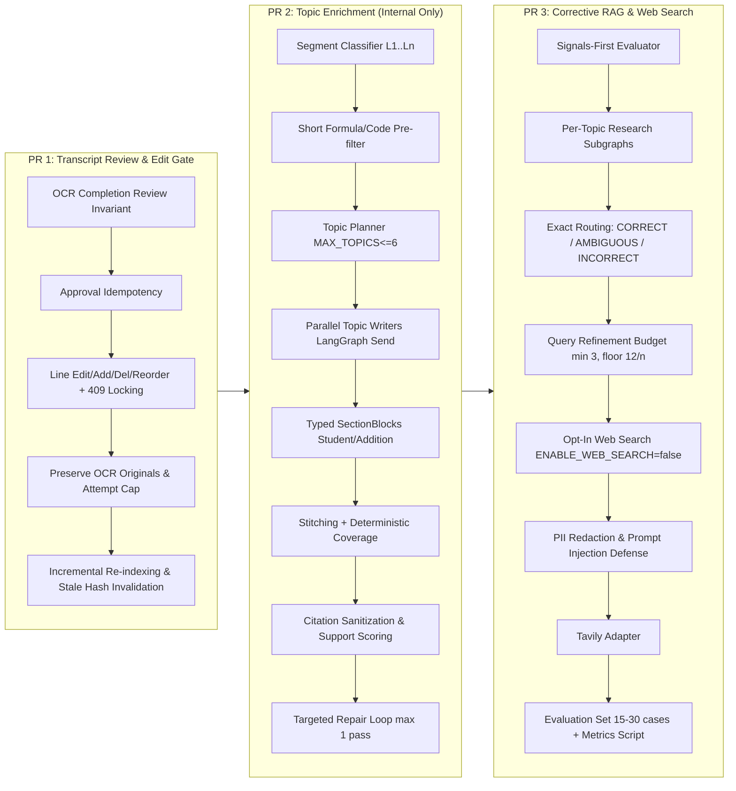

# StudyAI: Read-Only Audit Report — Topic-Based Note Enrichment & Corrective RAG

**Date:** 2026-10-29  
**Branch:** `feature/topic-based-enrichment-corrective-rag`  
**Base Commit:** `9be78dd` (Merge branch 'feature/enrichment-e2e-flow-and-approval-gating')  
**Working Tree Status:** Clean (no modifications to application code or migrations)

---

## 1. Executive Summary

This read-only audit examines the StudyAI repository in preparation for implementing **End-to-End Topic-Based Note Enrichment with Corrective RAG**. The audit adheres strictly to Section 0 of the Master Coding-Agent Prompt:
- No application code, configurations, database records, or migrations have been modified.
- All 7 mandatory architecture areas have been inspected across backend and frontend codebases.
- Existing capabilities, interface contracts, mismatches, and risks are documented below to establish the verified baseline for the three-phase delivery plan (**PR 1**, **PR 2**, and **PR 3**).

---

## 2. Mandatory Area Investigations

### Area 1: Where OCR Completion Enqueues Indexing or Downstream Jobs

**Inspected Files:**
- [`backend/apps/documents/services.py:run_ocr_job`](file:///Users/yash/CV_Project/StudyAI/backend/apps/documents/services.py#L340-L431)
- [`backend/apps/documents/services.py:create_user_revision`](file:///Users/yash/CV_Project/StudyAI/backend/apps/documents/services.py#L181-L235)
- [`backend/apps/documents/services.py:approve_page`](file:///Users/yash/CV_Project/StudyAI/backend/apps/documents/services.py#L236-L261)
- [`backend/apps/retrieval/services.py:enqueue_index_job`](file:///Users/yash/CV_Project/StudyAI/backend/apps/retrieval/services.py#L138)

**Findings:**
1. **OCR Completion does NOT enqueue indexing:**
   In `run_ocr_job` (lines 419–426), when OCR successfully completes, the worker updates:
   ```python
   page.needs_review = needs_review
   page.ocr_status = revision.ocr_status  # COMPLETED or NEEDS_REVIEW
   page.review_status = (
       DocumentPage.ReviewStatus.NEEDS_REVIEW
       if needs_review
       else DocumentPage.ReviewStatus.PENDING_REVIEW
   )
   page.save(update_fields=("needs_review", "ocr_status", "review_status"))
   ```
   No Celery job is dispatched from `run_ocr_job`. The document remains unindexed until explicit approval.
2. **Where indexing IS enqueued:**
   - In `approve_page` (line 257): When a student approves a page, if `unapproved_count == 0` (all pages approved), it calls `enqueue_index_job(doc)`.
   - In `create_user_revision` (line 233): When a user manually edits a transcript, it marks the page `is_approved = True` and calls `enqueue_index_job(page.document)`.
   - In `references/management/commands/ingest_reference_book.py` (line 108): For reference textbook ingestion.

---

### Area 2: Existing Transcript Review, Approval, Edit, Add/Delete/Reorder, and Retry Support

**Inspected Files:**
- [`backend/apps/documents/models.py`](file:///Users/yash/CV_Project/StudyAI/backend/apps/documents/models.py#L60-L150) (`DocumentPage`, `DocumentPageRevision`, `DocumentLine`)
- [`backend/apps/documents/services.py`](file:///Users/yash/CV_Project/StudyAI/backend/apps/documents/services.py#L155-L339) (`_create_revision_locked`, `create_user_revision`, `approve_page`, `retry_page_ocr`)
- [`backend/apps/documents/views.py`](file:///Users/yash/CV_Project/StudyAI/backend/apps/documents/views.py#L330-L450) (`approve`, `retry_ocr`, `revisions`)
- [`frontend/src/components/notes/HandwrittenView.tsx`](file:///Users/yash/CV_Project/StudyAI/frontend/src/components/notes/HandwrittenView.tsx)
- [`frontend/src/services/api/documents.ts`](file:///Users/yash/CV_Project/StudyAI/frontend/src/services/api/documents.ts)

**Findings:**
1. **Data Model Structure:**
   - [`DocumentPage`](file:///Users/yash/CV_Project/StudyAI/backend/apps/documents/models.py#L74) stores `current_revision_id`, `review_status` (`ocr_pending`, `ocr_processing`, `ocr_failed`, `needs_review`, `pending_review`, `approved`), `is_approved`, `approved_at`, `approved_by`.
   - [`DocumentPageRevision`](file:///Users/yash/CV_Project/StudyAI/backend/apps/documents/models.py#L110) stores `revision_number`, `content_hash`, `content_snapshot`, `ocr_status`, `edited_by`.
   - [`DocumentLine`](file:///Users/yash/CV_Project/StudyAI/backend/apps/documents/models.py#L125) stores `page_revision`, `line_index`, `text`, `bbox`, `confidence_score`.
2. **Review & Approval:**
   - Endpoint: `POST /api/v1/documents/{id}/pages/{page_id}/approve` calls `IngestionService.approve_page`.
   - *Current limitation:* Approval idempotency is partial: if called on an already approved page, it still re-saves timestamps and re-checks `all_approved`. It needs explicit idempotent short-circuiting.
3. **Editing & Line Manipulation:**
   - Endpoint: `POST /api/v1/documents/{id}/pages/{page_id}/revisions` calls `create_user_revision(user, doc_id, page_id, lines)`.
   - *Current limitation:* It accepts a full list of lines `[{"text": "...", "bbox": ...}]` and creates a new revision with `line_index = 0..n`.
   - *Missing PR 1 requirements:*
     - **Optimistic Locking:** Does NOT accept an `expected_version` or `parent_revision_id` and does not return HTTP 409 Conflict when concurrent edits occur.
     - **Line Add/Delete/Reorder semantics:** Currently lines are replaced wholesale; there is no granular line ID tracking, delete marking, or separate storage of manual changes vs raw OCR text.
     - **Preservation of Original OCR text:** While older `DocumentPageRevision` rows persist in the DB, there is no direct foreign key or pointer from a user revision back to the OCR revision attempt it was derived from.
4. **Retry Support (`retry_page_ocr`):**
   - Endpoint: `POST /api/v1/documents/{id}/pages/{page_id}/retry-ocr` calls `IngestionService.retry_page_ocr`.
   - *Current limitation:* It creates a new revision and dispatches an OCR job with the default provider. It does NOT enforce a configurable attempt cap (`MAX_OCR_ATTEMPTS`) and does not alternate between strategies (e.g. preprocessing contrast enhancement or alternate provider).

---

### Area 3: How `retrieve_reference_context` and Retrieval Service Score/Rank Results

**Inspected Files:**
- [`backend/apps/references/services.py:retrieve_reference_context`](file:///Users/yash/CV_Project/StudyAI/backend/apps/references/services.py#L31-L238)
- [`backend/apps/retrieval/retrieval.py:RetrievalService.search`](file:///Users/yash/CV_Project/StudyAI/backend/apps/retrieval/retrieval.py#L98-L257)
- [`backend/apps/references/models.py`](file:///Users/yash/CV_Project/StudyAI/backend/apps/references/models.py#L40-L100) (`ReferenceDocument`, `ReferenceChunk`)

**Findings:**
1. **Hybrid Scoring Architecture:**
   - **Dense Leg:** Embeds query via Ollama `qwen3-embedding:0.6b` (1024-dim). Uses pgvector `CosineDistance("embedding", qvec)`. Each chunk is assigned a Reciprocal Rank score: `dense_score = 1.0 / (rrf_k + rank)` where `rrf_k = 60`.
   - **Keyword Leg:** Uses PostgreSQL full-text search `SearchQuery(query, config="english")` against `tsvector_content` ranked by `SearchRank`. Each chunk is assigned: `keyword_score = 1.0 / (rrf_k + rank)`.
   - **Fusion (RRF):** Sums `dense_score + keyword_score`. Returns top `k` chunks sorted descending by fused score.
2. **Missing Signals for Corrective RAG (PR 3):**
   - The function currently only exposes the combined `score: float` (which is the RRF score, typically between 0.015 and 0.033).
   - PR 3 requires a **signals-first evaluator**:
     - Top cosine similarity score (dense vector distance converted to similarity).
     - Margin between rank 1 and rank 2.
     - Count of chunks above relevance threshold.
     - Lexical overlap ratio.
   - *Integration strategy:* Add an optional `include_signals=True` parameter to `retrieve_reference_context` that returns these raw metrics alongside chunk records.

---

### Area 4: How `JobExecutionState` is Created, Updated, Resumed, and Used by Celery Tasks

**Inspected Files:**
- [`backend/apps/jobs/models.py:JobExecutionState`](file:///Users/yash/CV_Project/StudyAI/backend/apps/jobs/models.py#L76-L111)
- [`backend/apps/ai_classroom/services.py:run_enrichment_job`](file:///Users/yash/CV_Project/StudyAI/backend/apps/ai_classroom/services.py#L350-L417)

**Findings:**
1. **Schema & Model:**
   ```python
   class JobExecutionState(models.Model):
       job = models.ForeignKey(Job, on_delete=models.CASCADE, related_name="execution_checkpoints")
       state_json = models.JSONField()  # serialized state dictionary
       completed_node = models.CharField(max_length=32, choices=CompletedNode.choices)
       created_at = models.DateTimeField(auto_now_add=True)
   ```
2. **Current Checkpoint Lifecycle:**
   - In `run_enrichment_job`:
     - Checks `last_checkpoint = JobExecutionState.objects.filter(job=job).order_by("-created_at").first()`.
     - If found, reads `checkpoint_state = last_checkpoint.get_state()` and merges into `initial_state`.
     - *Limitation:* Currently, `JobExecutionState.objects.create(...)` is only called once at the very end of the function (line 412), rather than persisting incremental checkpoints after each major pipeline stage.
3. **PR 2 & PR 3 Alignment:**
   - We must persist intermediate checkpoints after:
     - `classify_segments`
     - `topic_planning`
     - `internal_retrieval`
     - `topic_writing` (parallel workers)
     - `verification`
   - When Celery retries a failed enrichment job, it must inspect `completed_node` and resume execution without repeating already completed LLM or web search stages.

---

### Area 5: Celery Retry Behavior, Limits, Idempotency, and Task Boundaries

**Inspected Files:**
- [`backend/apps/jobs/tasks.py`](file:///Users/yash/CV_Project/StudyAI/backend/apps/jobs/tasks.py#L15-L39)
- [`backend/apps/jobs/services.py`](file:///Users/yash/CV_Project/StudyAI/backend/apps/jobs/services.py#L71-L160)
- [`backend/config/celery.py`](file:///Users/yash/CV_Project/StudyAI/backend/config/celery.py)

**Findings:**
1. **Task Boundary & Locking:**
   - Celery task `process_job_task(job_id)` calls `execute_job(job_id)`.
   - `execute_job` atomically invokes `job.claim()`:
     ```python
     Job.objects.filter(pk=self.pk, status=Status.QUEUED).update(
         status=Status.RUNNING, started_at=now, attempt_count=F("attempt_count") + 1
     )
     ```
     Returns `False` if another worker already claimed the job.
2. **Retry Mechanics:**
   - If an unhandled error occurs, `execute_job` catches the exception:
     - If `attempt_count < JOBS_MAX_ATTEMPTS` (default 3): transitions to `FAILED_RETRYABLE`, calculates exponential backoff with jitter (`JOBS_RETRY_BASE_SECONDS * 2^attempt + jitter`), sets `next_retry_at`.
     - If `attempt_count >= JOBS_MAX_ATTEMPTS`: transitions to `FAILED_DEAD_LETTER`.
   - Celery beat periodic task `promote_retries_task` queries `FAILED_RETRYABLE` jobs where `next_retry_at <= now` and promotes them back to `QUEUED`.
3. **Idempotency:**
   - Jobs use `idempotency_key` via `get_or_create_job`.
   - For enrichment, the key is `f"enrich:{document.pk}:{content_hash[:32]}"`. If a non-stale active job exists, `get_or_create_job` returns the existing job without creating duplicate tasks.

---

### Area 6: Actual Models, Tables, Providers, Graph Modules, and Frontend Contracts

**Inspected Files:**
- [`backend/apps/ai_classroom/models.py`](file:///Users/yash/CV_Project/StudyAI/backend/apps/ai_classroom/models.py) (`EnrichedNote`, `EnrichedNoteBlock`, `CitationBlock`, `PromptVersion`)
- [`backend/ai/langgraph/graphs/enrichment_graph.py`](file:///Users/yash/CV_Project/StudyAI/backend/ai/langgraph/graphs/enrichment_graph.py)
- [`backend/providers/web/base.py`](file:///Users/yash/CV_Project/StudyAI/backend/providers/web/base.py) (`WebSearchProvider`, `WebSearchResult`)
- [`backend/providers/web/duckduckgo.py`](file:///Users/yash/CV_Project/StudyAI/backend/providers/web/duckduckgo.py)
- [`frontend/src/components/notes/EnrichedView.tsx`](file:///Users/yash/CV_Project/StudyAI/frontend/src/components/notes/EnrichedView.tsx)
- [`frontend/src/services/api/enrichment.ts`](file:///Users/yash/CV_Project/StudyAI/frontend/src/services/api/enrichment.ts)

**Findings:**
1. **EnrichedNote & EnrichedNoteBlock Storage:**
   - `EnrichedNote`: `document`, `content_hash`, `revision_ids`, `provider`, `model`, `prompt_version`, `schema_version`, `ai_stale`, `empty_reason`.
   - `EnrichedNoteBlock`: `block_index`, `block_type`, `title`, `content`, `generation_method` (`llm`, `rule_based`, `user_edited`, `transcribed`), `source_chunk_ids`.
   - `CitationBlock`: `source_refs` (list of `{source_type, chunk_id, document_id, page_number, title}`), `verification_status` (`supported`, `partially_supported`, `unsupported`, `not_verified`), `verification_score`, `verifier_version`.
2. **Frontend Contract Compatibility:**
   - `EnrichedView.tsx` expects `blocks` array. Each block has `title`, `content`, `citations` (where each citation has `page`, `sourceType`, `title`).
   - If we store topic-based sections in `EnrichedNoteBlock` with `block_type="topic_section"`, and store typed blocks (`student` vs `addition`), the frontend can either:
     - Render the formatted markdown content directly (100% backward compatible), AND
     - Render distinct chips/badges for student vs system additions when typed block metadata is supplied in additive fields.
3. **Web Providers:**
   - `DuckDuckGoWebSearchProvider` and `MockWebSearchProvider` are present in `providers/web/`.
   - `TavilyWebSearchProvider` is currently missing and will be added in PR 3.
4. **Compatibility Modules:**
   - Notice that neither `backend/studyai_graph.py` nor `backend/studyai_lib.py` currently exists in the repository.
   - In accordance with Section 9 of the Master Prompt ("Remove the proposed backend compatibility modules... put implementation in actual application modules under `backend/ai/langgraph/...` and `backend/apps/ai_classroom/...`"), we will **not** pollute the backend root with legacy compatibility files.

---

### Area 7: Existing Tests and Current Test Status

**Inspected Tests:**
- Backend: `docker compose exec -e DJANGO_SETTINGS_MODULE=config.settings.test api pytest --tb=short`
- Frontend: `npm test -- --run` and `npm run build`

**Findings:**
- **Backend Test Status:** **632 passed, 9 skipped, 0 failed** (641 total tests executed in 12.95s).
- **Frontend Test Status:** **82 passed, 0 failed** across 12 test files (580ms).
- **Frontend Build Status:** Clean build with 0 TypeScript / bundling errors.

---

## 3. Plan-versus-Code Mismatches & Risks

| Component | Assumption in Initial Prompt | Actual Codebase Reality | Architectural Resolution |
| :--- | :--- | :--- | :--- |
| **Compatibility modules** | Expected `studyai_graph.py` and `studyai_lib.py` in backend | Files do not exist. Codebase strictly follows `backend/ai/langgraph/` and `backend/apps/ai_classroom/` structure. | Build clean native modules under `ai/langgraph/` and `apps/ai_classroom/` without adding unused compatibility files at root. |
| **Optimistic Locking** | Assumed existing version checking on line edits | `create_user_revision` currently accepts line arrays and increments revision number without checking for concurrent client edits. | Add `expected_revision_number` parameter in PR 1. Return HTTP 409 Conflict if `expected_revision_number != current_revision.revision_number`. |
| **OCR Text Preservation** | Assumed separate storage for manual vs OCR text | While older revisions are preserved in DB, lines are replaced on revision. There is no line-level mapping between manual edits and original OCR lines. | In PR 1, add additive fields: `original_text`, `is_edited`, `parent_line_id` to `DocumentLine` or snapshot to guarantee clear auditability. |
| **Retrieval Signals** | Assumed `retrieve_reference_context` returns raw cosine similarities | Function computes pgvector distance internally but only exposes fused RRF score. | Add `include_signals=True` to return top cosine score, margin, and chunk count for the PR 3 CRAG signals-first evaluator. |
| **Web Search Default** | Web search might be accidentally triggered | Existing agent tools use DuckDuckGo if enabled. | In PR 3, enforce strict opt-in with `ENABLE_WEB_SEARCH=false` default. Check flag before any web provider dispatch. |

---

## 4. Proposed PR Structure & Delivery Roadmap

The implementation is partitioned into three independent, reviewable, PR-sized phases:



- **PR 1:** Transcript review gate, editing with optimistic locking (HTTP 409), preservation of OCR text, retry cap, incremental indexing, and enrichment stale invalidation.
- **PR 2:** Topic-based note enrichment using internal retrieval only: transcript segment classification, short formula/code gate pre-filter, structured topic planning (max 6), parallel topic writing via LangGraph `Send`, typed `student`/`addition` blocks, stitching, deterministic coverage by line ID, citation sanitization, support scoring, guarded duplicate step, targeted repair, and atomic persistence.
- **PR 3:** Per-topic Corrective RAG research subgraph inside parallel branches: signals-first evaluator, exact CRAG routing, query refinement budget, evidence preparation, opt-in web search with PII redaction and prompt injection guards, Tavily adapter, evaluation set (15–30 cases), and runnable metrics script.
