# StudyAI: End-to-End Topic-Based Note Enrichment with Corrective RAG Plan

## 1. Executive Summary & Repository Baseline

- **Current Git Branch:** `feature/topic-based-enrichment-corrective-rag` (branched cleanly from `main` commit `9be78dd`).
- **Target Deliverable:** A production-conscious, end-to-end topic-based note enrichment pipeline utilizing **LangGraph**, **LangChain**, and existing StudyAI providers (Ollama / `qwen3.5:4b`, internal pgvector hybrid search, Web search providers), with deterministic validation, Corrective RAG (CRAG) routing, parallel topic writing workers, citation tracking, verification, bounded targeted repair, and database persistence.

### Codebase Audit & Existing Component Discovery

| Expected / Requested Identifier | Actual StudyAI Implementation in Repository | Integration Strategy |
| :--- | :--- | :--- |
| `doc_lines` | `DocumentLine` on `DocumentPageRevision` (`line_index`, `text`, `bbox`, `confidence_score`) | Extract lines from approved revisions (`is_approved=True`, `review_status="approved"`). Preserve stable `id` and `text`. Expose helper `doc_lines(doc_id)` in `studyai_lib.py`. |
| `book_ix` / `retrieve_candidates` | `retrieve_reference_context` + `RetrievalService.search` | Use internal pgvector dense + BM25 keyword search against textbook/reference library. Expose `book_ix` adapter in `studyai_lib.py`. |
| `web_docs` / Web Search | `WebSearchProvider` (`DuckDuckGoWebSearchProvider`, `MockWebSearchProvider`) | Reuse `providers.web` and add optional Tavily adapter (`providers/web/tavily.py`) configured via `TAVILY_API_KEY`. |
| `studyai_graph.py` | `ai/langgraph/graphs/enrichment_graph.py` | Implement topic-based CRAG graph in `enrichment_graph.py` and provide `studyai_graph.py` as an importable module / facade. |
| `register_enrichment` / Persistence | `EnrichmentService` + `EnrichedNote` / `EnrichedNoteBlock` / `CitationBlock` | Store per-topic sections into `EnrichedNoteBlock`, source citations into `CitationBlock`, and complete stitched markdown + verification report into `JobExecutionState`. |

---

## 2. End-to-End Pipeline Architecture

```mermaid
flowchart TD
    Start([Approved Transcript Lines]) --> Gate{Sufficient Content Gate}
    Gate -- Insufficient / Empty --> EarlyTerm([Early Termination: empty_reason])
    Gate -- Valid --> TopicPlanner[1. Topic Planner Node<br/>Pydantic Structured Output: 1 to 6 Topics]
    
    TopicPlanner --> ValPlan{Deterministic Validation}
    ValPlan -- Malformed / Missing Lines --> RepairPlan[Plan Normalization / Bounded Retry]
    RepairPlan --> InternalRet
    ValPlan -- Valid --> InternalRet[2. Initial Internal Retrieval<br/>Per-topic Knowledge Base Search]

    InternalRet --> Evaluator[3. Retrieval Quality Evaluator<br/>Per-topic Assessment]
    
    Evaluator --> Router{4. Corrective RAG Router<br/>Per-Topic Verdict}
    
    Router -- "CORRECT" --> BuildContext[5. Topic-Specific Evidence Preparation]
    
    Router -- "AMBIGUOUS" --> RefineAmb[Query Refinement<br/>Max 3 queries/topic, Deduplicated]
    RefineAmb --> IntRetPass2[Internal Retrieval Pass 2]
    IntRetPass2 --> CheckGaps{Remaining Gaps?}
    CheckGaps -- No --> BuildContext
    CheckGaps -- Yes --> WebSearchAmb[Web Search: Tavily / DuckDuckGo]
    WebSearchAmb --> BuildContext
    
    Router -- "INCORRECT" --> RefineInc[Query Refinement & Reformulation]
    RefineInc --> IntRetPass3[Internal Retrieval Pass 3]
    IntRetPass3 --> WebSearchInc[Web Search: Corrective Source]
    WebSearchInc --> BuildContext

    BuildContext --> DispatchWorkers[6. Dispatch Parallel Topic Writers<br/>LangGraph Send mechanism]
    
    subgraph ParallelWriters ["Parallel Topic Workers"]
        W1[Topic Writer 1]
        W2[Topic Writer 2]
        W3[Topic Writer N...]
    end
    
    DispatchWorkers --> ParallelWriters
    ParallelWriters --> Stitcher[7. Stitching & Markdown Generation<br/>Preserve Planned Topic Order]
    
    Stitcher --> Verifier[8. Verification Engine<br/>Coverage + Citation Validity + Support]
    
    Verifier --> CheckPassed{Verification Passed?}
    CheckPassed -- Yes --> Persist[9. Atomic Persistence<br/>EnrichedNote, Blocks, Citations & Report]
    CheckPassed -- No --> CheckBudget{Repair Budget Left?<br/>default max 1 pass}
    CheckBudget -- Yes --> TargetedRepair[Targeted Repair Worker<br/>Redispatch only affected topics with must_include]
    TargetedRepair --> Stitcher
    CheckBudget -- No --> PersistAttention[Persist with needs_attention<br/>Save full Diagnostic Report]
    
    Persist --> End([Complete])
    PersistAttention --> End
```



---

## 3. Detailed Component Design & Specifications

### Stage 1: Transcript Ingestion & Gate
- **Inputs**: `document_id`.
- **Query**: Fetch `DocumentPage` where `is_approved=True` and `review_status="approved"`. Retrieve lines from `page.current_revision.lines.order_by("line_index")`.
- **Preserved Structure**:
  ```python
  class TranscriptLine(BaseModel):
      line_id: str  # DocumentLine UUID or "p{page}_l{index}"
      page_number: int
      line_index: int
      text: str
  ```
- **Gate**: Run `validate_note_academic_content(document)`. If blank or unapproved, terminate early and record status.

### Stage 2: Topic Planner (Maximum 6 Topics)
- **Pydantic Schemas**:
  ```python
  class Topic(BaseModel):
      topic_id: str = Field(description="Unique snake_case identifier, e.g. topic_1_dijkstra_basics")
      title: str = Field(description="Clear, informative topic title")
      description: str = Field(description="1-2 sentence scope of the topic")
      transcript_line_ids: list[str] = Field(description="List of transcript line IDs assigned to this topic")

  class TopicPlan(BaseModel):
      topics: list[Topic] = Field(description="Between 1 and 6 topics covering all student notes", min_length=1, max_length=6)
  ```
- **Deterministic Validation Rules**:
  1. `1 <= len(topics) <= 6`.
  2. Every referenced `line_id` must exist in input `transcript_lines`.
  3. **Coverage Check**: Compute set difference `all_line_ids - assigned_line_ids`. If any lines are unassigned, automatically assign them to the closest thematic topic or create a general topic (if count < 6).
  4. **Deduplication Policy**: If the LLM assigns a line to multiple topics, retain primary assignment in the first topic to avoid redundant duplication across sections.
  5. Reject empty topics (`len(transcript_line_ids) == 0`).

### Stage 3 & 4: Internal Retrieval & Retrieval-Quality Evaluation (CRAG)
- **Internal Retrieval**:
  For each topic independently, generate a focused search query combining `title + description + assigned line texts`.
  Call `retrieve_reference_context(query, profile=profile, subject=subject, top_k=6)`.
- **Evaluation Verdicts**:
  Support exactly:
  - `CORRECT`: Sufficient evidence found in reference library covering all key assertions.
  - `AMBIGUOUS`: Partial coverage, conflicting explanations, or technical gaps.
  - `INCORRECT`: Retrieved references are irrelevant (off-topic) or contradict the student's premise.
- **Structured Evaluator Output**:
  ```python
  class RetrievalVerdict(str, Enum):
      CORRECT = "CORRECT"
      AMBIGUOUS = "AMBIGUOUS"
      INCORRECT = "INCORRECT"

  class TopicRetrievalEvaluation(BaseModel):
      topic_id: str
      verdict: RetrievalVerdict
      quality_assessment: str
      identified_gaps: list[str]
      initial_candidates: list[dict]
  ```

### Stage 5: Corrective RAG Routing & Query Refinement
- **Routing Rules**:
  - `CORRECT`: Bypass query refinement and web search. Proceed directly to topic context assembly.
  - `AMBIGUOUS`:
    1. Query Refinement (Pydantic `RefinedQuery`: `topic_id`, `query_text`, `motivated_by_line_ids`). Max 3 per topic, max 12 total.
    2. Internal Retrieval Pass 2 using refined queries.
    3. If gaps remain: Call Web Search adapter (`max_results=3`). Validate web results.
  - `INCORRECT`:
    1. Query Refinement targeting corrected formulation.
    2. Internal Retrieval Pass 2.
    3. Web Search as corrective source.
    4. Mark unresolved contradictions for writer notes.

### Stage 6: Web Search Integration
- Interface: Reuses `WebSearchProvider`.
- Providers:
  - `DuckDuckGoWebSearchProvider` (existing, default when no API key).
  - `MockWebSearchProvider` (existing, used in automated unit tests).
  - `TavilyWebSearchProvider` (new, optional provider when `TAVILY_API_KEY` is provided or `WEB_SEARCH_PROVIDER="tavily"`).
- Protection: Deduplicate URLs, limit text snippet lengths, sanitize untrusted web content.

### Stage 7: Parallel Topic-Writing Workers (`Send` API)
- **LangGraph Concurrency**:
  Use `Send("topic_writer", topic_context)` to fan out parallel tasks across all planned topics.
- **Topic Context**:
  ```python
  class TopicContext(BaseModel):
      topic_id: str
      title: str
      description: str
      assigned_notes: list[TranscriptLine]
      evidence_items: list[dict]  # internal + web evidence with stable citation_id
      other_topic_titles: list[str]  # to prevent cross-topic repetition
      must_include: list[str] = []  # populated during targeted repair
  ```
- **Output Schema**:
  ```python
  class EnrichedSection(BaseModel):
      topic_id: str
      title: str
      content: str
      source_citation_ids: list[str]
  ```
- **Reducer**:
  Annotated dict reducer `Annotated[dict[str, EnrichedSection], merge_sections]` keyed by `topic_id` ensuring thread-safe collection.

### Stage 8: Stitching & Final Markdown
- Order sections strictly by `TopicPlan.topics` order.
- Format with clean Markdown structure:
  - `# Document Title`
  - `## 1. Topic Title`
  - Inline citations linked to evidence (`[^1]` or `📖 [Ref: p. X]`).
  - `### Sources & Citations` section at the end.
- Verify formulas (`$E = mc^2$`) and code blocks are preserved.

### Stage 9: Verification Engine
Deterministic & semantic checks:
1. **Transcript Coverage**: Verify every assigned line's key semantic terms appear in the section.
2. **Citation Validity**: Every citation ID must exist in that topic's evidence manifest. Unmatched IDs flagged as invalid.
3. **Evidence Support**: Lexical support ratio checked via `EvidenceVerifier`.
4. **Consistency**: Check for inter-topic repetition.
- **Report Schema**:
  ```python
  class VerificationReport(BaseModel):
      passed: bool
      missing_original_content: list[dict]  # {topic_id, line_id, text}
      invalid_citations: list[str]
      unsupported_claims: list[str]
      topic_issues: list[str]
      repair_targets: list[str]  # topic_ids that need repair
      diagnostics: dict
  ```

### Stage 10: Targeted Repair Pass
- If `passed == False` and `repair_attempts < MAX_REPAIR_PASSES` (default 1):
  - Filter `repair_targets`.
  - Dispatch writers **only** for affected topics with missing content in `must_include`.
  - Replace repaired sections in the dictionary.
  - Re-stitch and re-verify.
- If still failing after max passes, persist with status `needs_attention` alongside the verification diagnostics.

### Stage 11: Persistence & Backward Compatibility
- Atomically persist to `EnrichedNote`, `EnrichedNoteBlock`, `CitationBlock`.
- Save `TopicPlan`, `VerificationReport`, `stitched_markdown`, and manifest in `JobExecutionState.state_json`.
- Existing API endpoints (`GET /documents/{id}/enrichment`) and frontend components (`EnrichedView.tsx`) continue to render seamlessly.

---

## 4. Proposed File Changes & Additions

1. **`backend/ai/langgraph/state/topic_enrichment_state.py`** *(New)*:
   TypedDict & Pydantic state definition for the complete topic enrichment graph.
2. **`backend/ai/langgraph/nodes/topic_planner_node.py`** *(New)*:
   Topic planner LLM prompt, Pydantic schemas, and deterministic line-coverage validation.
3. **`backend/ai/langgraph/nodes/crag_nodes.py`** *(New)*:
   Internal retrieval, retrieval evaluator (CORRECT/AMBIGUOUS/INCORRECT), query refinement, web search dispatch.
4. **`backend/ai/langgraph/nodes/topic_worker_node.py`** *(New)*:
   Parallel worker execution via `Send`, prompt generation, citation validation.
5. **`backend/ai/langgraph/nodes/stitching_node.py`** *(New)*:
   Ordered Markdown stitching and citation section formatting.
6. **`backend/ai/langgraph/nodes/verification_nodes.py`** *(Update/Extend)*:
   Coverage, citation validity, and targeted repair routing.
7. **`backend/ai/langgraph/graphs/enrichment_graph.py`** *(Update)*:
   Compile the StateGraph with parallel `Send` branches, conditional routing, and repair loop.
8. **`backend/studyai_graph.py` & `backend/studyai_lib.py`** *(New)*:
   Compatibility facade exposing the 11 named functions (`doc_lines`, `retrieve_candidates`, `section_context`, `classify_lines`, `verify_output`, `refine_duplicates`, `good_docs`, `web_docs`, `verdict`, `book_ix`, `register_enrichment`).
9. **`backend/providers/web/tavily.py`** *(New)*:
   Optional Tavily web search adapter adhering to `WebSearchProvider`.
10. **`backend/apps/ai_classroom/services.py`** *(Update)*:
    Update `run_enrichment_job` to pass transcript lines to the topic-based graph and persist full results.
11. **`backend/tests/unit/test_topic_enrichment_crag.py`** *(New)*:
    Unit and integration test suite covering all 20 required scenarios.

---

## 5. Verification & Testing Plan

Automated test matrix covering all 20 criteria specified in Section 17 of the user request:
- [x] Test 1: Valid transcript with topic planning.
- [x] Test 2: Enforcing 6-topic maximum constraint.
- [x] Test 3: Detecting and reconciling unassigned and duplicate transcript-line assignments.
- [x] Test 4: Early termination for empty or insufficient transcripts.
- [x] Test 5: `CORRECT` verdict routing (bypasses refinement and web search).
- [x] Test 6: `AMBIGUOUS` routing with refined internal retrieval.
- [x] Test 7: `AMBIGUOUS` routing with web search triggered when gaps remain.
- [x] Test 8: `INCORRECT` routing with corrective internal retrieval and web search.
- [x] Test 9: Query deduplication and strict query limits (<= 12 queries total).
- [x] Test 10: Graceful handling of empty retrieval results and failed web-search requests.
- [x] Test 11: Citation validation against actual supplied evidence.
- [x] Test 12: Parallel worker result merging into dictionary by `topic_id`.
- [x] Test 13: Preservation of planned topic order during final stitching.
- [x] Test 14: Verification detection of omitted student transcript content.
- [x] Test 15: Targeted repair pass rewriting only affected topics.
- [x] Test 16: Bounded repair budget terminating the loop.
- [x] Test 17: Correct final status when verification passes.
- [x] Test 18: `needs_attention` status when verification fails after repair budget exhausted.
- [x] Test 19: Persistence and linkage to document ID and content hash.
- [x] Test 20: Resilient handling of model errors and malformed structured output.
